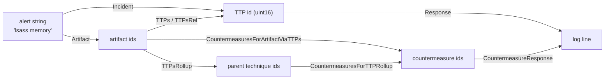

# gr4ph

A SIMD bitmatrix engine over **MITRE ATT&CK** (enterprise, ICS, mobile) crossed with **D3FEND**:
three node partitions — techniques (TTPs, sub-techniques included), artifacts and countermeasures —
flattened into a frozen set of structure-of-arrays bitmatrix planes.

Every directed relation is materialised in **both** directions, so a traversal is one row fetch plus
vector bitwise ops: no pointer chasing, no per-edge allocation, no strings on the hot path.
Sub-technique roll-up is explicit (`ArtifactsRollup`, `TTPsRollup`, `CountermeasuresForTTPRollup`,
`TTPsForCountermeasureRollup`), and the countermeasure chain answers "which countermeasures apply to
this artifact, directly or through the techniques that touch it".

* Go 1.27, **standard library only** (no third-party dependencies).
* Hot path takes and returns `uint16`-derived ids (`TTP`, `Artifact`, `Countermeasure`) and allocates
  **nothing** — callers own `dst` and `scratch`.
* Strings live only in the cold path: building the graph and formatting ids back into log lines.

## Build requirement

The engine is built on Go 1.27's experimental `simd` package, whose files are all gated behind the
`goexperiment.simd` build tag. Every file here (except `cmd/d3fendgen`, `internal/simdcheck` and
`internal/hotmethods`) carries the same tag, so `GOEXPERIMENT=simd` is required for the library. On a
stock toolchain
`go build .` fails with `build constraints exclude all Go files`, and `internal/simdcheck` makes
`go build ./...` / `go test ./...` fail the same way — without it they would silently skip every gated
package and report success while testing nothing. `go test ./cmd/d3fendgen` works without the
experiment.

```sh
GOEXPERIMENT=simd go build ./...     # the Makefile exports this for every target except `make stock`, which unsets it
```

`simd.VectorBitSize()` is chosen at **runtime** by the `simd` package, not by this module. The kernels
stride by the vector width (`wordsPerVector = simd.VectorBitSize()/64`), use the full-width
`LoadUint64s`/`Store` pair for whole vectors and a scalar loop for the tail. They never use the count
`LoadUint64sPart` reports, which is `min(wordsPerVector, len(s))` on hardware but `len(s)` under
`GODEBUG=simd=0` — advancing by it silently drops the tail of every row that is not a whole number of
vectors. `make test` therefore runs the suite at the platform width, again under `-race` (the
concurrency contract), and again with `GODEBUG=simd=0`; all three passes must be green.

On the development host (i5-10310U, AVX2, no `vpclmulqdq`) the package feature-reduces to **128-bit /
2 lanes**, so `GODEBUG=simd=256` panics at init instead of silently emulating. `GODEBUG=simd=+256`
opts into 256-bit by skipping the CPU feature check; it is a manual, host-specific check (it can
SIGILL on a CPU without AVX2) and this module's suite was verified that way.

If a stock-toolchain build is ever required, add `kernel_portable.go` with
`//go:build !goexperiment.simd` implementing `orRowInto`/`andRowInto`/`copyRow` as scalar loops and
drop the tag from the other files. No API change. Adding that portable kernel also means deleting
`internal/simdcheck`, whose only purpose is to make a stock `./...` build fail.

## The two flows



1. **Defensive triage** — an artifact (or an alert string) → the techniques that touch it, exact and
   rolled up → the countermeasures that apply. `CountermeasuresForArtifactViaTTPs` unions the direct
   countermeasure ↔ artifact links with the countermeasures defending every technique that touches
   the artifact.
2. **Authorized offensive planning** — the same artifact read as the countermeasure surface to attack
   or evade, plus `TTPsForCountermeasure` and `CountermeasureDegree` to rank which countermeasures
   defend the most technique surface.

`GOEXPERIMENT=simd go run ./examples/incident` walks the five stages on a hand-built graph
(register → wire → incident → evaluation → response). `GOEXPERIMENT=simd go run ./examples/ontology`
runs both flows against the real tables.

## Command line

`cmd/gr4ph` answers lookup questions over the frozen tables from a shell: a cold key — technique id,
label or alias; artifact name or label; countermeasure id, label or alias; relation name — resolves to
its dense id, and every relation of that node is printed in both directions.

```sh
GOEXPERIMENT=simd go run ./cmd/gr4ph <command> [flags] <query> [<query>...]
make build                                 # builds ./gr4ph (or: GOEXPERIMENT=simd go build ./cmd/gr4ph)
```

The command carries the library's build tag, so `GOEXPERIMENT=simd` is required for it exactly as it is
for the library. Flags may precede or follow the queries (`-json` may also precede the command), and
`gr4ph help` prints the usage text.

| command | query | flags | prints |
|---|---|---|---|
| `ttp` | technique id, label or alias | `-rel <name>`, `-json` | `out artifacts`, `out artifacts rollup`, `in countermeasures`, `in countermeasures rollup` |
| `artifact` | artifact name or label | `-rel <name>`, `-defrel <name>`, `-json` | `in techniques`, `in techniques rollup`, `in countermeasures`, `in countermeasures viaTTPs` |
| `cm` | countermeasure id, label or alias | `-defrel <name>`, `-json` | `out artifacts`, `out techniques`, `out techniques rollup` |
| `rel` | relation name | `-family <off\|def>`, `-json` | one line per family the name is registered in: plane id, distinct edges, sources |

`ttp` prints the artifacts a technique touches and the countermeasures that defend it, exact and rolled
up (the roll-up adds its direct sub-techniques). `artifact` prints the techniques that touch it and the
countermeasures linked to it, directly and via those techniques. `cm` prints the artifacts and techniques
a countermeasure covers. `rel` walks a plane instead of a node. `-rel` (default `any`, the union plane)
picks the offensive plane of the `ttp` and `artifact` sets, `-defrel` the defensive one; the sets that
take no relation are the roll-ups of `cm` and `in countermeasures viaTTPs`, which is the direct links
unioned with the links of the techniques touching the artifact. Relations exist in the two families
independently — 11 names, `blocks` among them, are registered in both — so `rel` prints one line per
family and `-family` narrows it.

```sh
GOEXPERIMENT=simd go run ./cmd/gr4ph ttp T1003.001
ttp T1003.001 "LSASS Memory" domain=enterprise parent=T1003 children=0
  out artifacts (2): AuthenticationService "Authentication Service", Process
  out artifacts rollup (2): AuthenticationService "Authentication Service", Process
  in  countermeasures (12): Application-basedProcessIsolation "Application-based Process Isolation", Hardware-basedProcessIsolation "Hardware-based Process Isolation", HostReboot "Host Reboot", HostShutdown "Host Shutdown", Kernel-basedProcessIsolation "Kernel-based Process Isolation", ProcessLineageAnalysis "Process Lineage Analysis", ProcessSelf-ModificationDetection "Process Self-Modification Detection", ProcessSpawnAnalysis "Process Spawn Analysis", ProcessSuspension "Process Suspension", ProcessTermination "Process Termination", SystemCallFiltering "System Call Filtering", WebSessionAccessMediation "Web Session Access Mediation"
  in  countermeasures rollup (12): Application-basedProcessIsolation "Application-based Process Isolation", Hardware-basedProcessIsolation "Hardware-based Process Isolation", HostReboot "Host Reboot", HostShutdown "Host Shutdown", Kernel-basedProcessIsolation "Kernel-based Process Isolation", ProcessLineageAnalysis "Process Lineage Analysis", ProcessSelf-ModificationDetection "Process Self-Modification Detection", ProcessSpawnAnalysis "Process Spawn Analysis", ProcessSuspension "Process Suspension", ProcessTermination "Process Termination", SystemCallFiltering "System Call Filtering", WebSessionAccessMediation "Web Session Access Mediation"
```

### Common queries

The examples below use the `./gr4ph` binary that `make build` produces. Every key is matched trimmed and
case-insensitively, so a technique can be named the way an alert names it — `T1136` and `create account`
are the same node — and a key that resolves to nothing is an error, never a guess. `head`/`cut` keep the
answers readable, because a set is printed as one line whatever its length.

```sh
$ ./gr4ph ttp "create account" | head -1
ttp T1136 "Create Account" domain=enterprise children=3
$ ./gr4ph artifact "authentication service" | head -1
artifact AuthenticationService "Authentication Service"
$ ./gr4ph cm "credential hardening" | head -1
cm CredentialHardening "Credential Hardening"
$ ./gr4ph ttp "lsass memroy"; echo $?          # typos do not resolve
gr4ph: no such technique: lsass memroy
1
```

Defensive triage from the artifact an alert names: 5 techniques touch `Process`, they collapse to 3
parents, 11 countermeasures link to it directly and 36 once the techniques that touch it are included.

```sh
$ ./gr4ph artifact Process | cut -c1-56
artifact Process
  in  techniques (5): T1003.001 "LSASS Memory", T1003.00
  in  techniques rollup (3): T1003 "OS Credential Dumpin
  in  countermeasures (11): Application-basedProcessIsol
  in  countermeasures viaTTPs (36): Application-basedPro
```

Narrow a set to one relation plane with `-rel` (offensive) or `-defrel` (defensive): the plane is named
in the set label, and the sets that take no relation are unchanged.

```sh
$ ./gr4ph artifact -rel accesses Process | cut -c1-56
artifact Process
  in  techniques (rel accesses) (1): T1003.001 "LSASS Me
  in  techniques rollup (rel accesses) (1): T1003 "OS Cr
  in  countermeasures (11): Application-basedProcessIsol
  in  countermeasures viaTTPs (36): Application-basedPro
$ ./gr4ph cm -defrel hardens CredentialHardening | cut -c1-56
cm CredentialHardening "Credential Hardening"
  out artifacts (defrel hardens) (1): Credential
  out techniques (25): DE-0011 "Credentialed Evasion", P
  out techniques rollup (16): DE-0011 "Credentialed Evas
```

`rel` walks the planes themselves — the offensive union plane holds 654 distinct technique → artifact
pairs from 427 techniques — and `-family` picks a side when the name is registered in both.

```sh
$ ./gr4ph rel any
rel any offensive union plane 0/41 (technique -> artifact): edges=654 sources=427
rel any defensive union plane 0/38 (countermeasure -> artifact): edges=182 sources=157
$ ./gr4ph rel -family def blocks
rel blocks defensive plane 3/38 (countermeasure -> artifact): edges=6 sources=6
$ ./gr4ph rel -family off analyzes; echo $?    # ... and an error when it is not
gr4ph: no such offensive relation: analyzes
1
```

`-json` prints the same answer as one object per resolved query, with the ids, the cold keys and (for
`rel`) the plane statistics in one place — what a script wants to join on.

```sh
$ ./gr4ph -json rel blocks
{"query":"blocks","kind":"rel","name":"blocks","planes":[{"family":"offensive","id":4,"count":41,"edges":2,"sources":2},{"family":"defensive","id":3,"count":38,"edges":6,"sources":6}]}
```

`examples/scenarios.sh` is a plain list of `gr4ph` commands — the four commands, the relation and family
filters, several queries per call, `-json`, the failures and `help` — grouped into defence and attack
scenarios. Nothing is checked and nothing is trimmed: it prints each answer in full, so run it after
`make build` and read the output.

Exit status is 0 when every query resolved, 1 when a query or relation was not found (the blocks of the
queries that did resolve are still written), and 2 for a usage error. `-json` emits one JSON object per
resolved query instead of text.

## Data model

Three partitions, six matrix blocks, two many-predicate relation families plus one single-predicate
family. Plane 0 of each many-predicate family is the union of all its predicates (`RelAny` /
`DefRelAny`); the countermeasure → technique link is one inferred predicate and needs no plane index.

| block | shape | meaning |
|---|---|---|
| `ttpArt` | `[nRel][nTTP][wArt]` | technique → artifact (offensive) |
| `artTTP` | `[nRel][nArt][wTTP]` | artifact → technique (transpose) |
| `cmArt` | `[nDefRel][nCM][wArt]` | countermeasure → artifact (defensive) |
| `artCM` | `[nDefRel][nArt][wCM]` | artifact → countermeasure (transpose) |
| `cmTTP` | `[nCM][wTTP]` | countermeasure → technique (defends-against) |
| `ttpCM` | `[nTTP][wCM]` | technique → countermeasure (transpose) |

Rows are exact-length (no padding), LSB-first within each `uint64`. For the pinned dataset
(1186 techniques, 247 artifacts, 157 countermeasures, 41 + 38 predicates):

| block | planes | words | bytes |
|---|---|---|---|
| `ttpArt` | 42 | 199,248 | 1,593,984 |
| `artTTP` | 42 | 197,106 | 1,576,848 |
| `cmArt` | 39 | 24,492 | 195,936 |
| `artCM` | 39 | 28,899 | 231,192 |
| `cmTTP` | 1 | 2,983 | 23,864 |
| `ttpCM` | 1 | 3,558 | 28,464 |
| **total** | | **456,286** | **3,650,288 (3.48 MiB)** |
| hierarchy (`ttpParents` + `ttpChildCount`) | | | 4,744 |

Strides: `WordsPerRow(KindTTP)` = 19, `KindArtifact` = 4, `KindCountermeasure` = 3. A single plane is
37 KiB (technique) / 37 KiB (artifact) — L1/L2 resident; the whole graph sits in L3.

## API

Sizes and cold path:

| method | work | alloc |
|---|---|---|
| `TTPCount` `ArtifactCount` `CountermeasureCount` `RelCount` `DefRelCount` `WordsPerRow` | O(1) | 0 |
| `Incident(alert) (TTP, bool)`, `Artifact(s)`, `Countermeasure(s)` | map lookup (trim + lower); a label shared by several techniques resolves to the lowest-index match | cold |
| `TTPName` `TTPLabel` `ArtifactName` `ArtifactLabel` `CountermeasureName` `CountermeasureLabel` `TTPDomain` | O(1) | 0 |
| `Rel` `DefRel` | map lookup (trim + lower), `"any"` is the union plane and cannot be registered (`ErrReservedName`) | cold |
| `RelName` `DefRelName` | O(1) | 0 |
| `Response(dst, ids)` `CountermeasureResponse(dst, ids)` | formats `<id> <label>` | cold |
| `TTPParent` `TTPChildCount` `TTPChildren` | O(1) / O(children) | 0 |

Technique labels are **not** unique keys: the pinned tables keep ATT&CK's revoked techniques, whose
live successors reuse their labels — 238 of the 1186 labels are carried by more than one technique and
shadow 269 ids — so `Incident` resolves a shared label to the lowest-index match, which may be the
revoked twin. Ids are unambiguous (every `TTPName` round-trips through `Incident`), and no artifact or
countermeasure key names two nodes.

Traversals (all take/return ids, all allocate nothing):

| method | work |
|---|---|
| `Adjacent` `AdjacentRel` `Defends` | 1 shift + 1 AND + 1 compare |
| `Artifacts` `ArtifactsRel` `ArtifactsForCountermeasure` | 1 row (4 words) |
| `CountermeasuresForArtifact` | 1 row (3 words) |
| `TTPs` `TTPsRel` `TTPsForCountermeasure` | 1 row (19 words) |
| `CountermeasuresForTTP` | 1 row (3 words) |
| `Degree` `ArtifactDegree` `CountermeasureDegree` | popcount of one row |
| `ArtifactsRollup` `ArtifactsRollupRel` | (1 + children) × 4 words, vector OR |
| `TTPsRollup` `TTPsRollupRel` `TTPsForCountermeasureRollup` | 19-word row scan + parent map + 19-word bitset |
| `CountermeasuresForTTPRollup` | (1 + children) × 3 words, vector OR |
| `CountermeasuresForArtifactViaTTPs` | 19-word row scan + ≤ 29 × 3-word ORs + 3-word direct row |
| `TTPsAny` `TTPsAll` `ArtifactsAny` `ArtifactsAll` | k × row words, vector OR/AND |

Builder (cold path; the builder is single-use and then frozen by `Build`):

| method | notes |
|---|---|
| `NewBuilder()` | fresh builder; the union plane `"any"` is seeded |
| `AddRel(name)` `AddDefRel(name)` | plane ids in registration order; `"any"` is reserved |
| `AddTTP(id, label, dom, parent, aliases…)` | `ErrDepthExceeded` / `ErrNonContiguousChild` / `ErrUnknownParent` |
| `AddArtifact(name, label)` `AddCountermeasure(id, label, aliases…)` | |
| `AddEdge(t, a, r)` `AddDefEdge(cm, a, dr)` `AddDefendsEdge(cm, t)` | edges are ORed into the planes |
| `Built()` `Build()` | `Build` is single-use: `ErrBuilderUsed` afterwards |

### Exact vs roll-up

Edges are stored exactly; the hierarchy is carried as data, never baked into the matrices. The exact
methods (`Artifacts`, `TTPs`, `CountermeasuresForTTP`, `TTPsForCountermeasure`) follow edges only — so
`Artifacts(T1003)` is `0` because a parent technique carries no edges of its own, while
`ArtifactsRollup(T1003)` is `9` (its own row plus its 8 sub-techniques). Conversely `TTPs(Process)`
returns 5 ids including sub-techniques, and `TTPsRollup(Process)` collapses them to
`[T1003 T1505 T1546]`. Callers choose precision explicitly.

`CountermeasuresForArtifactViaTTPs` uses the techniques linked to the artifact **exactly** (no
roll-up): every edge-bearing technique carries its own countermeasure links, and rolling up would pull
in countermeasure sets of parents the artifact does not touch. Compose
`TTPsRollup` + `CountermeasuresForTTPRollup` if that is what you want.

### Scratch sizing

Set and roll-up operations write their intermediate bitset into a caller-owned `scratch` row:

> `len(scratch) >= e.WordsPerRow(kind)` where `kind` is the partition of the **returned** ids —
> 19 words for TTP-returning methods, 4 for artifact-returning, 3 for countermeasure-returning.

Shorter `scratch` panics (`gr4ph: scratch too small`).

### Error contract

* Every traversal truncates its results at `len(dst)` and returns the **total** number of matches, so
  a nil or short `dst` still yields the count. Ids come out in ascending index order and are
  duplicate-free (they are the set bits of a row). Single-id traversals take `(id, rel, dst)`; set
  operations take `(rel, scratch, dst, ids…)`.
* Hot-path queries are **total** over the id space: an id outside its partition yields no matches
  (`0`/`false`). A stale or foreign id set can never crash a traversal, and an empty engine answers
  every query with 0/false.
* Engine-dimension misuse panics, because there is no sensible fallback: an offensive relation id
  `>= RelCount()+1`, a defensive relation id `>= DefRelCount()+1`, a `Kind` outside the three
  partitions (`WordsPerRow`), or an undersized `scratch`. The scratch check runs before the id bounds
  check, so an undersized `scratch` panics even when the id is out of range.
* The cold string accessors (`TTPName`, `TTPLabel`, `TTPDomain`, `ArtifactName`, …) panic on an
  out-of-range id. `Response` / `CountermeasureResponse` are the total boundary formatters: they
  render `<invalid ttp N>` / `<invalid cm N>` and still count the entry.

## Hierarchy

Sub-techniques are first-class nodes (581 of the 1186). The ATT&CK id prefix is authoritative
(`T1003.001` → `T1003`); the generator checks it against `x_mitre_is_subtechnique` on every STIX node
of 19.2 and fails on any disagreement, on an orphan sub-technique, and on any id deeper than two
levels. Where D3FEND's `off_tech_parent` disagrees with the prefix (T1499.002 carries `T1498` in
1.6.0 while ATT&CK makes it a child of `T1499`), the prefix wins; `off_tech_parent` is consulted only
to synthesise a parent that exists in no ATT&CK domain. The tables carry `TTPParents` (index or
`NoParent`); the builder derives child counts from those, so no child-count table is emitted.

The builder enforces two invariants, so roll-up needs no child lists:

* **two levels only** — `AddTTP` rejects a parent that is itself a sub-technique (`ErrDepthExceeded`)
  and the generator fails on any id with more than one dot;
* **contiguous child blocks** — a child's index must be exactly `parent+1+childCount[parent]`
  (`ErrNonContiguousChild`). Children of `t` are therefore the O(1) range `t+1 .. t+TTPChildCount(t)`,
  and byte-wise sorted ids make that hold automatically (`T1546` has 18 children at the next 18
  indices).

11 parents (`DE-0003`, `EX-0001`, `EX-0005`, `EX-0009`, `EX-0010`, `EX-0012`, `EX-0013`, `EX-0016`,
`EXF-0006`, `IA-0007`, `RD-0004`) exist in no ATT&CK domain; D3FEND names them only through
`off_tech_parent`, so the generator synthesises them (`DomainSPARTA`, no edges, no aliases) and the
tree has no orphans.

Each partition holds at most `MaxNodes` (65536) entries; `Add*` returns `ErrTooManyNodes` beyond that
rather than wrapping. `NoParent` is index 65535, so the node at that index cannot itself parent
children — passing it as a parent reads as "no parent".

## Regenerating the tables

`ontology/attack_gen.go` is generated and committed; the runtime never touches the network. Sources
are pinned by version:

| source | value |
|---|---|
| ATT&CK enterprise | `enterprise-attack-19.2.json` |
| ATT&CK ICS | `ics-attack-19.2.json` |
| ATT&CK mobile | `mobile-attack-19.2.json` |
| D3FEND | `d3fend-full-mappings.csv@1.6.0` |

```sh
make gen        # go run ./cmd/d3fendgen -out ontology/attack_gen.go   (network once)
```

`cmd/d3fendgen` is untagged and imports nothing from this module, so it regenerates on a stock
toolchain; `-enterprise`/`-ics`/`-mobile`/`-d3fend` accept local paths for an offline rerun, and the
output is byte-identical either way. The generated shape is asserted, not assumed, and a run reports
exactly what it measured (this is `make gen`'s stdout on the pinned sources, byte for byte):

```
d3fendgen: wrote ontology/attack_gen.go
  ttps           1186 (858 enterprise, 176 mobile, 106 ics, 46 sparta)
  artifacts      247
  countermeasures 157
  relations      41 offensive, 38 defensive
  edges          670 offensive, 182 defensive, 4133 defends-against
  hierarchy      605 top-level, 581 sub-techniques, 148 parents, max 18 children
```

If a future upstream release changes any of those, the generator fails with the actual counts instead
of emitting tables whose indices no longer match — re-pin the sources and re-derive the expectations.

Registration order is load-bearing (`ontology.Register`): relations first (so `RelNames[i]` becomes
plane `i+1`, matching the generated constants), then techniques depth-first with their parents, then
artifacts, countermeasures, and finally the three edge families.

## Concurrency

`*Engine` is immutable after `Build()`. Any number of goroutines may query it concurrently as long as
each supplies its own `dst` and `scratch` slices — queries never mutate engine state. The claim is
covered by `TestConcurrentQueries`, which runs under `go test -race` (`make test` includes that pass).
A `Builder` is single-use: after `Build()` every `Add*` returns `ErrBuilderUsed`, so a live `Engine`
cannot be mutated through its builder.

## Measured performance

`GOEXPERIMENT=simd go test -bench . -benchmem -count=5 ./...` on the development host (i5-10310U, 128-bit
vectors), real tables; ns/op below is the median of 5 runs, and every benchmark reports 0 B/op and 0 allocs/op:

| benchmark | ns/op |
|---|---|
| `TTPsRel(Process, accesses)` | 16 |
| `TTPsAny(Process, File)` | 97 |
| `CountermeasuresForArtifactViaTTPs(Process)` | 114 |
| `CountermeasuresForTTPRollup(T1546)` | 221 |
| `AdjacentRel` (root package) | 6 |

The zero-allocation contract is enforced by tests, not by convention: `AllocsPerRun` must be 0 for
every method in the pinned list (`internal/hotmethods`), on both a synthetic graph and the 1186-node
engine.

## License

Apache License 2.0 — see [LICENSE](LICENSE). Copyright 2026 fr0g <fr0g@66723067.io>
(see [NOTICE](NOTICE)).

### Attribution

`ontology/attack_gen.go` reproduces MITRE ATT&CK® and MITRE D3FEND™ content — technique ids, names,
aliases and hierarchy, D3FEND artifact and countermeasure labels — and the SPARTA® identifiers
D3FEND's mapping table carries, all under the upstream terms of use:

* ATT&CK: <https://attack.mitre.org/resources/legal-and-branding/terms-of-use/>
* D3FEND: <https://d3fend.mitre.org/tou/>
* SPARTA: <https://sparta.aerospace.org/terms-of-service>

The two designations the terms require are reproduced in `NOTICE`, the canonical attribution file:

> © 2026 The MITRE Corporation. This work is reproduced and distributed with the permission of The
> MITRE Corporation.
>
> ©2023 The Aerospace Corporation. This work is reproduced and distributed with the permission of
> The Aerospace Corporation.

ATT&CK® is a registered trademark, and D3FEND™ a trademark, of The MITRE Corporation. SPARTA® is a
registered trademark of The Aerospace Corporation.
