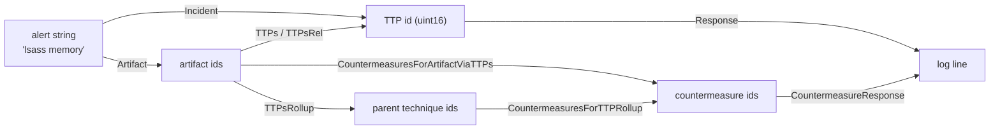

# gr4ph

A SIMD bitmatrix engine over **MITRE ATT&CK** (enterprise, ICS, mobile) crossed with **D3FEND** and the
**CISA Known Exploited Vulnerabilities** catalog: seven node partitions — techniques (TTPs,
sub-techniques included), artifacts, countermeasures, data components (DC), grouping nodes (actors G,
software S, campaigns C), KEV entries (CVE ids) and the weakness and product vocabularies the catalog
names — flattened into a frozen set of
structure-of-arrays bitmatrix planes, plus the per-technique ATT&CK attribute masks (tactics, platforms,
sub-technique flag).

Every directed relation is materialized in **both** directions, so a traversal is one row fetch plus
vector bitwise ops: no pointer chasing, no per-edge allocation, no strings on the hot path.
Sub-technique roll-up is explicit (`ArtifactsRollup`, `ArtifactsRollupRel`, `TTPsRollup`, `TTPsRollupRel`,
`CountermeasuresForTTPRollup`, `TTPsForCountermeasureRollup`, `TTPsForGroupRollup`,
`DataComponentsForTTPRollup`), and the
countermeasure chain answers "which countermeasures apply to this artifact, directly or through the
techniques that touch it".

* Go 1.27, **standard library only** (no third-party dependencies).
* Hot path takes and returns `uint16`-derived ids (`TTP`, `Artifact`, `Countermeasure`, `DataComponent`,
  `Group`, `KEV`, `CWE`, `Product`) or one-word attribute masks, and allocates **nothing** — callers own
  `dst` and `scratch`.
* Strings live only in the cold path: building the graph and formatting ids back into log lines.

## Build requirement

The engine is built on Go 1.27's experimental `simd` package, whose files are all gated behind the
`goexperiment.simd` build tag. Every file here (except `cmd/d3fendgen`, `cmd/kevgen`,
`internal/atomicfile`, `internal/simdcheck` and `internal/hotmethods`) carries the same tag, so
`GOEXPERIMENT=simd` is required
for the library. On a
stock toolchain
`go build .` fails with `build constraints exclude all Go files`, and `internal/simdcheck` makes
`go build ./...` / `go test ./...` fail the same way — without it they would silently skip every gated
package and report success while testing nothing. `go test ./cmd/d3fendgen ./cmd/kevgen` works without
the experiment, as does the untagged `internal/atomicfile` the two generators write their output with.

```sh
GOEXPERIMENT=simd go build ./...     # the Makefile exports this for every target except `make stock`, which unsets it
```

`simd.VectorBitSize()` is chosen at **runtime** by the `simd` package, not by this module. The kernels
stride by the vector width (`wordsPerVector = simd.VectorBitSize()/64`), use the full-width
`LoadUint64s`/`Store` pair for whole vectors and a scalar loop for the tail. They never use the count
`LoadUint64sPart` reports, which is `min(wordsPerVector, len(s))` on hardware but `len(s)` under
`GODEBUG=simd=0` — advancing by it silently drops the tail of every row that is not a whole number of
vectors. `make test` therefore runs the suite at the platform width, again under `-race` (the
concurrency contract), and again with `GODEBUG=simd=0`; all three passes must be green. `make all` adds
`go vet` and `make check`, which fails on any file `gofmt -l .` lists (formatting is a gate, not a
silent rewrite); `make stock` pins the stock-toolchain contract described here.

On the development host (i5-10310U, AVX2, no `vpclmulqdq`) the package feature-reduces to **128-bit /
2 lanes**, so `GODEBUG=simd=256` panics at init instead of silently emulating. `GODEBUG=simd=+256`
opts into 256-bit by skipping the CPU feature check; it is a manual, host-specific check (it can
SIGILL on a CPU without AVX2) and this module's suite was verified that way.

If a stock-toolchain build is ever required, add `kernel_portable.go` with
`//go:build !goexperiment.simd` implementing `orRowInto`/`andRowInto`/`copyRow` as scalar loops and
drop the tag from the other files. No API change. Adding that portable kernel also means deleting
`internal/simdcheck`, whose only purpose is to make a stock `./...` build fail.

## The two flows



1. **Defensive triage** — an artifact (or an alert string) → the techniques that touch it, exact and
   rolled up → the countermeasures that apply. `CountermeasuresForArtifactViaTTPs` unions the direct
   countermeasure ↔ artifact links with the countermeasures defending every technique that touches
   the artifact.
2. **Authorized offensive planning** — the same artifact read as the countermeasure surface to attack
   or evade, plus `TTPsForCountermeasure` and `CountermeasureDegree` to rank which countermeasures
   defend the most technique surface.

`GOEXPERIMENT=simd go run ./examples/incident` walks the five stages on a hand-built graph
(boot → wire → incident → evaluation → response). `GOEXPERIMENT=simd go run ./examples/ontology`
runs both flows against the real tables.

## Command line

`cmd/gr4ph` answers lookup questions over the frozen tables from a shell: a cold key — technique
id, label or alias; artifact name or label; countermeasure id, label or alias; data component id or
label; grouping-node id or label; ATT&CK tactic id; platform name; CVE id; weakness id; vendor/product
pair; relation name — resolves to its dense id, and every relation of that node is printed in both
directions. A grouping label shared by
two nodes resolves to its **live carrier** — the node ATT&CK still maintains — or to the lowest-index
holder when every carrier is revoked, exactly as a technique's label does; the printed header names the
node that resolved. 12
labels are shared verbatim in 19.2 (`Frankenstein` is the campaign `C0001` and the retired actor `G0101`,
and the live campaign keeps the key; `Gelsemium` is the retired actor `G0141` and the live software node
`S0666`, and resolves to the software node), all
across kinds, and the resolver's case-insensitive key space folds three case-variant pairs into shared
keys — 15 keys in all, 13 of them across kinds, the other two (`ngrok`, `triton`) pairing two software
nodes.

```sh
GOEXPERIMENT=simd go run ./cmd/gr4ph <command> [flags] <query> [<query>...]
make build                                 # builds ./gr4ph (or: GOEXPERIMENT=simd go build ./cmd/gr4ph)
```

The command carries the library's build tag, so `GOEXPERIMENT=simd` is required for it exactly as it is
for the library. Flags may precede or follow the queries (`-json` may also precede the command), and
`gr4ph help` prints the usage text, flags and worked examples included.

| command | query | flags | prints |
|---|---|---|---|
| `ttp` | technique id, label or alias | `-rel <name>`, `-json` | `out artifacts`, `out artifacts rollup`, `in countermeasures`, `in countermeasures rollup`, `in data components`, `in data components rollup`, `in groups` |
| `artifact` | artifact name or label | `-rel <name>`, `-defrel <name>`, `-json` | `in techniques`, `in techniques rollup`, `in countermeasures`, `in countermeasures viaTTPs` |
| `cm` | countermeasure id, label or alias | `-defrel <name>`, `-json` | `out artifacts`, `out techniques`, `out techniques rollup` |
| `dc` | data component id (`DC0084`) or label | `-json` | `out techniques` |
| `group` | grouping-node id (`G0007`, `S0002`, `C0001`) or label | `-json` | `out techniques`, `out software`, `in groups` |
| `tactic` | ATT&CK tactic id (`TA0005`) | `-json` | `out techniques` |
| `platform` | platform name (`Windows`) | `-json` | `out techniques` |
| `kev` | CVE id (`CVE-2021-44228`) | `-json` | `out weaknesses` |
| `cwe` | weakness id (`CWE-78`) | `-json` | `in entries` |
| `product` | vendor/product pair (`Apache/Log4j2`) | `-json` | `out entries` |
| `rel` | relation name | `-family <off\|def>`, `-json` | one line per family the name is registered in: plane id, distinct edges, sources |
| `coverage` | countermeasure id, label or alias, or none (`coverage`) | `-json` | `in defended`, `in undefended`, `in retired`, `in unmapped` |
| `gain` | countermeasure id, label or alias, or none (`gain`) | `-top <n>`, `-all`, `-greedy`, `-json` | one line per candidate: its gain, id and label |
| `contain` | technique id, label or alias | `-json` | `out countermeasures` |

Each verb answers a different kind of question, and the table above names the sets it prints:

* `ttp` — the artifacts a technique touches, the countermeasures that defend it, the data components that
  detect it and the grouping nodes recorded as using it, exact and rolled up (the roll-up adds its direct
  sub-techniques).
* `artifact` — the techniques that touch it and the countermeasures linked to it, directly and via those
  techniques.
* `cm` — the artifacts and techniques a countermeasure covers.
* `dc`, `group`, `tactic` and `platform` — the two later partitions and the attribute vocabularies in the
  reverse direction: the techniques a data component detects, the techniques and software a grouping node
  uses plus who uses it, and the techniques of one tactic or platform.
* `kev`, `cwe` and `product` — the vulnerability family: one catalog entry with its own columns and the
  weakness classes it names, the entries of one weakness class, and the union of the entries filed under
  any of the products a selection names, so `product Apache/Log4j2 Apache/Struts` is the inventory
  question "which exploited vulnerabilities are in the software we run?".
* `coverage`, `gain` and `contain` — whole-deployment answers rather than one node's neighborhood:
  several countermeasures become one deployment, `gain` ranks what adding one more would cover, and
  `contain` reads an observed technique set.
* `rel` — a plane instead of a node: one line per family the name is registered in.

**Relation filters.** Only `ttp`, `artifact` and `cm` take one. `-rel` (default `any`, the union plane)
picks the offensive plane of `ttp`'s `out artifacts` and `artifact`'s `in techniques`; `-defrel` picks
the defensive plane of `artifact`'s `in countermeasures` and `cm`'s `out artifacts`. A set whose label
carries no `(rel …)`/`(defrel …)` suffix is unfiltered, and so is every set of a command without the
flag. On `ttp` the four `in` sets — `in countermeasures`, `in countermeasures rollup`,
`in data components`, `in data components rollup` — and `in groups` escape it; on `artifact`
`in countermeasures viaTTPs` (the direct links unioned with the links of the techniques touching the
artifact); on `cm` `out techniques` and `out techniques rollup`. Relations exist in the two families
independently — 11 names, `blocks` among them, are registered in both — so `rel` prints one line per
family and `-family` narrows it.

**Revoked techniques.** A technique ATT&CK has revoked or deprecated prints ` revoked=true` in its `ttp`
header (`"revoked":true` under `-json`). ATT&CK moved most of its D3FEND mapping to the successor id, but
23 of the 222 flagged techniques still carry offensive edges (`T1053.004`, `T1070.001`, `T1070.002`,
`T1562.001` and `T1574.002` among them).

**Header attributes.** The same header carries the ATT&CK attributes: ` subtechnique=true` for a
sub-technique, ` tactics=` with the `TA` ids of its tactic mask and ` platforms=` with the names of its
platform mask, both in vocabulary order; under `-json` they are `"subtechnique"`, `"tactics"` and
`"platforms"`. Both are absent when the technique has no ATT&CK object (the D3FEND-named nodes), and
`tactic` therefore queries by `TA` id only: 11 tactic labels name two or three tactics across the three
domains. A grouping node's header names its kind (`kind=actor|software|campaign`, `"group_kind"` under
`-json`) and carries ` revoked=true` (`"revoked":true`), the ATT&CK flag its label is resolved
live-first by, exactly as a technique's header does.

```sh
$ ./gr4ph ttp T1003.001
ttp T1003.001 "LSASS Memory" domain=enterprise parent=T1003 children=0 subtechnique=true tactics=TA0006 platforms=Windows
  out artifacts (2): AuthenticationService "Authentication Service", Process
  out artifacts rollup (2): AuthenticationService "Authentication Service", Process
  in  countermeasures (12): Application-basedProcessIsolation "Application-based Process Isolation", Hardware-basedProcessIsolation "Hardware-based Process Isolation", HostReboot "Host Reboot", HostShutdown "Host Shutdown", Kernel-basedProcessIsolation "Kernel-based Process Isolation", ProcessLineageAnalysis "Process Lineage Analysis", ProcessSelf-ModificationDetection "Process Self-Modification Detection", ProcessSpawnAnalysis "Process Spawn Analysis", ProcessSuspension "Process Suspension", ProcessTermination "Process Termination", SystemCallFiltering "System Call Filtering", WebSessionAccessMediation "Web Session Access Mediation"
  in  countermeasures rollup (12): Application-basedProcessIsolation "Application-based Process Isolation", Hardware-basedProcessIsolation "Hardware-based Process Isolation", HostReboot "Host Reboot", HostShutdown "Host Shutdown", Kernel-basedProcessIsolation "Kernel-based Process Isolation", ProcessLineageAnalysis "Process Lineage Analysis", ProcessSelf-ModificationDetection "Process Self-Modification Detection", ProcessSpawnAnalysis "Process Spawn Analysis", ProcessSuspension "Process Suspension", ProcessTermination "Process Termination", SystemCallFiltering "System Call Filtering", WebSessionAccessMediation "Web Session Access Mediation"
  in  data components (5): DC0013 "User Account Metadata", DC0032 "Process Creation", DC0035 "Process Access", DC0039 "File Creation", DC0063 "Windows Registry Key Modification"
  in  data components rollup (5): DC0013 "User Account Metadata", DC0032 "Process Creation", DC0035 "Process Access", DC0039 "File Creation", DC0063 "Windows Registry Key Modification"
  in  groups (79): C0014 "Operation Wocao", C0025 "2016 Ukraine Electric Power Attack", C0029 "Cutting Edge", C0030 "Triton Safety Instrumented System Attack", C0032, C0038 "HomeLand Justice", C0058 "SharePoint ToolShell Exploitation", C0061 "Operation Digital Eye", C0063 "2025 Poland Wiper Attacks", G0003 "Cleaver", G0004 "Ke3chang", G0006 "APT1", G0007 "APT28", G0022 "APT3", G0027 "Threat Group-3390", G0034 "Sandworm Team", G0037 "FIN6", G0049 "OilRig", G0050 "APT32", G0059 "Magic Hound", G0060 "BRONZE BUTLER", G0061 "FIN8", G0064 "APT33", G0065 "Leviathan", G0068 "PLATINUM", G0069 "MuddyWater", G0077 "Leafminer", G0087 "APT39", G0091 "Silence", G0093 "GALLIUM", G0094 "Kimsuky", G0096 "APT41", G0102 "Wizard Spider", G0107 "Whitefly", G0108 "Blue Mockingbird", G0117 "Fox Kitten", G0119 "Indrik Spider", G0125 "HAFNIUM", G0129 "Mustang Panda", G0143 "Aquatic Panda", G1003 "Ember Bear", G1006 "Earth Lusca", G1016 "FIN13", G1017 "Volt Typhoon", G1023 "APT5", G1030 "Agrius", G1036 "Moonstone Sleet", G1039 "RedCurl", G1040 "Play", G1048 "UNC3886", G1051 "Medusa Group", G1054 "MirrorFace", G1055 "VOID MANTICORE", S0002 "Mimikatz", S0005 "Windows Credential Editor", S0046 "CozyCar", S0056 "Net Crawler", S0121 "Lslsass", S0154 "Cobalt Strike", S0187 "Daserf", S0192 "Pupy", S0194 "PowerSploit", S0342 "GreyEnergy", S0349 "LaZagne", S0357 "Impacket", S0363 "Empire", S0365 "Olympic Destroyer", S0367 "Emotet", S0368 "NotPetya", S0378 "PoshC2", S0428 "PoetRAT", S0439 "Okrum", S0583 "Pysa", S0606 "Bad Rabbit", S0633 "Sliver", S0681 "Lizar", S0692 "SILENTTRINITY", S1060 "Mafalda", S1242 "Qilin"
```

### Common queries

The examples below use the `./gr4ph` binary that `make build` produces, and every block is that
command's complete answer — a set is printed as one line whatever its length, so let the terminal wrap.
Every key is matched trimmed and case-insensitively, so a technique can be named the way an alert names
it — `T1136` and `create account` are the same node — and a key that resolves to nothing is an error,
never a guess.

```sh
$ ./gr4ph ttp "create account"
ttp T1136 "Create Account" domain=enterprise children=3 tactics=TA0003 platforms=Containers,ESXi,IaaS,Identity Provider,Linux,Network Devices,Office Suite,SaaS,Windows,macOS
  out artifacts (1): UserAccount "User Account"
  out artifacts rollup (4): CloudUserAccount "Cloud User Account", DomainUserAccount "Domain User Account", LocalUserAccount "Local User Account", UserAccount "User Account"
  in  countermeasures (7): AccessModeling "Access Modeling", AccountLocking "Account Locking", AgentAuthentication "Agent Authentication", ChangeDefaultPassword "Change Default Password", RestoreUserAccountAccess "Restore User Account Access", UnlockAccount "Unlock Account", UserAccountPermissions "User Account Permissions"
  in  countermeasures rollup (9): AccessModeling "Access Modeling", AccountLocking "Account Locking", AgentAuthentication "Agent Authentication", ChangeDefaultPassword "Change Default Password", DomainAccountMonitoring "Domain Account Monitoring", LocalAccountMonitoring "Local Account Monitoring", RestoreUserAccountAccess "Restore User Account Access", UnlockAccount "Unlock Account", UserAccountPermissions "User Account Permissions"
  in  data components (5): DC0010 "User Account Modification", DC0014 "User Account Creation", DC0032 "Process Creation", DC0061 "File Modification", DC0064 "Command Execution"
  in  data components rollup (8): DC0002 "User Account Authentication", DC0010 "User Account Modification", DC0014 "User Account Creation", DC0032 "Process Creation", DC0061 "File Modification", DC0064 "Command Execution", DC0067 "Logon Session Creation", DC0094 "Group Modification"
  in  groups (5): C0025 "2016 Ukraine Electric Power Attack", G0119 "Indrik Spider", G1015 "Scattered Spider", G1045 "Salt Typhoon", S1199 "LockBit 2.0"
$ ./gr4ph artifact "authentication service"
artifact AuthenticationService "Authentication Service"
  in  techniques (5): T1003.001 "LSASS Memory", T1003.002 "Security Account Manager", T1212 "Exploitation for Credential Access", T1550 "Use Alternate Authentication Material", T1556 "Modify Authentication Process"
  in  techniques rollup (4): T1003 "OS Credential Dumping", T1212 "Exploitation for Credential Access", T1550 "Use Alternate Authentication Material", T1556 "Modify Authentication Process"
  in  countermeasures (0): -
  in  countermeasures viaTTPs (25): Application-basedProcessIsolation "Application-based Process Isolation", AssetVulnerabilityEnumeration "Asset Vulnerability Enumeration", DataInventory "Data Inventory", Hardware-basedProcessIsolation "Hardware-based Process Isolation", HostReboot "Host Reboot", HostShutdown "Host Shutdown", Kernel-basedProcessIsolation "Kernel-based Process Isolation", MemoryBoundaryTracking "Memory Boundary Tracking", ProcessCodeSegmentVerification "Process Code Segment Verification", ProcessLineageAnalysis "Process Lineage Analysis", ProcessSegmentExecutionPrevention "Process Segment Execution Prevention", ProcessSelf-ModificationDetection "Process Self-Modification Detection", ProcessSpawnAnalysis "Process Spawn Analysis", ProcessSuspension "Process Suspension", ProcessTermination "Process Termination", RestoreDatabase "Restore Database", RestoreSoftware "Restore Software", SegmentAddressOffsetRandomization "Segment Address Offset Randomization", ServiceBinaryVerification "Service Binary Verification", ShadowStackComparisons "Shadow Stack Comparisons", SoftwareInventory "Software Inventory", SoftwareUpdate "Software Update", StackFrameCanaryValidation "Stack Frame Canary Validation", SystemCallFiltering "System Call Filtering", WebSessionAccessMediation "Web Session Access Mediation"
$ ./gr4ph cm "credential hardening"
cm CredentialHardening "Credential Hardening"
  out artifacts (1): Credential
  out techniques (25): DE-0011 "Credentialed Evasion", PER-0005 "Credentialed Persistence", T0812 "Default Credentials", T0891 "Hardcoded Credentials", T0892 "Change Credential", T1003.003 "NTDS", T1003.005 "Cached Domain Credentials", T1003.008 "/etc/passwd and /etc/shadow", T1098.001 "Additional Cloud Credentials", T1110.001 "Password Guessing", T1110.002 "Password Cracking", T1110.003 "Password Spraying", T1134.001 "Token Impersonation/Theft", T1134.002 "Create Process with Token", T1134.003 "Make and Impersonate Token", T1142 "Keychain", T1528 "Steal Application Access Token", T1539 "Steal Web Session Cookie", T1550.001 "Application Access Token", T1550.004 "Web Session Cookie", T1552 "Unsecured Credentials", T1558 "Steal or Forge Kerberos Tickets", T1558.001 "Golden Ticket", T1606 "Forge Web Credentials", T1606.001 "Web Cookies"
  out techniques rollup (16): DE-0011 "Credentialed Evasion", PER-0005 "Credentialed Persistence", T0812 "Default Credentials", T0891 "Hardcoded Credentials", T0892 "Change Credential", T1003 "OS Credential Dumping", T1098 "Account Manipulation", T1110 "Brute Force", T1134 "Access Token Manipulation", T1142 "Keychain", T1528 "Steal Application Access Token", T1539 "Steal Web Session Cookie", T1550 "Use Alternate Authentication Material", T1552 "Unsecured Credentials", T1558 "Steal or Forge Kerberos Tickets", T1606 "Forge Web Credentials"
$ ./gr4ph ttp "lsass memroy"; echo $?          # typos do not resolve
gr4ph: no such technique: lsass memroy
1
```

The two new partitions answer their own direction. `dc` is the data-component side of `detects`
(the technique rows are usually on the sub-technique, so `ttp` prints the roll-up too), and `group`
walks the one partition that holds actors, software and campaigns, printing the kind in the header
because the id prefix is the only thing that tells them apart.

```sh
$ ./gr4ph dc DC0084
dc DC0084 "Active Directory Credential Request"
  out techniques (9): T1207 "Rogue Domain Controller", T1550.002 "Pass the Hash", T1550.003 "Pass the Ticket", T1558 "Steal or Forge Kerberos Tickets", T1558.001 "Golden Ticket", T1558.002 "Silver Ticket", T1558.003 "Kerberoasting", T1558.004 "AS-REP Roasting", T1649 "Steal or Forge Authentication Certificates"
$ ./gr4ph group S0002
group S0002 "Mimikatz" kind=software
  out techniques (17): T1003.001 "LSASS Memory", T1003.002 "Security Account Manager", T1003.004 "LSA Secrets", T1003.006 "DCSync", T1098 "Account Manipulation", T1134.005 "SID-History Injection", T1207 "Rogue Domain Controller", T1547.005 "Security Support Provider", T1550.002 "Pass the Hash", T1550.003 "Pass the Ticket", T1552.004 "Private Keys", T1555 "Credentials from Password Stores", T1555.003 "Credentials from Web Browsers", T1555.004 "Windows Credential Manager", T1558.001 "Golden Ticket", T1558.002 "Silver Ticket", T1649 "Steal or Forge Authentication Certificates"
  out software (0): -
  in  groups (60): C0014 "Operation Wocao", C0017, C0018, C0024 "SolarWinds Compromise", C0030 "Triton Safety Instrumented System Attack", C0032, C0038 "HomeLand Justice", C0058 "SharePoint ToolShell Exploitation", C0061 "Operation Digital Eye", G0003 "Cleaver", G0004 "Ke3chang", G0006 "APT1", G0007 "APT28", G0008 "Carbanak", G0010 "Turla", G0011 "PittyTiger", G0016 "APT29", G0027 "Threat Group-3390", G0034 "Sandworm Team", G0035 "Dragonfly", G0037 "FIN6", G0045 "menuPass", G0046 "FIN7", G0049 "OilRig", G0050 "APT32", G0059 "Magic Hound", G0060 "BRONZE BUTLER", G0064 "APT33", G0069 "MuddyWater", G0076 "Thrip", G0077 "Leafminer", G0079 "DarkHydrus", G0080 "Cobalt Group", G0082 "APT38", G0087 "APT39", G0088 "TEMP.Veles", G0092 "TA505", G0093 "GALLIUM", G0094 "Kimsuky", G0096 "APT41", G0102 "Wizard Spider", G0107 "Whitefly", G0108 "Blue Mockingbird", G0114 "Chimera", G0119 "Indrik Spider", G0129 "Mustang Panda", G0131 "Tonto Team", G0135 "BackdoorDiplomacy", G1001 "HEXANE", G1004 "LAPSUS$", G1006 "Earth Lusca", G1015 "Scattered Spider", G1016 "FIN13", G1017 "Volt Typhoon", G1023 "APT5", G1024 "Akira", G1030 "Agrius", G1040 "Play", G1043 "BlackByte", G1051 "Medusa Group"
```

Defensive triage from the artifact an alert names: 5 techniques touch `Process`, they collapse to 3
parents, 11 countermeasures link to it directly and 36 once the techniques that touch it are included.

```sh
$ ./gr4ph artifact Process
artifact Process
  in  techniques (5): T1003.001 "LSASS Memory", T1003.002 "Security Account Manager", T1003.004 "LSA Secrets", T1505.003 "Web Shell", T1546.007 "Netsh Helper DLL"
  in  techniques rollup (3): T1003 "OS Credential Dumping", T1505 "Server Software Component", T1546 "Event Triggered Execution"
  in  countermeasures (11): Application-basedProcessIsolation "Application-based Process Isolation", Hardware-basedProcessIsolation "Hardware-based Process Isolation", HostReboot "Host Reboot", HostShutdown "Host Shutdown", Kernel-basedProcessIsolation "Kernel-based Process Isolation", ProcessLineageAnalysis "Process Lineage Analysis", ProcessSelf-ModificationDetection "Process Self-Modification Detection", ProcessSpawnAnalysis "Process Spawn Analysis", ProcessSuspension "Process Suspension", ProcessTermination "Process Termination", SystemCallFiltering "System Call Filtering"
  in  countermeasures viaTTPs (36): Application-basedProcessIsolation "Application-based Process Isolation", ConfigurationInventory "Configuration Inventory", ContentFiltering "Content Filtering", ContentModification "Content Modification", ContentQuarantine "Content Quarantine", DataInventory "Data Inventory", DecoyFile "Decoy File", DynamicAnalysis "Dynamic Analysis", EmulatedFileAnalysis "Emulated File Analysis", EndpointHealthBeacon "Endpoint Health Beacon", ExecutableAllowlisting "Executable Allowlisting", ExecutableDenylisting "Executable Denylisting", FileAnalysis "File Analysis", FileEncryption "File Encryption", FileEviction "File Eviction", FileIntegrityMonitoring "File Integrity Monitoring", Hardware-basedProcessIsolation "Hardware-based Process Isolation", HostReboot "Host Reboot", HostShutdown "Host Shutdown", Kernel-basedProcessIsolation "Kernel-based Process Isolation", LocalFilePermissions "Local File Permissions", LogicalLinkMapping "Logical Link Mapping", NetworkNodeInventory "Network Node Inventory", PhysicalLinkMapping "Physical Link Mapping", ProcessLineageAnalysis "Process Lineage Analysis", ProcessSelf-ModificationDetection "Process Self-Modification Detection", ProcessSpawnAnalysis "Process Spawn Analysis", ProcessSuspension "Process Suspension", ProcessTermination "Process Termination", RemoteFileAccessMediation "Remote File Access Mediation", RestoreConfiguration "Restore Configuration", RestoreDatabase "Restore Database", RestoreFile "Restore File", RestoreNetworkAccess "Restore Network Access", SystemCallFiltering "System Call Filtering", WebSessionAccessMediation "Web Session Access Mediation"
```

Narrow a set to one relation plane with `-rel` (offensive) or `-defrel` (defensive): the plane is named
in the set label, and the sets that take no relation are unchanged.

```sh
$ ./gr4ph artifact -rel accesses Process
artifact Process
  in  techniques (rel accesses) (1): T1003.001 "LSASS Memory"
  in  techniques rollup (rel accesses) (1): T1003 "OS Credential Dumping"
  in  countermeasures (11): Application-basedProcessIsolation "Application-based Process Isolation", Hardware-basedProcessIsolation "Hardware-based Process Isolation", HostReboot "Host Reboot", HostShutdown "Host Shutdown", Kernel-basedProcessIsolation "Kernel-based Process Isolation", ProcessLineageAnalysis "Process Lineage Analysis", ProcessSelf-ModificationDetection "Process Self-Modification Detection", ProcessSpawnAnalysis "Process Spawn Analysis", ProcessSuspension "Process Suspension", ProcessTermination "Process Termination", SystemCallFiltering "System Call Filtering"
  in  countermeasures viaTTPs (36): Application-basedProcessIsolation "Application-based Process Isolation", ConfigurationInventory "Configuration Inventory", ContentFiltering "Content Filtering", ContentModification "Content Modification", ContentQuarantine "Content Quarantine", DataInventory "Data Inventory", DecoyFile "Decoy File", DynamicAnalysis "Dynamic Analysis", EmulatedFileAnalysis "Emulated File Analysis", EndpointHealthBeacon "Endpoint Health Beacon", ExecutableAllowlisting "Executable Allowlisting", ExecutableDenylisting "Executable Denylisting", FileAnalysis "File Analysis", FileEncryption "File Encryption", FileEviction "File Eviction", FileIntegrityMonitoring "File Integrity Monitoring", Hardware-basedProcessIsolation "Hardware-based Process Isolation", HostReboot "Host Reboot", HostShutdown "Host Shutdown", Kernel-basedProcessIsolation "Kernel-based Process Isolation", LocalFilePermissions "Local File Permissions", LogicalLinkMapping "Logical Link Mapping", NetworkNodeInventory "Network Node Inventory", PhysicalLinkMapping "Physical Link Mapping", ProcessLineageAnalysis "Process Lineage Analysis", ProcessSelf-ModificationDetection "Process Self-Modification Detection", ProcessSpawnAnalysis "Process Spawn Analysis", ProcessSuspension "Process Suspension", ProcessTermination "Process Termination", RemoteFileAccessMediation "Remote File Access Mediation", RestoreConfiguration "Restore Configuration", RestoreDatabase "Restore Database", RestoreFile "Restore File", RestoreNetworkAccess "Restore Network Access", SystemCallFiltering "System Call Filtering", WebSessionAccessMediation "Web Session Access Mediation"
$ ./gr4ph cm -defrel hardens CredentialHardening
cm CredentialHardening "Credential Hardening"
  out artifacts (defrel hardens) (1): Credential
  out techniques (25): DE-0011 "Credentialed Evasion", PER-0005 "Credentialed Persistence", T0812 "Default Credentials", T0891 "Hardcoded Credentials", T0892 "Change Credential", T1003.003 "NTDS", T1003.005 "Cached Domain Credentials", T1003.008 "/etc/passwd and /etc/shadow", T1098.001 "Additional Cloud Credentials", T1110.001 "Password Guessing", T1110.002 "Password Cracking", T1110.003 "Password Spraying", T1134.001 "Token Impersonation/Theft", T1134.002 "Create Process with Token", T1134.003 "Make and Impersonate Token", T1142 "Keychain", T1528 "Steal Application Access Token", T1539 "Steal Web Session Cookie", T1550.001 "Application Access Token", T1550.004 "Web Session Cookie", T1552 "Unsecured Credentials", T1558 "Steal or Forge Kerberos Tickets", T1558.001 "Golden Ticket", T1606 "Forge Web Credentials", T1606.001 "Web Cookies"
  out techniques rollup (16): DE-0011 "Credentialed Evasion", PER-0005 "Credentialed Persistence", T0812 "Default Credentials", T0891 "Hardcoded Credentials", T0892 "Change Credential", T1003 "OS Credential Dumping", T1098 "Account Manipulation", T1110 "Brute Force", T1134 "Access Token Manipulation", T1142 "Keychain", T1528 "Steal Application Access Token", T1539 "Steal Web Session Cookie", T1550 "Use Alternate Authentication Material", T1552 "Unsecured Credentials", T1558 "Steal or Forge Kerberos Tickets", T1606 "Forge Web Credentials"
```

`rel` walks the planes themselves — the offensive union plane holds 654 distinct technique → artifact
pairs from 427 techniques — and `-family` picks a side when the name is registered in both.

```sh
$ ./gr4ph rel any
rel any offensive union plane 0/41 (technique -> artifact): edges=654 sources=427
rel any defensive union plane 0/38 (countermeasure -> artifact): edges=182 sources=157
$ ./gr4ph rel -family def blocks
rel blocks defensive plane 3/38 (countermeasure -> artifact): edges=6 sources=6
$ ./gr4ph rel -family off analyzes; echo $?    # ... and an error when it is not
gr4ph: no such offensive relation: analyzes
1
```

`-json` prints the same answer as one object per resolved query, with the ids, the cold keys and (for
`rel`) the plane statistics in one place — what a script wants to join on.

```sh
$ ./gr4ph -json rel blocks
{"query":"blocks","kind":"rel","name":"blocks","planes":[{"family":"offensive","id":4,"count":41,"edges":2,"sources":2},{"family":"defensive","id":3,"count":38,"edges":6,"sources":6}]}
```

`examples/scenarios.sh` is a plain list of `gr4ph` commands — all fourteen commands, the relation and
family filters, several queries per call, `-json` and the failures — grouped into defense and
attack scenarios, each scenario under a banner heading and each command labeled with the invocation that
produced the block below it. Nothing is checked and nothing is trimmed: it prints each answer in full, so
run it after `make build` and read the output.

Exit status is 0 when every query resolved, 1 when a query or relation was not found (the blocks of the
queries that did resolve are still written), and 2 for a usage error. `-json` emits one JSON object per
resolved query instead of text.

### Coverage and containment

The three overlay commands answer whole-set questions instead of one node's neighborhood, over the same
mask-driven kernel family (`TTPsCovered`, `TTPsBlind`, `TTPsMapped`, `CoverageGain`, `CoverageGains`,
`CountermeasuresForObserved`). `coverage` resolves its queries into a **deployed** set of
countermeasures and classifies every technique of the tables: **defended** (a deployed countermeasure
defends it), **undefended** (inside the D3FEND mapping but no deployed countermeasure covers it),
**retired** (ATT&CK revoked or deprecated it, so no purchase can ever be justified by it) and
**unmapped** (D3FEND maps no countermeasure to it at all). The four are disjoint and cover the 1186
techniques. `retired` is the only state that is not about this deployment: the 222 flagged techniques are
the same set whatever is deployed, and 23 of them still carry offensive edges, so they sit inside the
mapped range — the `mapped=` header count (427) stays the mapping range and therefore contains them while
the three live states do not. `undefended` is the actionable one: no purchase can cover the 560 unmapped
techniques or the 222 retired ones, and a blind spot is not automatically a gap.

`gain` ranks the candidates by the live techniques they would newly cover on top of the deployment
(`CoverageGain(cm)` = `popcount(cmTTP[cm] &^ covered &^ retired)`, the `retired` mask being what keeps a
candidate from being credited for a technique nobody can buy), which is the number a procurement order
sorts by: `-top <n>` shows the best `n` (the default), `-all` every candidate with a non-zero gain, and
`-greedy` the successive maximum-gain sequence. From an empty deployment 20 buys cover every mapped
technique that is not retired (404 of the 427), led by `ContentQuarantine` (119 techniques) and
`NetworkTrafficFiltering` (101 more); the walk
continues from whatever deployment is passed, so the example below starts at `ContentQuarantine` and buys
19 more. `contain` runs the same kernel from the other end: it resolves an **observed** set of techniques
— the alerts of one intrusion — and prints every countermeasure that touches any of them.

A selection is caller-owned and never retained: the engine reads it, allocates nothing and keeps no
reference, so a caller may flip bits between calls and turn an alert stream into the observed set. A
selection shorter than `WordsPerRow` of the partition it selects panics
(`gr4ph: selection too small`), a third sanctioned panic beside `gr4ph: scratch too small` and
`gr4ph: unknown kind`; bits past the live range select nothing.

```sh
$ ./gr4ph coverage ContentQuarantine
coverage deployed=1 mapped=427 retired=222
  in  defended (119): DE-0007 "Evasion via Rootkit", EX-0010.01 "Ransomware", EX-0010.02 "Wiper Malware", EX-0010.03 "Rootkit", RD-0004.02 "Upload Exploit/Payload", T0851 "Rootkit", T0853 "Scripting", T0865 "Spearphishing Attachment", T0871 "Execution through API", T0888 "Remote System Information Discovery", T0893 "Data from Local System", T0894 "System Binary Proxy Execution", T0895 "Autorun Image", T1003.007 "Proc Filesystem", T1003.008 "/etc/passwd and /etc/shadow", T1005 "Data from Local System", T1014 "Rootkit", T1016 "System Network Configuration Discovery", T1018 "Remote System Discovery", T1027.001 "Binary Padding", T1027.002 "Software Packing", T1027.004 "Compile After Delivery", T1033 "System Owner/User Discovery", T1036.001 "Invalid Code Signature", T1036.003 "Rename Legitimate Utilities", T1036.005 "Match Legitimate Resource Name or Location", T1036.006 "Space after Filename", T1037.001 "Logon Script (Windows)", T1037.002 "Login Hook", T1037.003 "Network Logon Script", T1037.004 "RC Scripts", T1041 "Exfiltration Over C2 Channel", T1048.002 "Exfiltration Over Asymmetric Encrypted Non-C2 Protocol", T1055.001 "Dynamic-link Library Injection", T1055.002 "Portable Executable Injection", T1055.003 "Thread Execution Hijacking", T1055.009 "Proc Memory", T1055.014 "VDSO Hijacking", T1059 "Command and Scripting Interpreter", T1070.004 "File Deletion", T1071 "Application Layer Protocol", T1071.001 "Web Protocols", T1072 "Software Deployment Tools", T1074.001 "Local Data Staging", T1083 "File and Directory Discovery", T1114.001 "Local Email Collection", T1119 "Automated Collection", T1127.001 "MSBuild", T1137.001 "Office Template Macros", T1137.002 "Office Test", T1137.003 "Outlook Forms", T1140 "Deobfuscate/Decode Files or Information", T1187 "Forced Authentication", T1204.002 "Malicious File", T1218.002 "Control Panel", T1218.005 "Mshta", T1218.011 "Rundll32", T1220 "XSL Script Processing", T1486 "Data Encrypted for Impact", T1505.003 "Web Shell", T1518.001 "Security Software Discovery", T1534 "Internal Spearphishing", T1543.001 "Launch Agent", T1543.002 "Systemd Service", T1543.004 "Launch Daemon", T1546.001 "Change Default File Association", T1546.002 "Screensaver", T1546.004 "Unix Shell Configuration Modification", T1546.005 "Trap", T1546.006 "LC_LOAD_DYLIB Addition", T1546.007 "Netsh Helper DLL", T1546.008 "Accessibility Features", T1546.009 "AppCert DLLs", T1546.010 "AppInit DLLs", T1546.013 "PowerShell Profile", T1546.014 "Emond", T1546.015 "Component Object Model Hijacking", T1547.001 "Registry Run Keys / Startup Folder", T1547.002 "Authentication Package", T1547.003 "Time Providers", T1547.004 "Winlogon Helper DLL", T1547.005 "Security Support Provider", T1547.006 "Kernel Modules and Extensions", T1547.007 "Re-opened Applications", T1547.008 "LSASS Driver", T1547.009 "Shortcut Modification", T1547.010 "Port Monitors", T1548.002 "Bypass User Account Control", T1548.003 "Sudo and Sudo Caching", T1552.001 "Credentials In Files", T1552.003 "Shell History", T1553.003 "SIP and Trust Provider Hijacking", T1555 "Credentials from Password Stores", T1555.003 "Credentials from Web Browsers", T1556.002 "Password Filter DLL", T1556.003 "Pluggable Authentication Modules", T1560 "Archive Collected Data", T1560.001 "Archive via Utility", T1560.002 "Archive via Library", T1560.003 "Archive via Custom Method", T1564.002 "Hidden Users", T1564.003 "Hidden Window", T1564.006 "Run Virtual Instance", T1564.007 "VBA Stomping", T1565.001 "Stored Data Manipulation", T1565.003 "Runtime Data Manipulation", T1566.001 "Spearphishing Attachment", T1566.002 "Spearphishing Link", T1566.003 "Spearphishing via Service", T1573.002 "Asymmetric Cryptography", T1574.001 "DLL", T1574.004 "Dylib Hijacking", T1574.006 "Dynamic Linker Hijacking", T1574.007 "Path Interception by PATH Environment Variable", T1574.008 "Path Interception by Search Order Hijacking", T1574.009 "Path Interception by Unquoted Path", T1574.011 "Services Registry Permissions Weakness", T1574.012 "COR_PROFILER", T1649 "Steal or Forge Authentication Certificates"
  in  undefended (285): DE-0003.08 "Received Commands", DE-0006 "Modify Whitelist", DE-0008 "Evasion via Bootkit", DE-0010 "Overflow Audit Log", DE-0011 "Credentialed Evasion", EX-0001.01 "Command Packets", EX-0003 "Modify Authentication Process", EX-0004 "Compromise Boot Memory", EX-0005.02 "Malicious Use of Hardware Commands", EX-0007 "Trigger Single Event Upset", EX-0009.01 "Flight Software", EX-0010.04 "Bootkit", EX-0012.02 "Internal Routing Tables", EX-0012.03 "Memory Write/Loads", EX-0012.04 "App/Subscriber Tables", EX-0012.05 "Scheduling Algorithm", EX-0012.07 "Propulsion Subsystem", EX-0012.08 "Attitude Determination & Control Subsystem", EX-0012.09 "Electrical Power Subsystem", EX-0012.10 "Command & Data Handling Subsystem", EX-0013.01 "Valid Commands", EX-0016.01 "Uplink Jamming", EX-0016.02 "Downlink Jamming", EXF-0001 "Replay", EXF-0006.01 "Software Defined Radio", EXF-0006.02 "Transponder", IA-0002 "Compromise Software Defined Radio", IA-0007.02 "Malicious Commanding via Valid GS", PER-0001 "Memory Compromise", PER-0005 "Credentialed Persistence", T0800 "Activate Firmware Update Mode", T0801 "Monitor Process State", T0802 "Automated Collection", T0806 "Brute Force I/O", T0807 "Command-Line Interface", T0809 "Data Destruction", T0811 "Data from Information Repositories", T0813 "Denial of Control", T0814 "Denial of Service", T0816 "Device Restart/Shutdown", T0817 "Drive-by Compromise", T0819 "Exploit Public-Facing Application", T0820 "Exploitation for Evasion", T0821 "Modify Controller Tasking", T0822 "External Remote Services", T0823 "Graphical User Interface", T0830 "Adversary-in-the-Middle", T0834 "Native API", T0835 "Manipulate I/O Image", T0836 "Modify Parameter", T0838 "Modify Alarm Settings", T0840 "Network Connection Enumeration", T0842 "Network Sniffing", T0843 "Program Download", T0845 "Program Upload", T0846 "Remote System Discovery", T0847 "Replication Through Removable Media", T0848 "Rogue Master", T0852 "Screen Capture", T0858 "Change Operating Mode", T0859 "Valid Accounts", T0860 "Wireless Compromise", T0861 "Point & Tag Identification", T0863 "User Execution", T0864 "Transient Cyber Asset", T0866 "Exploitation of Remote Services", T0867 "Lateral Tool Transfer", T0868 "Detect Operating Mode", T0869 "Standard Application Layer Protocol", T0873 "Project File Infection", T0874 "Hooking", T0877 "I/O Image", T0878 "Alarm Suppression", T0884 "Connection Proxy", T0885 "Commonly Used Port", T0886 "Remote Services", T0887 "Wireless Sniffing", T0889 "Modify Program", T0890 "Exploitation for Privilege Escalation", T0892 "Change Credential", T1001 "Data Obfuscation", T1003.001 "LSASS Memory", T1003.002 "Security Account Manager", T1003.003 "NTDS", T1003.004 "LSA Secrets", T1003.005 "Cached Domain Credentials", T1003.006 "DCSync", T1007 "System Service Discovery", T1008 "Fallback Channels", T1010 "Application Window Discovery", T1011 "Exfiltration Over Other Network Medium", T1012 "Query Registry", T1020 "Automated Exfiltration", T1021 "Remote Services", T1021.001 "Remote Desktop Protocol", T1021.004 "SSH", T1025 "Data from Removable Media", T1029 "Scheduled Transfer", T1030 "Data Transfer Size Limits", T1036.004 "Masquerade Task or Service", T1037.005 "Startup Items", T1039 "Data from Network Shared Drive", T1040 "Network Sniffing", T1047 "Windows Management Instrumentation", T1048 "Exfiltration Over Alternative Protocol", T1048.001 "Exfiltration Over Symmetric Encrypted Non-C2 Protocol", T1048.003 "Exfiltration Over Unencrypted Non-C2 Protocol", T1049 "System Network Connections Discovery", T1052.001 "Exfiltration over USB", T1053 "Scheduled Task/Job", T1053.005 "Scheduled Task", T1055.004 "Asynchronous Procedure Call", T1055.005 "Thread Local Storage", T1055.008 "Ptrace System Calls", T1055.012 "Process Hollowing", T1055.013 "Process Doppelgänging", T1056.001 "Keylogging", T1056.003 "Web Portal Capture", T1056.004 "Credential API Hooking", T1057 "Process Discovery", T1068 "Exploitation for Privilege Escalation", T1070.003 "Clear Command History", T1070.005 "Network Share Connection Removal", T1071.002 "File Transfer Protocols", T1071.003 "Mail Protocols", T1071.004 "DNS", T1074.002 "Remote Data Staging", T1078 "Valid Accounts", T1078.001 "Default Accounts", T1078.002 "Domain Accounts", T1078.003 "Local Accounts", T1078.004 "Cloud Accounts", T1080 "Taint Shared Content", T1082 "System Information Discovery", T1087.001 "Local Account", T1087.002 "Domain Account", T1087.004 "Cloud Account", T1090.001 "Internal Proxy", T1090.002 "External Proxy", T1090.003 "Multi-hop Proxy", T1090.004 "Domain Fronting", T1091 "Replication Through Removable Media", T1092 "Communication Through Removable Media", T1095 "Non-Application Layer Protocol", T1098 "Account Manipulation", T1098.001 "Additional Cloud Credentials", T1098.002 "Additional Email Delegate Permissions", T1098.003 "Additional Cloud Roles", T1102 "Web Service", T1104 "Multi-Stage Channels", T1105 "Ingress Tool Transfer", T1106 "Native API", T1110.001 "Password Guessing", T1110.002 "Password Cracking", T1110.003 "Password Spraying", T1110.004 "Credential Stuffing", T1111 "Multi-Factor Authentication Interception", T1112 "Modify Registry", T1113 "Screen Capture", T1114.002 "Remote Email Collection", T1114.003 "Email Forwarding Rule", T1123 "Audio Capture", T1124 "System Time Discovery", T1125 "Video Capture", T1132 "Data Encoding", T1133 "External Remote Services", T1134.001 "Token Impersonation/Theft", T1134.002 "Create Process with Token", T1134.003 "Make and Impersonate Token", T1134.004 "Parent PID Spoofing", T1134.005 "SID-History Injection", T1136 "Create Account", T1136.001 "Local Account", T1136.002 "Domain Account", T1136.003 "Cloud Account", T1137.004 "Outlook Home Page", T1137.005 "Outlook Rules", T1137.006 "Add-ins", T1176 "Software Extensions", T1185 "Browser Session Hijacking", T1189 "Drive-by Compromise", T1190 "Exploit Public-Facing Application", T1195.001 "Compromise Software Dependencies and Development Tools", T1195.002 "Compromise Software Supply Chain", T1195.003 "Compromise Hardware Supply Chain", T1197 "BITS Jobs", T1199 "Trusted Relationship", T1200 "Hardware Additions", T1203 "Exploitation for Client Execution", T1204.001 "Malicious Link", T1205 "Traffic Signaling", T1205.001 "Port Knocking", T1207 "Rogue Domain Controller", T1210 "Exploitation of Remote Services", T1211 "Exploitation for Stealth", T1212 "Exploitation for Credential Access", T1213.001 "Confluence", T1213.002 "Sharepoint", T1213.003 "Code Repositories", T1218.001 "Compiled HTML File", T1218.003 "CMSTP", T1218.013 "Mavinject", T1218.014 "MMC", T1219 "Remote Access Tools", T1222 "File and Directory Permissions Modification", T1484 "Domain or Tenant Policy Modification", T1489 "Service Stop", T1490 "Inhibit System Recovery", T1491.002 "External Defacement", T1497.003 "Time Based Checks", T1498.001 "Direct Network Flood", T1498.002 "Reflection Amplification", T1499.002 "Service Exhaustion Flood", T1505.001 "SQL Stored Procedures", T1505.002 "Transport Agent", T1505.004 "IIS Components", T1525 "Implant Internal Image", T1526 "Cloud Service Discovery", T1528 "Steal Application Access Token", T1531 "Account Access Removal", T1538 "Cloud Service Dashboard", T1539 "Steal Web Session Cookie", T1542.001 "System Firmware", T1542.002 "Component Firmware", T1542.003 "Bootkit", T1542.004 "ROMMONkit", T1542.005 "TFTP Boot", T1543.003 "Windows Service", T1546.003 "Windows Management Instrumentation Event Subscription", T1546.011 "Application Shimming", T1546.012 "Image File Execution Options Injection", T1548.001 "Setuid and Setgid", T1548.004 "Elevated Execution with Prompt", T1548.005 "Temporary Elevated Cloud Access", T1550 "Use Alternate Authentication Material", T1550.001 "Application Access Token", T1550.004 "Web Session Cookie", T1552 "Unsecured Credentials", T1552.002 "Credentials in Registry", T1552.005 "Cloud Instance Metadata API", T1552.006 "Group Policy Preferences", T1554 "Compromise Host Software Binary", T1555.001 "Keychain", T1555.002 "Securityd Memory", T1556 "Modify Authentication Process", T1556.009 "Conditional Access Policies", T1557 "Adversary-in-the-Middle", T1557.001 "Name Resolution Poisoning and SMB Relay", T1557.003 "DHCP Spoofing", T1558 "Steal or Forge Kerberos Tickets", T1558.001 "Golden Ticket", T1558.003 "Kerberoasting", T1561.001 "Disk Content Wipe", T1561.002 "Disk Structure Wipe", T1563 "Remote Service Session Hijacking", T1563.001 "SSH Hijacking", T1563.002 "RDP Hijacking", T1564.005 "Hidden File System", T1564.008 "Email Hiding Rules", T1564.009 "Resource Forking", T1565.002 "Transmitted Data Manipulation", T1567 "Exfiltration Over Web Service", T1567.001 "Exfiltration to Code Repository", T1567.002 "Exfiltration to Cloud Storage", T1568 "Dynamic Resolution", T1570 "Lateral Tool Transfer", T1571 "Non-Standard Port", T1572 "Protocol Tunneling", T1573 "Encrypted Channel", T1573.001 "Symmetric Cryptography", T1574.005 "Executable Installer File Permissions Weakness", T1574.010 "Services File Permissions Weakness", T1578.002 "Create Cloud Instance", T1578.003 "Delete Cloud Instance", T1578.004 "Revert Cloud Instance", T1578.005 "Modify Cloud Compute Configurations", T1606 "Forge Web Credentials", T1606.001 "Web Cookies", T1614 "System Location Discovery", T1614.001 "System Language Discovery", T1615 "Group Policy Discovery", T1619 "Cloud Storage Object Discovery", T1620 "Reflective Code Loading", T1621 "Multi-Factor Authentication Request Generation", T1666 "Modify Cloud Resource Hierarchy"
  in  retired (222): T0803 "Block Command Message", T0804 "Block Reporting Message", T0805 "Block Serial COM", T0812 "Default Credentials", T0839 "Module Firmware", T0855 "Unauthorized Command Message", T0856 "Spoof Reporting Message", T0857 "System Firmware", T0891 "Hardcoded Credentials", T1002 "Data Compressed", T1004 "Winlogon Helper DLL", T1009 "Binary Padding", T1013 "Port Monitors", T1015 "Accessibility Features", T1017 "Application Deployment Software", T1019 "System Firmware", T1022 "Data Encrypted", T1023 "Shortcut Modification", T1024 "Custom Cryptographic Protocol", T1026 "Multiband Communication", T1028 "Windows Remote Management", T1031 "Modify Existing Service", T1032 "Standard Cryptographic Protocol", T1034 "Path Interception", T1035 "Service Execution", T1038 "DLL Search Order Hijacking", T1042 "Change Default File Association", T1043 "Commonly Used Port", T1044 "File System Permissions Weakness", T1045 "Software Packing", T1050 "New Service", T1051 "Shared Webroot", T1053.001 "At (Linux)", T1053.004 "Launchd", T1054 "Indicator Blocking", T1058 "Service Registry Permissions Weakness", T1060 "Registry Run Keys / Startup Folder", T1061 "Graphical User Interface", T1062 "Hypervisor", T1063 "Security Software Discovery", T1064 "Scripting", T1065 "Uncommonly Used Port", T1066 "Indicator Removal from Tools", T1067 "Bootkit", T1070.001 "Clear Windows Event Logs", T1070.002 "Clear Linux or Mac System Logs", T1073 "DLL Side-Loading", T1075 "Pass the Hash", T1076 "Remote Desktop Protocol", T1077 "Windows Admin Shares", T1079 "Multilayer Encryption", T1081 "Credentials in Files", T1084 "Windows Management Instrumentation Event Subscription", T1085 "Rundll32", T1086 "PowerShell", T1088 "Bypass User Account Control", T1089 "Disabling Security Tools", T1093 "Process Hollowing", T1094 "Custom Command and Control Protocol", T1096 "NTFS File Attributes", T1097 "Pass the Ticket", T1099 "Timestomp", T1100 "Web Shell", T1101 "Security Support Provider", T1103 "AppInit DLLs", T1107 "File Deletion", T1108 "Redundant Access", T1109 "Component Firmware", T1116 "Code Signing", T1117 "Regsvr32", T1118 "InstallUtil", T1121 "Regsvcs/Regasm", T1122 "Component Object Model Hijacking", T1126 "Network Share Connection Removal", T1128 "Netsh Helper DLL", T1130 "Install Root Certificate", T1131 "Authentication Package", T1138 "Application Shimming", T1139 "Bash History", T1141 "Input Prompt", T1142 "Keychain", T1143 "Hidden Window", T1144 "Gatekeeper Bypass", T1145 "Private Keys", T1146 "Clear Command History", T1147 "Hidden Users", T1148 "HISTCONTROL", T1149 "LC_MAIN Hijacking", T1150 "Plist Modification", T1151 "Space after Filename", T1152 "Launchctl", T1153 "Source", T1154 "Trap", T1155 "AppleScript", T1156 "Malicious Shell Modification", T1157 "Dylib Hijacking", T1158 "Hidden Files and Directories", T1159 "Launch Agent", T1160 "Launch Daemon", T1161 "LC_LOAD_DYLIB Addition", T1162 "Login Item", T1163 "Rc.common", T1164 "Re-opened Applications", T1165 "Startup Items", T1166 "Setuid and Setgid", T1167 "Securityd Memory", T1168 "Local Job Scheduling", T1169 "Sudo", T1170 "Mshta", T1171 "LLMNR/NBT-NS Poisoning and Relay", T1172 "Domain Fronting", T1173 "Dynamic Data Exchange", T1174 "Password Filter DLL", T1175 "Component Object Model and Distributed COM", T1177 "LSASS Driver", T1178 "SID-History Injection", T1179 "Hooking", T1180 "Screensaver", T1181 "Extra Window Memory Injection", T1182 "AppCert DLLs", T1183 "Image File Execution Options Injection", T1184 "SSH Hijacking", T1186 "Process Doppelgänging", T1188 "Multi-hop Proxy", T1191 "CMSTP", T1192 "Spearphishing Link", T1193 "Spearphishing Attachment", T1194 "Spearphishing via Service", T1196 "Control Panel Items", T1198 "SIP and Trust Provider Hijacking", T1206 "Sudo Caching", T1208 "Kerberoasting", T1209 "Time Providers", T1214 "Credentials in Registry", T1215 "Kernel Modules and Extensions", T1223 "Compiled HTML File", T1399 "Modify Trusted Execution Environment", T1400 "Modify System Partition", T1401 "Device Administrator Permissions", T1402 "Broadcast Receivers", T1403 "Modify Cached Executable Code", T1405 "Exploit TEE Vulnerability", T1408 "Disguise Root/Jailbreak Indicators", T1410 "Network Traffic Capture or Redirection", T1411 "Input Prompt", T1412 "Capture SMS Messages", T1413 "Access Sensitive Data in Device Logs", T1415 "URL Scheme Hijacking", T1416 "URI Hijacking", T1419 "Device Type Discovery", T1427 "Attack PC via USB Connection", T1432 "Access Contact List", T1433 "Access Call Log", T1435 "Access Calendar Entries", T1436 "Commonly Used Port", T1438 "Exfiltration Over Other Network Medium", T1439 "Eavesdrop on Insecure Network Communication", T1444 "Masquerade as Legitimate Application", T1446 "Device Lockout", T1447 "Delete Device Data", T1448 "Carrier Billing Fraud", T1449 "Exploit SS7 to Redirect Phone Calls/SMS", T1450 "Exploit SS7 to Track Device Location", T1452 "Manipulate App Store Rankings or Ratings", T1454 "Malicious SMS Message", T1463 "Manipulate Device Communication", T1465 "Rogue Wi-Fi Access Points", T1466 "Downgrade to Insecure Protocols", T1467 "Rogue Cellular Base Station", T1468 "Remotely Track Device Without Authorization", T1469 "Remotely Wipe Data Without Authorization", T1470 "Obtain Device Cloud Backups", T1472 "Generate Fraudulent Advertising Revenue", T1475 "Deliver Malicious App via Authorized App Store", T1476 "Deliver Malicious App via Other Means", T1477 "Exploit via Radio Interfaces", T1478 "Install Insecure or Malicious Configuration", T1483 "Domain Generation Algorithms", T1487 "Disk Structure Wipe", T1488 "Disk Content Wipe", T1492 "Stored Data Manipulation", T1493 "Transmitted Data Manipulation", T1494 "Runtime Data Manipulation", T1500 "Compile After Delivery", T1501 "Systemd Service", T1502 "Parent PID Spoofing", T1503 "Credentials from Web Browsers", T1504 "PowerShell Profile", T1506 "Web Session Cookie", T1507 "Network Information Discovery", T1508 "Suppress Application Icon", T1510 "Clipboard Modification", T1514 "Elevated Execution with Prompt", T1519 "Emond", T1520 "Domain Generation Algorithms", T1522 "Cloud Instance Metadata API", T1523 "Evade Analysis Environment", T1527 "Application Access Token", T1536 "Revert Cloud Instance", T1540 "Code Injection", T1547.011 "Plist Modification", T1562 "Impair Defenses", T1562.001 "Disable or Modify Tools", T1562.002 "Disable Windows Event Logging", T1562.003 "Impair Command History Logging", T1562.004 "Disable or Modify System Firewall", T1562.006 "Indicator Blocking", T1562.007 "Disable or Modify Cloud Firewall", T1562.008 "Disable or Modify Cloud Logs", T1562.009 "Safe Mode Boot", T1562.010 "Downgrade Attack", T1562.011 "Spoof Security Alerting", T1562.012 "Disable or Modify Linux Audit System", T1562.013 "Disable or Modify Network Device Firewall", T1574.002 "DLL Side-Loading", T1576 "Uninstall Malicious Application", T1579 "Keychain", T1581 "Geofencing", T1605 "Command-Line Interface", T1618 "User Evasion", T1656 "Impersonation", T1672 "Email Spoofing"
  in  unmapped (560): DE-0003 "On-Board Values Obfuscation", EX-0001 "Replay", EX-0005 "Exploit Hardware/Firmware Corruption", EX-0009 "Exploit Code Flaws", EX-0010 "Malicious Code", EX-0012 "Modify On-Board Values", EX-0013 "Flooding", EX-0016 "Jamming", EXF-0006 "Modify Communications Configuration", IA-0007 "Compromise Ground System", RD-0004 "Stage Capabilities", T0815 "Denial of View", T0826 "Loss of Availability", T0827 "Loss of Control", T0828 "Loss of Productivity and Revenue", T0829 "Loss of View", T0831 "Manipulation of Control", T0832 "Manipulation of View", T0837 "Loss of Protection", T0843.001 "Download All", T0843.002 "Online Edit", T0843.003 "Program Append", T0846.001 "Port Scan", T0846.002 "Broadcast Discovery", T0846.003 "Multicast Discovery", T0849 "Masquerading", T0862 "Supply Chain Compromise", T0872 "Indicator Removal on Host", T0873.001 "Siemens Project File Format", T0879 "Damage to Property", T0880 "Loss of Safety", T0881 "Service Stop", T0882 "Theft of Operational Information", T0883 "Internet Accessible Device", T1001.001 "Junk Data", T1001.002 "Steganography", T1001.003 "Protocol or Service Impersonation", T1003 "OS Credential Dumping", T1006 "Direct Volume Access", T1011.001 "Exfiltration Over Bluetooth", T1016.001 "Internet Connection Discovery", T1016.002 "Wi-Fi Discovery", T1020.001 "Traffic Duplication", T1021.002 "SMB/Windows Admin Shares", T1021.003 "Distributed Component Object Model", T1021.005 "VNC", T1021.006 "Windows Remote Management", T1021.007 "Cloud Services", T1021.008 "Direct Cloud VM Connections", T1027 "Obfuscated Files or Information", T1027.003 "Steganography", T1027.005 "Indicator Removal from Tools", T1027.006 "HTML Smuggling", T1027.007 "Dynamic API Resolution", T1027.008 "Stripped Payloads", T1027.009 "Embedded Payloads", T1027.010 "Command Obfuscation", T1027.011 "Fileless Storage", T1027.012 "LNK Icon Smuggling", T1027.013 "Encrypted/Encoded File", T1027.014 "Polymorphic Code", T1027.015 "Compression", T1027.016 "Junk Code Insertion", T1027.017 "SVG Smuggling", T1027.018 "Invisible Unicode", T1036 "Masquerading", T1036.002 "Right-to-Left Override", T1036.007 "Double File Extension", T1036.008 "Masquerade File Type", T1036.009 "Break Process Trees", T1036.010 "Masquerade Account Name", T1036.011 "Overwrite Process Arguments", T1036.012 "Browser Fingerprint", T1037 "Boot or Logon Initialization Scripts", T1046 "Network Service Discovery", T1052 "Exfiltration Over Physical Medium", T1053.002 "At", T1053.003 "Cron", T1053.006 "Systemd Timers", T1053.007 "Container Orchestration Job", T1055 "Process Injection", T1055.011 "Extra Window Memory Injection", T1055.015 "ListPlanting", T1056 "Input Capture", T1056.002 "GUI Input Capture", T1059.001 "PowerShell", T1059.002 "AppleScript", T1059.003 "Windows Command Shell", T1059.004 "Unix Shell", T1059.005 "Visual Basic", T1059.006 "Python", T1059.007 "JavaScript", T1059.008 "Network Device CLI", T1059.009 "Cloud API", T1059.010 "AutoHotKey & AutoIT", T1059.011 "Lua", T1059.012 "Hypervisor CLI", T1059.013 "Container CLI/API", T1069 "Permission Groups Discovery", T1069.001 "Local Groups", T1069.002 "Domain Groups", T1069.003 "Cloud Groups", T1070 "Indicator Removal", T1070.006 "Timestomp", T1070.007 "Clear Network Connection History and Configurations", T1070.008 "Clear Mailbox Data", T1070.009 "Clear Persistence", T1070.010 "Relocate Malware", T1071.005 "Publish/Subscribe Protocols", T1074 "Data Staged", T1087 "Account Discovery", T1087.003 "Email Account", T1090 "Proxy", T1098.004 "SSH Authorized Keys", T1098.005 "Device Registration", T1098.006 "Additional Container Cluster Roles", T1098.007 "Additional Local or Domain Groups", T1102.001 "Dead Drop Resolver", T1102.002 "Bidirectional Communication", T1102.003 "One-Way Communication", T1110 "Brute Force", T1114 "Email Collection", T1115 "Clipboard Data", T1120 "Peripheral Device Discovery", T1127 "Trusted Developer Utilities Proxy Execution", T1127.002 "ClickOnce", T1127.003 "JamPlus", T1129 "Shared Modules", T1132.001 "Standard Encoding", T1132.002 "Non-Standard Encoding", T1134 "Access Token Manipulation", T1135 "Network Share Discovery", T1137 "Office Application Startup", T1176.001 "Browser Extensions", T1176.002 "IDE Extensions", T1195 "Supply Chain Compromise", T1201 "Password Policy Discovery", T1202 "Indirect Command Execution", T1204 "User Execution", T1204.003 "Malicious Image", T1204.004 "Malicious Copy and Paste", T1204.005 "Malicious Library", T1205.002 "Socket Filters", T1213 "Data from Information Repositories", T1213.004 "Customer Relationship Management Software", T1213.005 "Messaging Applications", T1213.006 "Databases", T1216 "System Script Proxy Execution", T1216.001 "PubPrn", T1216.002 "SyncAppvPublishingServer", T1217 "Browser Information Discovery", T1218 "System Binary Proxy Execution", T1218.004 "InstallUtil", T1218.007 "Msiexec", T1218.008 "Odbcconf", T1218.009 "Regsvcs/Regasm", T1218.010 "Regsvr32", T1218.012 "Verclsid", T1218.015 "Electron Applications", T1219.001 "IDE Tunneling", T1219.002 "Remote Desktop Software", T1219.003 "Remote Access Hardware", T1221 "Template Injection", T1222.001 "Windows Permissions", T1222.002 "Linux and Mac Permissions", T1398 "Boot or Logon Initialization Scripts", T1404 "Exploitation for Privilege Escalation", T1406 "Obfuscated Files or Information", T1406.001 "Steganography", T1406.002 "Software Packing", T1407 "Download New Code at Runtime", T1409 "Stored Application Data", T1414 "Clipboard Data", T1417 "Input Capture", T1417.001 "Keylogging", T1417.002 "GUI Input Capture", T1418 "Software Discovery", T1418.001 "Security Software Discovery", T1420 "File and Directory Discovery", T1421 "System Network Connections Discovery", T1422 "System Network Configuration Discovery", T1422.001 "Internet Connection Discovery", T1422.002 "Wi-Fi Discovery", T1423 "Network Service Scanning", T1424 "Process Discovery", T1426 "System Information Discovery", T1428 "Exploitation of Remote Services", T1429 "Audio Capture", T1430 "Location Tracking", T1430.001 "Remote Device Management Services", T1430.002 "Impersonate SS7 Nodes", T1437 "Application Layer Protocol", T1437.001 "Web Protocols", T1451 "SIM Card Swap", T1453 "Abuse Accessibility Features", T1456 "Drive-By Compromise", T1458 "Replication Through Removable Media", T1461 "Lockscreen Bypass", T1464 "Network Denial of Service", T1471 "Data Encrypted for Impact", T1474 "Supply Chain Compromise", T1474.001 "Compromise Software Dependencies and Development Tools", T1474.002 "Compromise Hardware Supply Chain", T1474.003 "Compromise Software Supply Chain", T1480 "Execution Guardrails", T1480.001 "Environmental Keying", T1480.002 "Mutual Exclusion", T1481 "Web Service", T1481.001 "Dead Drop Resolver", T1481.002 "Bidirectional Communication", T1481.003 "One-Way Communication", T1482 "Domain Trust Discovery", T1484.001 "Group Policy Modification", T1484.002 "Trust Modification", T1485 "Data Destruction", T1485.001 "Lifecycle-Triggered Deletion", T1491 "Defacement", T1491.001 "Internal Defacement", T1495 "Firmware Corruption", T1496 "Resource Hijacking", T1496.001 "Compute Hijacking", T1496.002 "Bandwidth Hijacking", T1496.003 "SMS Pumping", T1496.004 "Cloud Service Hijacking", T1497 "Virtualization/Sandbox Evasion", T1497.001 "System Checks", T1497.002 "User Activity Based Checks", T1498 "Network Denial of Service", T1499 "Endpoint Denial of Service", T1499.001 "OS Exhaustion Flood", T1499.003 "Application Exhaustion Flood", T1499.004 "Application or System Exploitation", T1505 "Server Software Component", T1505.005 "Terminal Services DLL", T1505.006 "vSphere Installation Bundles", T1509 "Non-Standard Port", T1512 "Video Capture", T1513 "Screen Capture", T1516 "Input Injection", T1517 "Access Notifications", T1518 "Software Discovery", T1518.002 "Backup Software Discovery", T1521 "Encrypted Channel", T1521.001 "Symmetric Cryptography", T1521.002 "Asymmetric Cryptography", T1521.003 "SSL Pinning", T1529 "System Shutdown/Reboot", T1530 "Data from Cloud Storage", T1532 "Archive Collected Data", T1533 "Data from Local System", T1535 "Unused/Unsupported Cloud Regions", T1537 "Transfer Data to Cloud Account", T1541 "Foreground Persistence", T1542 "Pre-OS Boot", T1543 "Create or Modify System Process", T1543.005 "Container Service", T1544 "Ingress Tool Transfer", T1546 "Event Triggered Execution", T1546.016 "Installer Packages", T1546.017 "Udev Rules", T1546.018 "Python Startup Hooks", T1547 "Boot or Logon Autostart Execution", T1547.012 "Print Processors", T1547.013 "XDG Autostart Entries", T1547.014 "Active Setup", T1547.015 "Login Items", T1548 "Abuse Elevation Control Mechanism", T1548.006 "TCC Manipulation", T1550.002 "Pass the Hash", T1550.003 "Pass the Ticket", T1552.004 "Private Keys", T1552.007 "Container API", T1552.008 "Chat Messages", T1553 "Subvert Trust Controls", T1553.001 "Gatekeeper Bypass", T1553.002 "Code Signing", T1553.004 "Install Root Certificate", T1553.005 "Mark-of-the-Web Bypass", T1553.006 "Code Signing Policy Modification", T1555.004 "Windows Credential Manager", T1555.005 "Password Managers", T1555.006 "Cloud Secrets Management Stores", T1556.001 "Domain Controller Authentication", T1556.004 "Network Device Authentication", T1556.005 "Reversible Encryption", T1556.006 "Multi-Factor Authentication", T1556.007 "Hybrid Identity", T1556.008 "Network Provider DLL", T1557.002 "ARP Cache Poisoning", T1557.004 "Evil Twin", T1558.002 "Silver Ticket", T1558.004 "AS-REP Roasting", T1558.005 "Ccache Files", T1559 "Inter-Process Communication", T1559.001 "Component Object Model", T1559.002 "Dynamic Data Exchange", T1559.003 "XPC Services", T1561 "Disk Wipe", T1564 "Hide Artifacts", T1564.001 "Hidden Files and Directories", T1564.004 "NTFS File Attributes", T1564.010 "Process Argument Spoofing", T1564.011 "Ignore Process Interrupts", T1564.012 "File/Path Exclusions", T1564.013 "Bind Mounts", T1564.014 "Extended Attributes", T1565 "Data Manipulation", T1566 "Phishing", T1566.004 "Spearphishing Voice", T1567.003 "Exfiltration to Text Storage Sites", T1567.004 "Exfiltration Over Webhook", T1568.001 "Fast Flux DNS", T1568.002 "Domain Generation Algorithms", T1568.003 "DNS Calculation", T1569 "System Services", T1569.001 "Launchctl", T1569.002 "Service Execution", T1569.003 "Systemctl", T1574 "Hijack Execution Flow", T1574.013 "KernelCallbackTable", T1574.014 "AppDomainManager", T1575 "Native API", T1577 "Compromise Application Executable", T1578 "Modify Cloud Compute Infrastructure", T1578.001 "Create Snapshot", T1580 "Cloud Infrastructure Discovery", T1582 "SMS Control", T1583 "Acquire Infrastructure", T1583.001 "Domains", T1583.002 "DNS Server", T1583.003 "Virtual Private Server", T1583.004 "Server", T1583.005 "Botnet", T1583.006 "Web Services", T1583.007 "Serverless", T1583.008 "Malvertising", T1584 "Compromise Infrastructure", T1584.001 "Domains", T1584.002 "DNS Server", T1584.003 "Virtual Private Server", T1584.004 "Server", T1584.005 "Botnet", T1584.006 "Web Services", T1584.007 "Serverless", T1584.008 "Network Devices", T1585 "Establish Accounts", T1585.001 "Social Media Accounts", T1585.002 "Email Accounts", T1585.003 "Cloud Accounts", T1586 "Compromise Accounts", T1586.001 "Social Media Accounts", T1586.002 "Email Accounts", T1586.003 "Cloud Accounts", T1587 "Develop Capabilities", T1587.001 "Malware", T1587.002 "Code Signing Certificates", T1587.003 "Digital Certificates", T1587.004 "Exploits", T1588 "Obtain Capabilities", T1588.001 "Malware", T1588.002 "Tool", T1588.003 "Code Signing Certificates", T1588.004 "Digital Certificates", T1588.005 "Exploits", T1588.006 "Vulnerabilities", T1588.007 "Artificial Intelligence", T1589 "Gather Victim Identity Information", T1589.001 "Credentials", T1589.002 "Email Addresses", T1589.003 "Employee Names", T1590 "Gather Victim Network Information", T1590.001 "Domain Properties", T1590.002 "DNS", T1590.003 "Network Trust Dependencies", T1590.004 "Network Topology", T1590.005 "IP Addresses", T1590.006 "Network Security Appliances", T1591 "Gather Victim Org Information", T1591.001 "Determine Physical Locations", T1591.002 "Business Relationships", T1591.003 "Identify Business Tempo", T1591.004 "Identify Roles", T1592 "Gather Victim Host Information", T1592.001 "Hardware", T1592.002 "Software", T1592.003 "Firmware", T1592.004 "Client Configurations", T1593 "Search Open Websites/Domains", T1593.001 "Social Media", T1593.002 "Search Engines", T1593.003 "Code Repositories", T1594 "Search Victim-Owned Websites", T1595 "Active Scanning", T1595.001 "Scanning IP Blocks", T1595.002 "Vulnerability Scanning", T1595.003 "Wordlist Scanning", T1596 "Search Open Technical Databases", T1596.001 "DNS/Passive DNS", T1596.002 "WHOIS", T1596.003 "Digital Certificates", T1596.004 "CDNs", T1596.005 "Scan Databases", T1597 "Search Closed Sources", T1597.001 "Threat Intel Vendors", T1597.002 "Purchase Technical Data", T1598 "Phishing for Information", T1598.001 "Spearphishing Service", T1598.002 "Spearphishing Attachment", T1598.003 "Spearphishing Link", T1598.004 "Spearphishing Voice", T1599 "Network Boundary Bridging", T1599.001 "Network Address Translation Traversal", T1600 "Weaken Encryption", T1600.001 "Reduce Key Space", T1600.002 "Disable Crypto Hardware", T1601 "Modify System Image", T1601.001 "Patch System Image", T1601.002 "Downgrade System Image", T1602 "Data from Configuration Repository", T1602.001 "SNMP (MIB Dump)", T1602.002 "Network Device Configuration Dump", T1603 "Scheduled Task/Job", T1604 "Proxy Through Victim", T1606.002 "SAML Tokens", T1608 "Stage Capabilities", T1608.001 "Upload Malware", T1608.002 "Upload Tool", T1608.003 "Install Digital Certificate", T1608.004 "Drive-by Target", T1608.005 "Link Target", T1608.006 "SEO Poisoning", T1609 "Container Administration Command", T1610 "Deploy Container", T1611 "Escape to Host", T1612 "Build Image on Host", T1613 "Container and Resource Discovery", T1616 "Call Control", T1617 "Hooking", T1622 "Debugger Evasion", T1623 "Command and Scripting Interpreter", T1623.001 "Unix Shell", T1624 "Event Triggered Execution", T1624.001 "Broadcast Receivers", T1625 "Hijack Execution Flow", T1625.001 "System Runtime API Hijacking", T1626 "Abuse Elevation Control Mechanism", T1626.001 "Device Administrator Permissions", T1627 "Execution Guardrails", T1627.001 "Geofencing", T1628 "Hide Artifacts", T1628.001 "Suppress Application Icon", T1628.002 "User Evasion", T1628.003 "Conceal Multimedia Files", T1629 "Impair Defenses", T1629.001 "Prevent Application Removal", T1629.002 "Device Lockout", T1629.003 "Disable or Modify Tools", T1630 "Indicator Removal on Host", T1630.001 "Uninstall Malicious Application", T1630.002 "File Deletion", T1630.003 "Disguise Root/Jailbreak Indicators", T1631 "Process Injection", T1631.001 "Ptrace System Calls", T1632 "Subvert Trust Controls", T1632.001 "Code Signing Policy Modification", T1633 "Virtualization/Sandbox Evasion", T1633.001 "System Checks", T1634 "Credentials from Password Store", T1634.001 "Keychain", T1635 "Steal Application Access Token", T1635.001 "URI Hijacking", T1636 "Protected User Data", T1636.001 "Calendar Entries", T1636.002 "Call Log", T1636.003 "Contact List", T1636.004 "SMS Messages", T1636.005 "Accounts", T1637 "Dynamic Resolution", T1637.001 "Domain Generation Algorithms", T1638 "Adversary-in-the-Middle", T1639 "Exfiltration Over Alternative Protocol", T1639.001 "Exfiltration Over Unencrypted Non-C2 Protocol", T1640 "Account Access Removal", T1641 "Data Manipulation", T1641.001 "Transmitted Data Manipulation", T1642 "Endpoint Denial of Service", T1643 "Generate Traffic from Victim", T1644 "Out of Band Data", T1645 "Compromise Client Software Binary", T1646 "Exfiltration Over C2 Channel", T1647 "Plist File Modification", T1648 "Serverless Execution", T1650 "Acquire Access", T1651 "Cloud Administration Command", T1652 "Device Driver Discovery", T1653 "Power Settings", T1654 "Log Enumeration", T1655 "Masquerading", T1655.001 "Match Legitimate Name or Location", T1657 "Financial Theft", T1658 "Exploitation for Client Execution", T1659 "Content Injection", T1660 "Phishing", T1661 "Application Versioning", T1662 "Data Destruction", T1663 "Remote Access Software", T1664 "Exploitation for Initial Access", T1665 "Hide Infrastructure", T1667 "Email Bombing", T1668 "Exclusive Control", T1669 "Wi-Fi Networks", T1670 "Virtualization Solution", T1671 "Cloud Application Integration", T1673 "Virtual Machine Discovery", T1674 "Input Injection", T1675 "ESXi Administration Command", T1676 "Linked Devices", T1677 "Poisoned Pipeline Execution", T1678 "Delay Execution", T1679 "Selective Exclusion", T1680 "Local Storage Discovery", T1681 "Search Threat Vendor Data", T1682 "Query Public AI Services", T1683 "Generate Content", T1683.001 "Written Content", T1683.002 "Audio-Visual Content", T1684 "Social Engineering", T1684.001 "Impersonation", T1684.002 "Email Spoofing", T1685 "Disable or Modify Tools", T1685.001 "Disable or Modify Windows Event Log", T1685.002 "Disable or Modify Cloud Log", T1685.003 "Modify or Spoof Tool UI", T1685.004 "Disable or Modify Linux Audit System Log", T1685.005 "Clear Windows Event Logs", T1685.006 "Clear Linux or Mac System Logs", T1686 "Disable or Modify System Firewall", T1686.001 "Cloud Firewall", T1686.002 "Network Device Firewall", T1686.003 "Windows Host Firewall", T1687 "Exploitation for Defense Impairment", T1688 "Safe Mode Boot", T1689 "Downgrade Attack", T1690 "Prevent Command History Logging", T1691 "Block Operational Technology Message", T1691.001 "Command Message", T1691.002 "Reporting Message", T1692 "Unauthorized Message", T1692.001 "Command Message", T1692.002 "Reporting Message", T1693 "Modify Firmware", T1693.001 "System Firmware", T1693.002 "Module Firmware", T1694 "Insecure Credentials", T1694.001 "Default Credentials", T1694.002 "Hardcoded Credentials", T1695 "Block Communications", T1695.001 "Serial COM", T1695.002 "Ethernet", T1695.003 "Wi-Fi"
$ ./gr4ph gain -greedy ContentQuarantine
gain deployed=1 greedy=19
  101  NetworkTrafficFiltering "Network Traffic Filtering"
  34  SystemCallFiltering "System Call Filtering"
  31  ConfigurationInventory "Configuration Inventory"
  21  AssetVulnerabilityEnumeration "Asset Vulnerability Enumeration"
  19  ChangeDefaultPassword "Change Default Password"
  18  HardwareComponentInventory "Hardware Component Inventory"
  15  AuthenticationCacheInvalidation "Authentication Cache Invalidation"
  9  DataInventory "Data Inventory"
  9  ProcessSegmentExecutionPrevention "Process Segment Execution Prevention"
  7  DecoyNetworkResource "Decoy Network Resource"
  6  PhysicalLinkMapping "Physical Link Mapping"
  3  ApplicationExceptionMonitoring "Application Exception Monitoring"
  3  OTVariableAccessRestriction "OT Variable Access Restriction"
  3  SessionTermination "Session Termination"
  2  DiskPartitioning "Disk Partitioning"
  1  ContainerImageAnalysis "Container Image Analysis"
  1  DNSTrafficAnalysis "DNS Traffic Analysis"
  1  FileFormatVerification "File Format Verification"
  1  ScheduledJobAnalysis "Scheduled Job Analysis"
$ ./gr4ph contain T1003.001
contain observed=1
  out countermeasures (12): Application-basedProcessIsolation "Application-based Process Isolation", Hardware-basedProcessIsolation "Hardware-based Process Isolation", HostReboot "Host Reboot", HostShutdown "Host Shutdown", Kernel-basedProcessIsolation "Kernel-based Process Isolation", ProcessLineageAnalysis "Process Lineage Analysis", ProcessSelf-ModificationDetection "Process Self-Modification Detection", ProcessSpawnAnalysis "Process Spawn Analysis", ProcessSuspension "Process Suspension", ProcessTermination "Process Termination", SystemCallFiltering "System Call Filtering", WebSessionAccessMediation "Web Session Access Mediation"
```

### KEV, weaknesses and products

The three vulnerability commands answer from the CISA Known Exploited Vulnerabilities catalog the
engine carries beside ATT&CK and D3FEND: `kev` prints one entry's own columns — the date CISA added it
and whether it is linked to a ransomware campaign — plus the weakness classes it is filed under, `cwe`
the entries of one class, and `product` the union of the entries filed under any of the products a
selection names. The two families are the `kevCWE`/`cweKEV` matrix and the `kevProduct`/`productKEV`
one, which holds exactly one edge per entry; the CVE id is the only key, because vulnerability titles
repeat across entries, so a title never resolves.

```sh
$ ./gr4ph kev CVE-2021-44228
kev CVE-2021-44228 "Apache Log4j2 Remote Code Execution Vulnerability" added=2021-12-10 ransomware=true vendor="Apache" product="Log4j2"
  out weaknesses (3): CWE-20, CWE-400, CWE-502
$ ./gr4ph cwe CWE-78
cwe CWE-78
  in  entries (110): CVE-2014-6271 "GNU Bourne-Again Shell (Bash) Arbitrary Code Execution Vulnerability", CVE-2014-6278 "GNU Bash OS Command Injection Vulnerability", CVE-2014-7169 "GNU Bourne-Again Shell (Bash) Arbitrary Code Execution Vulnerability", CVE-2016-11021 "D-Link DCS-930L Devices OS Command Injection Vulnerability", CVE-2017-18368 "Zyxel P660HN-T1A Routers Command Injection Vulnerability", CVE-2017-3506 "Oracle WebLogic Server OS Command Injection Vulnerability", CVE-2017-6077 "NETGEAR DGN2200 Remote Code Execution Vulnerability", CVE-2017-6334 "NETGEAR DGN2200 Devices OS Command Injection Vulnerability", CVE-2017-6884 "Zyxel EMG2926 Routers Command Injection Vulnerability", CVE-2018-10562 "Dasan GPON Routers Command Injection Vulnerability", CVE-2018-11138 "Quest KACE System Management Appliance Remote Command Execution Vulnerability", CVE-2018-14558 "Tenda AC7, AC9, and AC10 Routers Command Injection Vulnerability", CVE-2018-14839 "LG N1A1 NAS Remote Command Execution Vulnerability", CVE-2018-14933 "NUUO NVRmini Devices OS Command Injection Vulnerability", CVE-2018-19949 "QNAP NAS File Station Command Injection Vulnerability", CVE-2018-6530 "D-Link Multiple Routers OS Command Injection Vulnerability", CVE-2018-6961 "VMware SD-WAN Edge by VeloCloud Command Injection Vulnerability", CVE-2018-9276 "Paessler PRTG Network Monitor OS Command Injection Vulnerability", CVE-2019-10149 "Exim Mail Transfer Agent (MTA) Improper Input Validation", CVE-2019-11001 "Reolink Multiple IP Cameras OS Command Injection Vulnerability", CVE-2019-11539 "Ivanti Pulse Connect Secure and Policy Secure Command Injection Vulnerability", CVE-2019-12991 "Citrix SD-WAN and NetScaler Command Injection Vulnerability", CVE-2019-15107 "Webmin Command Injection Vulnerability", CVE-2019-15949 "Nagios XI Remote Code Execution Vulnerability", CVE-2019-16057 "D-Link DNS-320 Remote Code Execution Vulnerability", CVE-2019-16920 "D-Link Multiple Routers Command Injection Vulnerability", CVE-2019-17621 "D-Link DIR-859 Router Command Execution Vulnerability", CVE-2019-19356 "Netis WF2419 Devices Remote Code Execution Vulnerability", CVE-2019-20500 "D-Link DWL-2600AP Access Point Command Injection Vulnerability", CVE-2019-7256 "Nice Linear eMerge E3-Series OS Command Injection Vulnerability", CVE-2020-10221 "rConfig OS Command Injection Vulnerability", CVE-2020-10987 "Tenda AC1900 Router AC15 Model Remote Code Execution Vulnerability", CVE-2020-11978 "Apache Airflow Command Injection", CVE-2020-12641 "Roundcube Webmail Remote Code Execution Vulnerability", CVE-2020-15415 "DrayTek Multiple Vigor Routers OS Command Injection Vulnerability", CVE-2020-16846 "SaltStack Salt Shell Injection Vulnerability", CVE-2020-1956 "Apache Kylin OS Command Injection Vulnerability", CVE-2020-2509 "QNAP Network-Attached Storage (NAS) Command Injection Vulnerability", CVE-2020-25223 "Sophos SG UTM Remote Code Execution Vulnerability", CVE-2020-25506 "D-Link DNS-320 Device Command Injection Vulnerability", CVE-2020-4006 "Multiple VMware Products Command Injection Vulnerability", CVE-2020-4428 "IBM Data Risk Manager Remote Code Execution Vulnerability", CVE-2020-7247 "OpenSMTPD Remote Code Execution Vulnerability", CVE-2020-8515 "Multiple DrayTek Vigor Routers Web Management Page Vulnerability", CVE-2020-8816 "Pi-Hole AdminLTE Remote Code Execution Vulnerability", CVE-2020-9054 "Zyxel Multiple NAS Devices OS Command Injection Vulnerability", CVE-2020-9377 "D-Link DIR-610 Devices Remote Command Execution", CVE-2021-1497 "Cisco HyperFlex HX Installer Virtual Machine Command Injection Vulnerability", CVE-2021-1498 "Cisco HyperFlex HX Data Platform Command Injection Vulnerability", CVE-2021-20035 "SonicWall SMA100 Appliances OS Command Injection Vulnerability", CVE-2021-21315 "System Information Library for Node.JS Command Injection", CVE-2021-22502 "Micro Focus Operation Bridge Report (OBR) Remote Code Execution Vulnerability", CVE-2021-25296 "Nagios XI OS Command Injection", CVE-2021-25297 "Nagios XI OS Command Injection", CVE-2021-25298 "Nagios XI OS Command Injection", CVE-2021-27102 "Accellion FTA OS Command Injection Vulnerability", CVE-2021-27104 "Accellion FTA OS Command Injection Vulnerability", CVE-2021-27561 "Yealink Device Management Server-Side Request Forgery (SSRF) Vulnerability", CVE-2021-35394 "Realtek Jungle SDK Remote Code Execution Vulnerability", CVE-2021-36260 "Hikvision Improper Input Validation", CVE-2021-36380 "Sunhillo SureLine OS Command Injection Vulnerablity", CVE-2021-40407 "Reolink RLC-410W IP Camera OS Command Injection Vulnerability", CVE-2021-45382 "D-Link Multiple Routers Remote Code Execution Vulnerability", CVE-2022-26258 "D-Link DIR-820L Remote Code Execution Vulnerability", CVE-2022-28810 "Zoho ManageEngine ADSelfService Plus Remote Code Execution Vulnerability", CVE-2022-29303 "SolarView Compact Command Injection Vulnerability", CVE-2022-30525 "Zyxel Multiple Firewalls OS Command Injection Vulnerability", CVE-2022-33891 "Apache Spark Command Injection Vulnerability", CVE-2022-36804 "Atlassian Bitbucket Server and Data Center Command Injection Vulnerability", CVE-2022-44877 "CWP Control Web Panel OS Command Injection Vulnerability", CVE-2023-20273 "Cisco IOS XE Web UI Command Injection Vulnerability", CVE-2023-25280 "D-Link DIR-820 Router OS Command Injection Vulnerability", CVE-2023-27992 "Zyxel Multiple NAS Devices Command Injection Vulnerability", CVE-2023-28771 "Zyxel Multiple Firewalls OS Command Injection Vulnerability", CVE-2023-39780 "ASUS RT-AX55 Routers OS Command Injection Vulnerability", CVE-2023-44221 "SonicWall SMA100 Appliances OS Command Injection Vulnerability", CVE-2023-47565 "QNAP VioStor NVR OS Command Injection Vulnerability", CVE-2023-49897 "FXC AE1021, AE1021PE OS Command Injection Vulnerability", CVE-2024-11120 "GeoVision Devices OS Command Injection Vulnerability", CVE-2024-1212 "Progress Kemp LoadMaster OS Command Injection Vulnerability", CVE-2024-12686 "BeyondTrust Privileged Remote Access (PRA) and Remote Support (RS) OS Command Injection Vulnerability", CVE-2024-12987 "DrayTek Vigor Routers OS Command Injection Vulnerability", CVE-2024-20399 "Cisco NX-OS Command Injection Vulnerability", CVE-2024-40890 "Zyxel DSL CPE OS Command Injection Vulnerability", CVE-2024-40891 "Zyxel DSL CPE OS Command Injection Vulnerability", CVE-2024-4577 "PHP-CGI OS Command Injection Vulnerability", CVE-2024-50603 "Aviatrix Controllers OS Command Injection Vulnerability", CVE-2024-6047 "GeoVision Devices OS Command Injection Vulnerability", CVE-2024-8190 "Ivanti Cloud Services Appliance OS Command Injection Vulnerability", CVE-2024-8957 "PTZOptics PT30X-SDI/NDI Cameras OS Command Injection Vulnerability", CVE-2024-9463 "Palo Alto Networks Expedition OS Command Injection Vulnerability", CVE-2025-11953 "React Native Community CLI OS Command Injection Vulnerability", CVE-2025-1316 "Edimax IC-7100 IP Camera OS Command Injection Vulnerability", CVE-2025-48703 "CWP Control Web Panel OS Command Injection Vulnerability", CVE-2025-54948 "Trend Micro Apex One OS Command Injection Vulnerability", CVE-2025-58034 "Fortinet FortiWeb OS Command Injection Vulnerability", CVE-2025-64328 "Sangoma FreePBX OS Command Injection Vulnerability", CVE-2025-66644 "Array Networks ArrayOS AG OS Command Injection Vulnerability", CVE-2025-67038 "Lantronix EDS5000 Code Injection Vulnerability", CVE-2025-9377 "TP-Link Archer C7(EU) and TL-WR841N/ND(MS) OS Command Injection Vulnerability", CVE-2026-10520 "Ivanti Sentry OS Command Injection Vulnerability", CVE-2026-16812 "Arista VeloCloud Orchestrator On-Prem OS Command Injection Vulnerability", CVE-2026-1731 "BeyondTrust Remote Support (RS) and Privileged Remote Access (PRA) OS Command Injection Vulnerability", CVE-2026-25089 "Fortinet FortiSandbox OS Command Injection Vulnerability", CVE-2026-25108 "Soliton Systems K.K FileZen OS Command Injection Vulnerability", CVE-2026-39808 "Fortinet FortiSandbox OS Command Injection Vulnerability", CVE-2026-42271 "BerriAI LiteLLM Command Injection Vulnerability", CVE-2026-49869 "Kestra OSS OS Command Injection Vulnerability", CVE-2026-73570 "Zimbra Collaboration Suite (ZCS) OS Command Injection Vulnerability", CVE-2026-83549 "SonicWall SMA1000 Appliances OS Command Injection Vulnerability"
$ ./gr4ph product Apache/Log4j2
product Apache/Log4j2
  out entries (2): CVE-2021-44228 "Apache Log4j2 Remote Code Execution Vulnerability", CVE-2021-45046 "Apache Log4j2 Deserialization of Untrusted Data Vulnerability"
```

## Data model

Seven partitions, twenty-one frozen arrays: four multi-plane bitmatrix blocks (`ttpArt`/`artTTP` over
`nRel` planes, `cmArt`/`artCM` over `nDefRel`), sixteen single-plane blocks and one per-technique flag
column. Plane 0 of each multi-plane family is the union of all its predicates (`RelAny` / `DefRelAny`);
every other family is one inferred predicate and needs no plane index. The attribute columns are one `uint64` per technique (a 41-tactic and a 15-platform mask, so bits
above the vocabulary are always zero) plus the derived sub-technique flag, and the coverage overlay reads
one more row: `ttpRevokedRow`, the 19-word live mask of the cold `ttpRevoked` column, which
`CoverageGain`/`CoverageGains` clear from a marginal gain.

| block | shape | meaning |
|---|---|---|
| `ttpArt` | `[nRel][nTTP][wArt]` | technique → artifact (offensive) |
| `artTTP` | `[nRel][nArt][wTTP]` | artifact → technique (transpose) |
| `cmArt` | `[nDefRel][nCM][wArt]` | countermeasure → artifact (defensive) |
| `artCM` | `[nDefRel][nArt][wCM]` | artifact → countermeasure (transpose) |
| `cmTTP` | `[nCM][wTTP]` | countermeasure → technique (defends-against) |
| `ttpCM` | `[nTTP][wCM]` | technique → countermeasure (transpose) |
| `tacticTTP` | `[nTactic][wTTP]` | tactic → technique (assignment) |
| `ttpTactic` | `[nTTP][wTactic]` | technique → tactic mask |
| `platformTTP` | `[nPlatform][wTTP]` | platform → technique (assignment) |
| `ttpPlatform` | `[nTTP][wPlatform]` | technique → platform mask |
| `ttpFlags` | `[nTTP]` | technique attribute flags (sub-technique) |
| `dcTTP` | `[nDC][wTTP]` | data component → technique (detects) |
| `ttpDC` | `[nTTP][wDC]` | technique → data component (transpose) |
| `grpTTP` | `[nGrp][wTTP]` | group → technique (uses) |
| `ttpGrp` | `[nTTP][wGrp]` | technique → group (transpose) |
| `grpSoftware` | `[nGrp][wGrp]` | group → software (uses) |
| `softwareGrp` | `[nGrp][wGrp]` | software → group (transpose) |
| `kevCWE` | `[nKEV][wCWE]` | KEV entry → weakness (filed under) |
| `cweKEV` | `[nCWE][wKEV]` | weakness → KEV entry (transpose) |
| `kevProduct` | `[nKEV][wProduct]` | KEV entry → product (about) |
| `productKEV` | `[nProduct][wKEV]` | product → KEV entry (transpose) |

Rows are exact-length (no padding), LSB-first within each `uint64`. For the pinned dataset
(1186 techniques, 247 artifacts, 157 countermeasures, 123 data components, 1212 groups, 1739 KEV
entries, 189 weaknesses, 722 products, 41 tactics, 15 platforms, 41 + 38 predicates):

| block | planes | words | bytes |
|---|---|---|---|
| `ttpArt` | 42 | 199,248 | 1,593,984 |
| `artTTP` | 42 | 197,106 | 1,576,848 |
| `cmArt` | 39 | 24,492 | 195,936 |
| `artCM` | 39 | 28,899 | 231,192 |
| `cmTTP` | 1 | 2,983 | 23,864 |
| `ttpCM` | 1 | 3,558 | 28,464 |
| **six-block subtotal** | | **456,286** | **3,650,288 (3.48 MiB)** |
| `tacticTTP` | 1 | 779 | 6,232 |
| `ttpTactic` | 1 | 1,186 | 9,488 |
| `platformTTP` | 1 | 285 | 2,280 |
| `ttpPlatform` | 1 | 1,186 | 9,488 |
| `ttpFlags` | 1 | 1,186 | 9,488 |
| `dcTTP` | 1 | 2,337 | 18,696 |
| `ttpDC` | 1 | 2,372 | 18,976 |
| `grpTTP` | 1 | 23,028 | 184,224 |
| `ttpGrp` | 1 | 22,534 | 180,272 |
| `grpSoftware` | 1 | 23,028 | 184,224 |
| `softwareGrp` | 1 | 23,028 | 184,224 |
| `kevCWE` | 1 | 5,217 | 41,736 |
| `cweKEV` | 1 | 5,292 | 42,336 |
| `kevProduct` | 1 | 20,868 | 166,944 |
| `productKEV` | 1 | 20,216 | 161,728 |
| **total** | | **608,828** | **4,870,624 (4.645 MiB)** |
| hierarchy (`ttpParents` + `ttpChildCount`) | | | 4,744 |
| revoked flag (`ttpRevoked`) | | | 1,186 |
| revocation row (`ttpRevokedRow`) | | 19 | 152 |
| grouping revocation flag (`GroupRevoked`) | | | 1,212 |
| tactic vocabulary (`tacticIDs` + `tacticLabels` + `tacticIndex`) | | | cold |
| platform vocabulary (`platformNames` + `platformIndex`) | | | cold |
| data components (`dcIDs` + `dcLabels` + `dcIndex`) | | | cold |
| grouping nodes (`groupIDs` + `groupLabels` + `groupKinds` + `groupIndex`) | | | cold |
| KEV entries (`kevIDs` + `kevNames` + `kevAdded` + `kevRansomware` + `kevIndex`) | | | cold |
| weakness vocabulary (`cweIDs` + `cweIndex`) | | | cold |
| product vocabulary (`productVendors` + `productNames` + `productIndex`) | | | cold |

Strides: `WordsPerRow(KindTTP)` = 19, `KindArtifact` = 4, `KindCountermeasure` = 3,
`KindDataComponent` = 2, `KindKEV` = 28, `KindCWE` = 3, `KindProduct` = 12; the attribute masks are one
word per technique (`wTactic` = `wPlatform` = 1).
A single plane is 37,952 B technique-side and 37,544 B artifact-side, so a plane is L2-resident; the
six existing blocks keep their address range, and the new arrays follow them, so the hot six are
unchanged.

### KEV and the product partition

The vulnerability family is two joins over the same entries: **KEV → CWE** (1679 edges over 189
weaknesses, reaching 1564 of the 1739 entries — 175 cataloged vulnerabilities carry no weakness class at
all) and **KEV → product** (exactly one edge per entry, over 722 vendor products; the 732 raw product
spellings of the feed collapse to those 722 keys). Both are stored in both directions, because both are
asked: `cwe CWE-78` walks `cweKEV` (110 entries) while `kev CVE-2021-44228` walks `kevCWE` (3 classes),
and `product Apache/Log4j2` walks `productKEV` (2 entries). An entry row is 3 words wide over the
weakness vocabulary and 12 over the product one (`kevCWE`, `kevProduct`), while a vocabulary row is 28
words wide over the entries (`cweKEV`, `productKEV`), so the four blocks cost 403 KiB. There is no
roll-up variant of any of these queries: neither the weakness vocabulary nor the product vocabulary is
hierarchical, so every one of them follows edges exactly.

There is deliberately **no KEV ↔ ATT&CK `software` block**, because the two name different things: the
catalog names the victim-side products that were exploited (`Microsoft Windows`, `Apache Log4j2`, `Cisco
IOS`), while ATT&CK's 957 malware and tool nodes name attacker tooling (`Mimikatz`, `Cobalt Strike`). The
measurement over the pinned sources: normalizing the 957 software node names and their aliases (1252
distinct keys) and comparing them with the 722 product names matches 3 — `Spark` (S0543), `Cobalt
Strike` (S0154) and `ScreenConnect`, an alias of the `ConnectWise` node S0591 — which is 0.4%, and a
token-set comparison that ignores word order matches the same 3. A join on that overlap would be a
three-row lookup table that is wrong for the other 719 products, so `kev` prints the catalog's own
vendor and product strings and nothing maps them onto the ATT&CK software partition.

## API

Sizes and cold path:

| method | work | alloc |
|---|---|---|
| `TTPCount` `ArtifactCount` `CountermeasureCount` `DataComponentCount` `GroupCount` `KEVCount` `CWECount` `ProductCount` `TacticCount` `PlatformCount` `RelCount` `DefRelCount` `WordsPerRow` | O(1) | 0 |
| `Incident(alert) (TTP, bool)`, `Artifact(s)`, `Countermeasure(s)`, `DataComponent(s)`, `Group(s)` | map lookup (trim + lower); a shared technique label resolves to its live carrier, or to the lowest-index match when every carrier is revoked; a shared grouping label resolves the same way (`GroupRevoked` reports the flag) | cold |
| `Tactic(id) (Tactic, bool)`, `Platform(name) (Platform, bool)` | map lookup (trim + lower); only the `TA` id keys a tactic — 11 tactic labels name two or three tactics across the three domains | cold |
| `KEV(id) (KEV, bool)`, `CWE(id) (CWE, bool)`, `Product(vendor, name) (Product, bool)` | map lookup (trim + lower); the CVE id is the only key of an entry (titles repeat), a weakness keys on its id and a product on the vendor/name pair | cold |
| `TTPName` `TTPLabel` `ArtifactName` `ArtifactLabel` `CountermeasureName` `CountermeasureLabel` `DataComponentID` `DataComponentLabel` `GroupID` `GroupLabel` `GroupKind` `GroupRevoked` `TacticID` `TacticLabel` `PlatformName` `TTPDomain` `TTPRevoked` `KEVID` `KEVName` `KEVAdded` `KEVRansomware` `CWEID` `KEVProductVendor` `KEVProductName` `KEVVendor` `KEVProduct` | O(1) | 0 |
| `Rel` `DefRel` | map lookup (trim + lower), `"any"` is the union plane and cannot be registered (`ErrReservedName`) | cold |
| `RelName` `DefRelName` | O(1) | 0 |
| `TTPTactics` `TTPPlatforms` `TTPFlags` `TTPSubTechnique` | one attribute load / one shift+compare | 0 |
| `Response(dst, ids)` `CountermeasureResponse(dst, ids)` | formats `<id> <label>` | cold |
| `TTPParent` `TTPChildCount` `TTPChildren` | O(1) / O(children) | 0 |

Technique labels are **not** unique keys: the pinned tables keep ATT&CK's revoked techniques, whose
live successors reuse their labels — 238 of the 1186 labels are carried by more than one technique and
shadow 269 ids — so `Incident` resolves a shared label to its live carrier, and to the lowest-index
match only when every carrier is revoked (4 labels in 19.2, `DLL Side-Loading` among them). `TTPRevoked`
reports the flag that decides this: ATT&CK's `revoked` or `x_mitre_deprecated`, 222 of the 1186 here (197
carry `revoked: true`, 25 are deprecated-only). Ids are unambiguous (every `TTPName` round-trips through
`Incident`, and no label or alias key takes an id key), and no artifact or countermeasure key names two
nodes.

Traversals (all take/return ids, all allocate nothing):

| method | work |
|---|---|
| `Adjacent` `AdjacentRel` `Defends` | 1 shift + 1 AND + 1 compare |
| `Artifacts` `ArtifactsRel` `ArtifactsForCountermeasure` | 1 row (4 words) |
| `CountermeasuresForArtifact` | 1 row (3 words) |
| `TTPs` `TTPsRel` `TTPsForCountermeasure` | 1 row (19 words) |
| `CountermeasuresForTTP` | 1 row (3 words) |
| `Degree` `ArtifactDegree` `CountermeasureDegree` | popcount of one row |
| `ArtifactsRollup` `ArtifactsRollupRel` | (1 + children) × 4 words, vector OR |
| `TTPsRollup` `TTPsRollupRel` `TTPsForCountermeasureRollup` | 19-word row scan + parent map + 19-word bitset |
| `CountermeasuresForTTPRollup` | (1 + children) × 3 words, vector OR |
| `CountermeasuresForArtifactViaTTPs` | 19-word row scan + ≤ 29 × 3-word ORs + 3-word direct row |
| `TTPsForTactic` `TTPsForPlatform` `TTPsForDataComponent` `GroupsForTTP` | 1 row (19 words) |
| `DataComponentsForTTP` | 1 row (2 words) |
| `TTPsForGroup` `SoftwareForGroup` `GroupsForSoftware` | 1 row (19 words) |
| `DataComponentDegree` `SoftwareDegree` | popcount of one row |
| `DataComponentsForTTPRollup` | (1 + children) × 2 words, vector OR |
| `TTPsForGroupRollup` | 19-word row scan + parent map + 19-word bitset |
| `CWEsForKEV` `ProductsForKEV` | 1 row (3 words over the weakness vocabulary, 12 over the product vocabulary) |
| `KEVCWEDegree` | popcount of one row |
| `KEVsForCWE` | 1 row (28 words) |
| `TTPsAny` `TTPsAll` `ArtifactsAny` `ArtifactsAll` | k × row words, vector OR/AND |
| `TTPsMapped` | every countermeasure row: 157 × 19 words, vector OR |
| `TTPsCovered` `TTPsBlind` `CountermeasuresForObserved` | selected-row union over the caller's `Selection` (k × 19 words for `cmTTP`, k × 3 for `ttpCM`) + a 19-word difference or popcount |
| `CoverageGain` | selected-row union over the caller's `Selection` (k × 19 words for `cmTTP`) + one 19-word masked popcount; the trial mask also clears the retired techniques, so the gain counts the live surface only |
| `CoverageGains` | the same as `CoverageGain` for every countermeasure at once: the union once + one 19-word masked popcount per countermeasure |
| `KEVsForProducts` `KEVsForCWEs` | selected-row union over the caller's `Selection` (k × 28 words over `productKEV`/`cweKEV`) |

Builder (cold path; the builder is single-use and then frozen by `Build`):

| method | notes |
|---|---|
| `NewBuilder()` | fresh builder; the union plane `"any"` is seeded |
| `AddRel(name)` `AddDefRel(name)` | plane ids in registration order; `"any"` is reserved |
| `AddTTP(id, label, dom, parent, revoked, aliases…)` | `ErrDepthExceeded` / `ErrNonContiguousChild` / `ErrUnknownParent` |
| `AddArtifact(name, label)` `AddCountermeasure(id, label, aliases…)` | |
| `AddDataComponent(id, label)` `AddGroup(id, label, kind)` | `ErrUnknownGroupKind` on a kind outside the three constants |
| `AddTactic(id, label)` `AddPlatform(name)` | dense ids in registration order (≤ 64: `ErrTooManyTactics` / `ErrTooManyPlatforms`, the width of the `uint64` mask each technique carries) |
| `AddKEV(id, name, added, ransomware)` | idempotent on the normalized CVE id, which is the only key: a second call with the same id ignores its other arguments |
| `AddCWE(id, label)` `AddProduct(vendor, name)` | the weakness and product vocabularies, dense ids in registration order |
| `AddEdge(t, a, r)` `AddDefEdge(cm, a, dr)` `AddDefendsEdge(cm, t)` `AddTacticEdge(t, ta)` `AddPlatformEdge(t, p)` `AddDetectsEdge(dc, t)` `AddGroupUsesEdge(g, t)` `AddGroupSoftwareEdge(from, to)` `AddKEVWeaknessEdge(k, c)` `AddKEVProductEdge(k, p)` | edges are ORed into the planes; an unregistered endpoint is `ErrUnknownTTP` / `ErrUnknownArtifact` / `ErrUnknownCountermeasure` / `ErrUnknownTactic` / `ErrUnknownPlatform` / `ErrUnknownDataComponent` / `ErrUnknownGroup` / `ErrUnknownKEV` / `ErrUnknownCWE` / `ErrUnknownProduct` |
| `Built()` `Build()` | `Build` is single-use: `ErrBuilderUsed` afterwards; `ErrKEVWithoutProduct` / `ErrKEVMultipleProducts` when the graph breaks the one-product-per-entry invariant the KEV accessors read |

### Exact vs roll-up

Edges are stored exactly; the hierarchy is carried as data, never baked into the matrices. The exact
methods (`Artifacts`, `TTPs`, `CountermeasuresForTTP`, `TTPsForCountermeasure`) follow edges only — so
`Artifacts(T1003)` is `0` because a parent technique carries no edges of its own, while
`ArtifactsRollup(T1003)` is `9` (its own row plus its 8 sub-techniques). Conversely `TTPs(Process)`
returns 5 ids including sub-techniques, and `TTPsRollup(Process)` collapses them to
`[T1003 T1505 T1546]`. Callers choose precision explicitly.

`CountermeasuresForArtifactViaTTPs` uses the techniques linked to the artifact **exactly** (no
roll-up): every edge-bearing technique carries its own countermeasure links, and rolling up would pull
in countermeasure sets of parents the artifact does not touch. Compose
`TTPsRollup` + `CountermeasuresForTTPRollup` if that is what you want.

### Scratch sizing

Set and roll-up operations write their intermediate bitset into a caller-owned `scratch` row:

> `len(scratch) >= e.WordsPerRow(kind)` where `kind` is the partition of the **returned** ids —
> 19 words for TTP-returning methods, 4 for artifact-returning, 3 for countermeasure-returning,
> 2 for `KindDataComponent` (the `DataComponentsForTTPRollup` scratch) and 28 for `KindKEV`
> (`KEVsForProducts`, `KEVsForCWEs`; `KEVsForCWE` reads one row and takes no scratch).

Shorter `scratch` panics (`gr4ph: scratch too small`).

The overlay queries take a **selection** — a caller-owned bitset over one partition's dense ids — instead
of an id list, with the same sizing rule:

> `len(sel) >= e.WordsPerRow(kind)` where `kind` is the partition the selection indexes —
> 3 words to select countermeasures, 19 words to select techniques, 3 to select weaknesses
> (`KindCWE`, `KEVsForCWEs`) and 12 to select products (`KindProduct`, `KEVsForProducts`).

Shorter `sel` panics (`gr4ph: selection too small`). Bits past the live range select nothing, so a stale
inventory is never an error.

### Error contract

* Every traversal truncates its results at `len(dst)` and returns the **total** number of matches, so
  a nil or short `dst` still yields the count. Ids come out in ascending index order and are
  duplicate-free (they are the set bits of a row). Single-id traversals take `(id, rel, dst)`; set
  operations take `(rel, scratch, dst, ids…)`.
* Hot-path queries are **total** over the id space: an id outside its partition yields no matches
  (`0`/`false`). A stale or foreign id set can never crash a traversal, and an empty engine answers
  every query with 0/false.
* Engine-dimension misuse panics, because there is no sensible fallback: an offensive relation id
  `>= RelCount()+1`, a defensive relation id `>= DefRelCount()+1`, a `Kind` outside the seven
  `WordsPerRow` maps, an undersized `scratch`, or an undersized `selection`
  (`gr4ph: selection too small`). The engine has eight row-strided partitions but only seven `Kind`
  values — grouping rows are always read into a caller-sized `dst`, never through the scratch or
  selection protocol, so no `Kind` names them — which is why `WordsPerRow` panics
  `gr4ph: unknown kind`. The scratch check runs before the id bounds
  check, so an undersized `scratch` panics even when the id is out of range.
* The overlay queries read the caller's selection and never retain it, so a caller may flip bits
  between calls — an alert stream becomes the observed set, a tool inventory the deployed one.
* The cold accessors (`TTPName`, `TTPLabel`, `TTPDomain`, `TTPRevoked`, `GroupKind`, `GroupRevoked`,
  `ArtifactName`, `KEVID`, `KEVName`, `KEVAdded`, `KEVRansomware`, `CWEID`, `KEVProductVendor`,
  `KEVProductName`, `KEVVendor`, `KEVProduct`, …) panic on an out-of-range id, as does a relation id
  outside `RelCount()+1` / `DefRelCount()+1`. `Response` / `CountermeasureResponse` are the total
  boundary formatters: they render `<invalid ttp N>` / `<invalid cm N>` and still count the entry.

## Hierarchy

Sub-techniques are first-class nodes (581 of the 1186). The ATT&CK id prefix is authoritative
(`T1003.001` → `T1003`); the generator checks it against `x_mitre_is_subtechnique` on every STIX node
of 19.2 and fails on any disagreement, on an orphan sub-technique, and on any id deeper than two
levels. Where D3FEND's `off_tech_parent` disagrees with the prefix (T1499.002 carries `T1498` in
1.6.0 while ATT&CK makes it a child of `T1499`), the prefix wins; `off_tech_parent` is consulted only
to synthesise a parent that exists in no ATT&CK domain. The tables carry `TTPParents` (index or
`NoParent`); the builder derives child counts from those, so no child-count table is emitted.

The builder enforces two invariants, so roll-up needs no child lists:

* **two levels only** — `AddTTP` rejects a parent that is itself a sub-technique (`ErrDepthExceeded`)
  and the generator fails on any id with more than one dot;
* **contiguous child blocks** — a child's index must be exactly `parent+1+childCount[parent]`
  (`ErrNonContiguousChild`). Children of `t` are therefore the O(1) range `t+1 .. t+TTPChildCount(t)`,
  and byte-wise sorted ids make that hold automatically (`T1546` has 18 children at the next 18
  indices).

11 parents (`DE-0003`, `EX-0001`, `EX-0005`, `EX-0009`, `EX-0010`, `EX-0012`, `EX-0013`, `EX-0016`,
`EXF-0006`, `IA-0007`, `RD-0004`) exist in no ATT&CK domain; D3FEND names them only through
`off_tech_parent`, so the generator synthesises them (`DomainSPARTA`, no edges, no aliases) and the
tree has no orphans. `DomainSPARTA` holds 46 nodes in all: those 11 parents, their 23 D3FEND-only
sub-techniques, and 12 top-level D3FEND technique ids that no ATT&CK domain carries either (`DE-0006`,
`EX-0003`, `EXF-0001`, `PER-0005`, …). The last group takes its label from the D3FEND mapping and
does carry edges, so `coverage` counts those 12 as undefended rather than unmapped.

Each partition holds at most `MaxNodes` (65536) entries; `Add*` returns `ErrTooManyNodes` beyond that
rather than wrapping. `NoParent` is index 65535, so the node at that index cannot itself parent
children — passing it as a parent reads as "no parent".

## Regenerating the tables

`ontology/attack_gen.go` and `ontology/kev_gen.go` are generated and committed; the runtime never
touches the network. Sources are pinned by version:

| source | value |
|---|---|
| ATT&CK enterprise | `enterprise-attack-19.2.json` |
| ATT&CK ICS | `ics-attack-19.2.json` |
| ATT&CK mobile | `mobile-attack-19.2.json` |
| D3FEND | `d3fend-full-mappings.csv@1.6.0` |
| CISA KEV | `known_exploited_vulnerabilities.json@2026.10.08` |

```sh
make gen        # go run ./cmd/d3fendgen -out ontology/attack_gen.go   (network once)
                # go run ./cmd/kevgen    -out ontology/kev_gen.go      (network once)
```

`cmd/d3fendgen` and `cmd/kevgen` are untagged and import nothing gated from this module (their only
import is the untagged `internal/atomicfile`), so they regenerate on
a stock toolchain; `-enterprise`/`-ics`/`-mobile`/`-d3fend` and `-kev` accept local paths for an offline
rerun, and the output is byte-identical either way. Both write the table through
`internal/atomicfile`: a temporary file in the destination directory, renamed over the target, so an
interrupted `make gen` (or a full disk) cannot leave a truncated table, and a `format.Source` failure
writes nothing at all. `cmd/kevgen` re-pins its own source the same way. The generated shape is asserted, not assumed, and a
run reports exactly what it measured (this is the two generators' stdout on the pinned sources, byte for
byte, in the order `make gen` runs them):

```
d3fendgen: wrote ontology/attack_gen.go
  ttps           1186 (858 enterprise, 176 mobile, 106 ics, 46 sparta)
  artifacts      247
  countermeasures 157
  relations      41 offensive, 38 defensive
  edges          670 offensive, 182 defensive, 4133 defends-against
  hierarchy      605 top-level, 581 sub-techniques, 148 parents, max 18 children
  revoked        222
  tactics        41, platforms 15, assignments 1431/2527
  data components 123, detects edges 3263
  groups         1212 (195 actors, 957 software, 60 campaigns), uses edges 18885 technique, 1339 software
kevgen: wrote ontology/kev_gen.go
  catalog        known_exploited_vulnerabilities.json@2026.10.08
  entries        1739 (361 ransomware)
  weaknesses     1679 references over 189 CWEs, 1564 entries with at least one
  products       722 (one per entry)
```

If a future upstream release changes any of those, the generator fails with the actual counts instead
of emitting tables whose indices no longer match — re-pin the sources and re-derive the expectations.

KEV is a rolling feed, unlike the three versioned ATT&CK releases: CISA revises the catalog in place and
bumps its `catalogVersion`. When the fetched version differs from the pinned one, `cmd/kevgen` re-pins
its own `sourceKEV`/`pinnedShape` literals in place, emits with the freshly measured counts and prints
`kevgen: re-pinned known_exploited_vulnerabilities.json@<old> -> @<new> (re-measure the count pins in
ontology/ontology_test.go and cmd/gr4ph/main_test.go, and the README's numbers by hand)` — the two count
pins then fail until they are re-measured, which is the forcing function. The README's own numbers are
read by no test, so they are re-measured by hand in the same pass. `-re-pin=false` turns the same
condition into a hard error instead (`KEV catalog <pinned> expected, got <fetched> (re-run without
-re-pin to re-pin in place)`), and a count change under an *unchanged* version is always an error: the
version is the contract, the counts are the measurement that keeps the emitted tables honest.

Three ingestion rules keep the emitted dense ids equal to the ones the builder assigns: entries are sorted
by normalized CVE id (the feed's own order is neither sorted nor stable), every ingested string is trimmed
and lower-cased — the feed carries surrounding whitespace on 27 names, 6 vendors and 13 products, three
product names differ only in case, and the ten product pairs that collapse are why the pinned product
count is 722 rather than the 732 raw spellings — and every vocabulary and per-entry reference list is
deduped on that normalized key, one element per node the builder registers.

Registration order is load-bearing (`ontology.Register`): relations first (so `RelNames[i]` becomes
plane `i+1`, matching the generated constants) and then the tactic and platform vocabularies (so
`TacticIDs[i]` becomes attribute bit `i`, matching the emitted `TacticTTP`/`PlatformTTP` rows), then
techniques depth-first with their parents, then artifacts, countermeasures, data components, grouping
nodes and the KEV entries with their two vocabularies, and finally the edge families (offensive,
defensive, defends-against, tactic and platform assignments, `detects`, `uses`, software-use, and the
KEV weakness and product edges).

## Concurrency

`*Engine` is immutable after `Build()`. Any number of goroutines may query it concurrently as long as
each supplies its own `dst` and `scratch` slices — queries never mutate engine state. The claim is
covered by `TestConcurrentQueries`, which runs under `go test -race` (`make test` includes that pass).
The overlay queries additionally take the caller's `Selection` and never retain it, so a goroutine may
mutate its selection between calls while others query the same engine. A `Builder` is single-use: after
`Build()` every `Add*` returns `ErrBuilderUsed`, so a live `Engine` cannot be mutated through its
builder.

## Measured performance

`GOEXPERIMENT=simd go test -bench . -benchmem -benchtime=1s -count=10 ./...` on the development
host (i5-10310U, 128-bit vectors); the table lists all 27 benchmarks, ns/op is the median of 10 runs,
and every benchmark reports 0 B/op and 0 allocs/op. The real-table rows run against `ontology.Register`'s
1186-node engine; the synthetic rows run against three root-package fixtures — `benchEngine`'s generated graph
(1200 techniques, 250 artifacts, 160 countermeasures), `attributedEngine` (1200 techniques with
41 tactics, 15 platforms and 1212 grouping nodes, and no artifacts, countermeasures or data
components) and `kevEngine` (the catalog's shape: 1739 KEV entries, 189 weaknesses, 722 products, 1679
weakness edges and one product edge per entry):

| benchmark | fixture | ns/op |
|---|---|---|
| `TTPsRel(Process, accesses)` | real tables | 16 |
| `TTPsAny(Process, File)` | real tables | 103 |
| `CountermeasuresForArtifactViaTTPs(Process)` | real tables | 118 |
| `CountermeasuresForTTPRollup(T1546)` | real tables | 215 |
| `AdjacentRel` | synthetic | 6 |
| `Artifacts` (one technique row) | synthetic | 12 |
| `ArtifactsRollup` (one technique row + children) | synthetic | 31 |
| `TTPTactics` | synthetic | 2 |
| `TTPsForTactic` (212-technique row) | synthetic | 218 |
| `TTPsForGroupRollup` | synthetic | 280 |
| `TTPsCovered` (20-countermeasure selection) | synthetic | 671 |
| `TTPsBlind` (1200 active, 20 of 160 deployed) | synthetic | 1758 |
| `CoverageGain` (20-countermeasure selection) | synthetic | 654 |
| `CoverageGains` (all 160 countermeasures) | synthetic | 5119 |
| `CountermeasuresForObserved` (50-bit observed set) | synthetic | 486 |
| `CountermeasuresForArtifactViaTTPs` (one artifact) | synthetic | 82 |
| `CountermeasuresForTTPRollup` (one technique row + children) | synthetic | 26 |
| `TTPsRel` (one artifact plane) | synthetic | 22 |
| `TTPsRollup` (one artifact row) | synthetic | 80 |
| `TTPsAny` (RelAny, two artifacts) | synthetic | 89 |
| `TTPsMapped` (all 160 countermeasures) | synthetic | 5077 |
| `KEVsForProducts` (50 of 722 products) | synthetic | 2299 |
| `KEVsForCWEs` (all 189 weaknesses) | synthetic | 9187 |
| `CWEsForKEV` (one entry) | synthetic | 15 |
| `KEVCWEDegree` (one entry) | synthetic | 5 |
| `KEVsForCWE` (one class) | synthetic | 72 |
| `ProductsForKEV` (one entry) | synthetic | 25 |

The eleven round-1 arrays (ten blocks plus the `ttpFlags` column) and the four KEV blocks sit after the
six existing blocks, so
those keep their address range, and the overlay kernels add no array at all. Against a worktree of `main`
at `4b9cf7b` (same host, `-benchtime=1s -count=1` interleaved ten times per tree, medians): every one of
the 15 pre-existing benchmarks is still present, all 19 report 0 `B/op` and 0 `allocs/op`, and 14 of the
15 medians are within ±3.8% of the baseline (median ratio 1.0035×). The one exception is
`BenchmarkOntologyTTPsRel` in the ontology test binary, 23.4 → 28.3 ns (1.21×, and 1.00× when the same
library sources are linked against the previous `ontology_test.go`): the shift is how that test binary
lays the package out once the new test code is linked in, not a cost of the overlay, and the same method
on the synthetic fixture reads 0.99×. The `TTPTactics` row is a single load; a group row is a 1212-bit
scan plus the parent substitution of every sub-technique, which is what `TTPsForGroupRollup` costs; the
overlay rows are a selected-row union (20 rows of the countermeasure block, or every row for
`TTPsBlind`'s active set) plus one 19-word difference or popcount.

The zero-allocation contract is enforced by tests, not by convention: `AllocsPerRun` must be 0 for
every method in the pinned list (`internal/hotmethods`), on a synthetic graph
(`TestZeroAllocSynthetic`) and on the 1186-node engine (`TestZeroAllocOntology`) — the second is what
covers the KEV queries at the real strides.

Round 2 (the KEV family) adds four arrays and no change to any existing block: against a worktree at
`60f68a3` (the round-1 merge; same host, `-benchtime=1s -count=1` interleaved ten times per tree,
medians) all 19 pre-existing benchmarks are still present, all 22 report 0 `B/op` and 0 `allocs/op`, and
the worst pre-existing median ratio is 1.039× (`BenchmarkTTPsAnyProcessFile`; the other five re-measured
rows are 0.999–1.02×). The full-suite `-count=10` medians of the two trees drifted up to 1.14× on some
rows — sequential runs, not a cost of this change: the same rows read 1.002–1.004× when the two trees
are interleaved, which is why the gate uses the interleaved protocol. The three new rows are dominated by
their memory traffic: `CWEsForKEV` is one 3-word row, `KEVsForProducts` unions 50 28-word rows, and
`KEVsForCWEs` unions all 189 of them.

Round 3 (the hardening round) changes the hot path by one masked AND — `TTPsBlind` now clears the tail of
its active row against the live technique range — and adds a `Build` cardinality check that is cold and
runs once per process, so it appears in no benchmark. Against a worktree at `19ccf2a` (the round-2 merge;
same host, `-benchtime=1s -count=1` interleaved ten times per tree, medians) all 22 pre-existing
benchmarks are still present, all 26 report 0 `B/op` and 0 `allocs/op`, and every pre-existing median is
within 1.02× — `BenchmarkTTPsBlind`, the method that gained the work, reads 0.989× (1591.5 → 1573.5 ns)
and the worst row is `BenchmarkAdjacentRel` at 1.020× (5.8 → 5.9 ns, a single row fetch).
`BenchmarkOntologyTTPsRel` reads 0.615×, the test-binary layout effect round 1 documented in the other
direction. The table above is one full-suite `-count=10` run of the declared command, so every row in
it — including the four methods this round added — is reproducible with that single command; the
interleaved A/B medians quoted here are lower (1573.5 ns for `TTPsBlind`, for instance) because each
sample starts a fresh process with a colder cache.

Round 4 (the defects the documentation audit exposed) adds one method (`CoverageGains`) and one derived
row (`ttpRevokedRow`, the live mask of the 222 flagged techniques) and moves no matrix block: the `gain`
verb ranked every candidate with its own `CoverageGain` call, so each of the 160 (synthetic) or 157 (real)
candidates re-derived the same covered union, and both gain methods now clear the retired techniques a
candidate would otherwise be credited for. `CoverageGains` derives the union once and writes one marginal
gain per countermeasure, which is what `gain -all` and every round of `gain -greedy ContentQuarantine` now
walk; the swap is behavior-preserving at the point it landed — the two verbs printed byte-identical
output against a worktree of the previous commit — and the retired mask that later widened the difference
is the subject of the coverage section above.

Against a worktree at `b49e2d3` (the round-3 merge; same host, `-benchtime=1s -count=1` interleaved ten
times per tree, medians) `BenchmarkCoverageGain` reads 610.1 → 613.2 ns (1.005×: all it gained is one
masked AND) while `BenchmarkCoverageGains` reads 5021.0 ns for the whole scan — 19.2× less than the
157 × 613.2 ns = 96 µs of union work the old `gain -all` ran — and the other re-measured rows are
`BenchmarkTTPsForGroupRollup` 1.024×, `BenchmarkTTPsMapped` 1.010×, `BenchmarkTTPsBlind` 1.008× and
`BenchmarkOntologyTTPsRel` 1.018×. The same bulk scan read 3712.5 ns before the round's other coverage
change landed — the retired mask this round added to both gain methods — so clearing the 222 flagged
techniques out of every candidate's count costs 35% of the ranking, which is still 19× cheaper than
re-deriving the union per candidate. The table above is again one full-suite `-count=10` run of the
declared command, so its pre-existing rows differ from the round-3 table by up to 1.13×
(`TTPsForGroupRollup` 248 → 280 ns) and by −0.3% on others (`KEVsForCWEs` 9215 → 9187 ns): the
interleaved medians show that spread is the host and the test-binary layout this round's new tests and
fixture changes bring, not the one added method, which is why the table is refreshed wholesale rather
than row by row.

## Versioning and stability

The module is versioned with semantic import versioning: `v0.x` releases declare no compatibility
promise, and a tag is the release unit — `go get github.com/fr0g-66723067-io/gr4ph@v0.1.0` pins the
committed tables, the API and the pinned upstream sources together, and the undeclared `@latest`
pseudo-version of `main` is not a release. Every tag's notes live in [CHANGELOG.md](CHANGELOG.md).

Two release requirements come from the toolchain rather than from this module's API, and both are
checked by `make all`/`make stock` and by CI:

* **Go 1.27 with `GOEXPERIMENT=simd` exported** — the library's files are gated behind the
  experimental `simd` build tag, which `go.mod` cannot express; a consumer must export the experiment
  in the environment that runs `go build`/`go test`, or the build fails with the explicit
  `build constraints exclude all Go files` error. Consumers that cannot export it are limited to
  `cmd/d3fendgen`, `cmd/kevgen` and `internal/atomicfile`.
* **No third-party dependencies** — standard library only, no `go.sum`; the pinned ATT&CK 19.2 ×
  D3FEND 1.6.0 × CISA KEV 2026.10.08 tables are committed, and the runtime never touches the network.

What a `v0.x` minor bump may change without a major bump: the exported Go API (adding or renaming a
method, changing a stride or the memory layout, changing an error string or a panic), the CLI's output
text, and the pinned upstream sources — the generator fails rather than emitting tables whose indices
no longer match, and the README's numbers are re-measured in the same pass. Nothing in this module is
deprecated: there are no shims, aliases or compatibility re-exports to carry.

## License

Apache License 2.0 — see [LICENSE](LICENSE). Copyright 2026 fr0g <fr0g@66723067.io>
(see [NOTICE](NOTICE)).

### Attribution

`ontology/attack_gen.go` reproduces MITRE ATT&CK® and MITRE D3FEND™ content — technique ids, names,
aliases and hierarchy, D3FEND artifact and countermeasure labels — and the SPARTA® identifiers
D3FEND's mapping table carries, all under the upstream terms of use:

* ATT&CK: <https://attack.mitre.org/resources/legal-and-branding/terms-of-use/>
* D3FEND: <https://d3fend.mitre.org/tou/>
* SPARTA: <https://sparta.aerospace.org/terms-of-service>

`ontology/kev_gen.go` reproduces the CISA Known Exploited Vulnerabilities catalog — CVE ids,
vulnerability names, the dates CISA added them, the ransomware flag and the vendor/product and CWE
references — a work of the U.S. Cybersecurity and Infrastructure Security Agency (public domain):

* CISA KEV: <https://www.cisa.gov/known-exploited-vulnerabilities-catalog>

The two designations the terms require are reproduced in `NOTICE`, the canonical attribution file:

> © 2026 The MITRE Corporation. This work is reproduced and distributed with the permission of The
> MITRE Corporation.
>
> ©2023 The Aerospace Corporation. This work is reproduced and distributed with the permission of
> The Aerospace Corporation.

ATT&CK® is a registered trademark, and D3FEND™ a trademark, of The MITRE Corporation. SPARTA® is a
registered trademark of The Aerospace Corporation.
