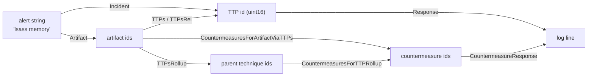

# gr4ph

A SIMD bitmatrix engine over **MITRE ATT&CK** (enterprise, ICS, mobile) crossed with **D3FEND**:
five node partitions — techniques (TTPs, sub-techniques included), artifacts, countermeasures, data
components (DC) and grouping nodes (actors G, software S, campaigns C) — flattened into a frozen set of
structure-of-arrays bitmatrix planes, plus the per-technique ATT&CK attribute masks (tactics, platforms,
sub-technique flag).

Every directed relation is materialised in **both** directions, so a traversal is one row fetch plus
vector bitwise ops: no pointer chasing, no per-edge allocation, no strings on the hot path.
Sub-technique roll-up is explicit (`ArtifactsRollup`, `TTPsRollup`, `CountermeasuresForTTPRollup`,
`TTPsForCountermeasureRollup`, `TTPsForGroupRollup`, `DataComponentsForTTPRollup`), and the
countermeasure chain answers "which countermeasures apply to this artifact, directly or through the
techniques that touch it".

* Go 1.27, **standard library only** (no third-party dependencies).
* Hot path takes and returns `uint16`-derived ids (`TTP`, `Artifact`, `Countermeasure`, `DataComponent`,
  `Group`) or one-word attribute masks, and allocates **nothing** — callers own `dst` and `scratch`.
* Strings live only in the cold path: building the graph and formatting ids back into log lines.

## Build requirement

The engine is built on Go 1.27's experimental `simd` package, whose files are all gated behind the
`goexperiment.simd` build tag. Every file here (except `cmd/d3fendgen`, `internal/simdcheck` and
`internal/hotmethods`) carries the same tag, so `GOEXPERIMENT=simd` is required for the library. On a
stock toolchain
`go build .` fails with `build constraints exclude all Go files`, and `internal/simdcheck` makes
`go build ./...` / `go test ./...` fail the same way — without it they would silently skip every gated
package and report success while testing nothing. `go test ./cmd/d3fendgen` works without the
experiment.

```sh
GOEXPERIMENT=simd go build ./...     # the Makefile exports this for every target except `make stock`, which unsets it
```

`simd.VectorBitSize()` is chosen at **runtime** by the `simd` package, not by this module. The kernels
stride by the vector width (`wordsPerVector = simd.VectorBitSize()/64`), use the full-width
`LoadUint64s`/`Store` pair for whole vectors and a scalar loop for the tail. They never use the count
`LoadUint64sPart` reports, which is `min(wordsPerVector, len(s))` on hardware but `len(s)` under
`GODEBUG=simd=0` — advancing by it silently drops the tail of every row that is not a whole number of
vectors. `make test` therefore runs the suite at the platform width, again under `-race` (the
concurrency contract), and again with `GODEBUG=simd=0`; all three passes must be green.

On the development host (i5-10310U, AVX2, no `vpclmulqdq`) the package feature-reduces to **128-bit /
2 lanes**, so `GODEBUG=simd=256` panics at init instead of silently emulating. `GODEBUG=simd=+256`
opts into 256-bit by skipping the CPU feature check; it is a manual, host-specific check (it can
SIGILL on a CPU without AVX2) and this module's suite was verified that way.

If a stock-toolchain build is ever required, add `kernel_portable.go` with
`//go:build !goexperiment.simd` implementing `orRowInto`/`andRowInto`/`copyRow` as scalar loops and
drop the tag from the other files. No API change. Adding that portable kernel also means deleting
`internal/simdcheck`, whose only purpose is to make a stock `./...` build fail.

## The two flows



1. **Defensive triage** — an artifact (or an alert string) → the techniques that touch it, exact and
   rolled up → the countermeasures that apply. `CountermeasuresForArtifactViaTTPs` unions the direct
   countermeasure ↔ artifact links with the countermeasures defending every technique that touches
   the artifact.
2. **Authorized offensive planning** — the same artifact read as the countermeasure surface to attack
   or evade, plus `TTPsForCountermeasure` and `CountermeasureDegree` to rank which countermeasures
   defend the most technique surface.

`GOEXPERIMENT=simd go run ./examples/incident` walks the five stages on a hand-built graph
(register → wire → incident → evaluation → response). `GOEXPERIMENT=simd go run ./examples/ontology`
runs both flows against the real tables.

## Command line

`cmd/gr4ph` answers lookup questions over the frozen tables from a shell: a cold key — technique
id, label or alias; artifact name or label; countermeasure id, label or alias; data component id or
label; grouping-node id or label; ATT&CK tactic id; platform name; relation name — resolves to its
dense id, and every relation of that node is printed in both directions. A grouping label shared by
two nodes (12 in 19.2, always across kinds: `Frankenstein` is the campaign `C0001` and the actor
`G0101`) resolves to the byte-smallest id, and the printed header names the node that resolved.

```sh
GOEXPERIMENT=simd go run ./cmd/gr4ph <command> [flags] <query> [<query>...]
make build                                 # builds ./gr4ph (or: GOEXPERIMENT=simd go build ./cmd/gr4ph)
```

The command carries the library's build tag, so `GOEXPERIMENT=simd` is required for it exactly as it is
for the library. Flags may precede or follow the queries (`-json` may also precede the command), and
`gr4ph help` prints the usage text, flags and worked examples included.

| command | query | flags | prints |
|---|---|---|---|
| `ttp` | technique id, label or alias | `-rel <name>`, `-json` | `out artifacts`, `out artifacts rollup`, `in countermeasures`, `in countermeasures rollup`, `in data components`, `in data components rollup`, `in groups` |
| `artifact` | artifact name or label | `-rel <name>`, `-defrel <name>`, `-json` | `in techniques`, `in techniques rollup`, `in countermeasures`, `in countermeasures viaTTPs` |
| `cm` | countermeasure id, label or alias | `-defrel <name>`, `-json` | `out artifacts`, `out techniques`, `out techniques rollup` |
| `dc` | data component id (`DC0084`) or label | `-json` | `out techniques` |
| `group` | grouping-node id (`G0007`, `S0002`, `C0001`) or label | `-json` | `out techniques`, `out software`, `in groups` |
| `tactic` | ATT&CK tactic id (`TA0005`) | `-json` | `out techniques` |
| `platform` | platform name (`Windows`) | `-json` | `out techniques` |
| `rel` | relation name | `-family <off\|def>`, `-json` | one line per family the name is registered in: plane id, distinct edges, sources |

`ttp` prints the artifacts a technique touches, the countermeasures that defend it, the data components
that detect it and the grouping nodes recorded as using it, exact and rolled up (the roll-up adds its
direct sub-techniques). `artifact` prints the techniques that touch it and the countermeasures linked to
it, directly and via those techniques. `cm` prints the artifacts and techniques a countermeasure covers.
`dc`, `group`, `tactic` and `platform` answer the two new partitions and the attribute vocabularies in
the reverse direction: the techniques a data component detects, the techniques and software a grouping
node uses plus who uses it, and the techniques of one tactic or platform. `rel` walks a plane instead of
a node. `-rel` (default `any`, the union plane) picks the offensive plane of `ttp`'s `out
artifacts` and `artifact`'s `in techniques`; `-defrel` picks the defensive plane of `artifact`'s
`in countermeasures` and `cm`'s `out artifacts`. Every set whose label carries no `(rel
…)`/`(defrel …)` suffix is unfiltered — on `ttp`: `in countermeasures`, `in countermeasures
rollup`, `in data components`, `in data components rollup` and `in groups`; on `artifact`: `in
countermeasures viaTTPs` (the direct links unioned with the links of the techniques touching the
artifact); on `cm`: `out techniques` and `out techniques rollup`. The four new commands take no
relation flag, so every set they print is unfiltered. Relations exist in the two families
independently — 11 names, `blocks` among them, are registered in both — so `rel` prints one line
per family and `-family` narrows it. A technique ATT&CK has revoked or deprecated prints `
revoked=true` in
its `ttp` header (`"revoked":true` under `-json`); its D3FEND links live on the successor id. The same
header carries the ATT&CK attributes: ` subtechnique=true` for a sub-technique, ` tactics=` with the
`TA` ids of its tactic mask and ` platforms=` with the names of its platform mask, both in vocabulary
order and both absent when the technique has no ATT&CK object (the D3FEND-named nodes) — under `-json`
they are `"subtechnique"`, `"tactics"` and `"platforms"`, and `tactic` queries only by `TA` id because
11 tactic labels name two or three tactics across the three domains. A grouping node's header names its
kind (`kind=actor|software|campaign`, `"group_kind"` under `-json`).

```sh
$ ./gr4ph ttp T1003.001
ttp T1003.001 "LSASS Memory" domain=enterprise parent=T1003 children=0 subtechnique=true tactics=TA0006 platforms=Windows
  out artifacts (2): AuthenticationService "Authentication Service", Process
  out artifacts rollup (2): AuthenticationService "Authentication Service", Process
  in  countermeasures (12): Application-basedProcessIsolation "Application-based Process Isolation", Hardware-basedProcessIsolation "Hardware-based Process Isolation", HostReboot "Host Reboot", HostShutdown "Host Shutdown", Kernel-basedProcessIsolation "Kernel-based Process Isolation", ProcessLineageAnalysis "Process Lineage Analysis", ProcessSelf-ModificationDetection "Process Self-Modification Detection", ProcessSpawnAnalysis "Process Spawn Analysis", ProcessSuspension "Process Suspension", ProcessTermination "Process Termination", SystemCallFiltering "System Call Filtering", WebSessionAccessMediation "Web Session Access Mediation"
  in  countermeasures rollup (12): Application-basedProcessIsolation "Application-based Process Isolation", Hardware-basedProcessIsolation "Hardware-based Process Isolation", HostReboot "Host Reboot", HostShutdown "Host Shutdown", Kernel-basedProcessIsolation "Kernel-based Process Isolation", ProcessLineageAnalysis "Process Lineage Analysis", ProcessSelf-ModificationDetection "Process Self-Modification Detection", ProcessSpawnAnalysis "Process Spawn Analysis", ProcessSuspension "Process Suspension", ProcessTermination "Process Termination", SystemCallFiltering "System Call Filtering", WebSessionAccessMediation "Web Session Access Mediation"
  in  data components (5): DC0013 "User Account Metadata", DC0032 "Process Creation", DC0035 "Process Access", DC0039 "File Creation", DC0063 "Windows Registry Key Modification"
  in  data components rollup (5): DC0013 "User Account Metadata", DC0032 "Process Creation", DC0035 "Process Access", DC0039 "File Creation", DC0063 "Windows Registry Key Modification"
  in  groups (79): C0014 "Operation Wocao", C0025 "2016 Ukraine Electric Power Attack", C0029 "Cutting Edge", C0030 "Triton Safety Instrumented System Attack", C0032, C0038 "HomeLand Justice", C0058 "SharePoint ToolShell Exploitation", C0061 "Operation Digital Eye", C0063 "2025 Poland Wiper Attacks", G0003 "Cleaver", G0004 "Ke3chang", G0006 "APT1", G0007 "APT28", G0022 "APT3", G0027 "Threat Group-3390", G0034 "Sandworm Team", G0037 "FIN6", G0049 "OilRig", G0050 "APT32", G0059 "Magic Hound", G0060 "BRONZE BUTLER", G0061 "FIN8", G0064 "APT33", G0065 "Leviathan", G0068 "PLATINUM", G0069 "MuddyWater", G0077 "Leafminer", G0087 "APT39", G0091 "Silence", G0093 "GALLIUM", G0094 "Kimsuky", G0096 "APT41", G0102 "Wizard Spider", G0107 "Whitefly", G0108 "Blue Mockingbird", G0117 "Fox Kitten", G0119 "Indrik Spider", G0125 "HAFNIUM", G0129 "Mustang Panda", G0143 "Aquatic Panda", G1003 "Ember Bear", G1006 "Earth Lusca", G1016 "FIN13", G1017 "Volt Typhoon", G1023 "APT5", G1030 "Agrius", G1036 "Moonstone Sleet", G1039 "RedCurl", G1040 "Play", G1048 "UNC3886", G1051 "Medusa Group", G1054 "MirrorFace", G1055 "VOID MANTICORE", S0002 "Mimikatz", S0005 "Windows Credential Editor", S0046 "CozyCar", S0056 "Net Crawler", S0121 "Lslsass", S0154 "Cobalt Strike", S0187 "Daserf", S0192 "Pupy", S0194 "PowerSploit", S0342 "GreyEnergy", S0349 "LaZagne", S0357 "Impacket", S0363 "Empire", S0365 "Olympic Destroyer", S0367 "Emotet", S0368 "NotPetya", S0378 "PoshC2", S0428 "PoetRAT", S0439 "Okrum", S0583 "Pysa", S0606 "Bad Rabbit", S0633 "Sliver", S0681 "Lizar", S0692 "SILENTTRINITY", S1060 "Mafalda", S1242 "Qilin"
```

### Common queries

The examples below use the `./gr4ph` binary that `make build` produces, and every block is that
command's complete answer — a set is printed as one line whatever its length, so let the terminal wrap.
Every key is matched trimmed and case-insensitively, so a technique can be named the way an alert names
it — `T1136` and `create account` are the same node — and a key that resolves to nothing is an error,
never a guess.

```sh
$ ./gr4ph ttp "create account"
ttp T1136 "Create Account" domain=enterprise children=3 tactics=TA0003 platforms=Containers,ESXi,IaaS,Identity Provider,Linux,Network Devices,Office Suite,SaaS,Windows,macOS
  out artifacts (1): UserAccount "User Account"
  out artifacts rollup (4): CloudUserAccount "Cloud User Account", DomainUserAccount "Domain User Account", LocalUserAccount "Local User Account", UserAccount "User Account"
  in  countermeasures (7): AccessModeling "Access Modeling", AccountLocking "Account Locking", AgentAuthentication "Agent Authentication", ChangeDefaultPassword "Change Default Password", RestoreUserAccountAccess "Restore User Account Access", UnlockAccount "Unlock Account", UserAccountPermissions "User Account Permissions"
  in  countermeasures rollup (9): AccessModeling "Access Modeling", AccountLocking "Account Locking", AgentAuthentication "Agent Authentication", ChangeDefaultPassword "Change Default Password", DomainAccountMonitoring "Domain Account Monitoring", LocalAccountMonitoring "Local Account Monitoring", RestoreUserAccountAccess "Restore User Account Access", UnlockAccount "Unlock Account", UserAccountPermissions "User Account Permissions"
  in  data components (5): DC0010 "User Account Modification", DC0014 "User Account Creation", DC0032 "Process Creation", DC0061 "File Modification", DC0064 "Command Execution"
  in  data components rollup (8): DC0002 "User Account Authentication", DC0010 "User Account Modification", DC0014 "User Account Creation", DC0032 "Process Creation", DC0061 "File Modification", DC0064 "Command Execution", DC0067 "Logon Session Creation", DC0094 "Group Modification"
  in  groups (5): C0025 "2016 Ukraine Electric Power Attack", G0119 "Indrik Spider", G1015 "Scattered Spider", G1045 "Salt Typhoon", S1199 "LockBit 2.0"
$ ./gr4ph artifact "authentication service"
artifact AuthenticationService "Authentication Service"
  in  techniques (5): T1003.001 "LSASS Memory", T1003.002 "Security Account Manager", T1212 "Exploitation for Credential Access", T1550 "Use Alternate Authentication Material", T1556 "Modify Authentication Process"
  in  techniques rollup (4): T1003 "OS Credential Dumping", T1212 "Exploitation for Credential Access", T1550 "Use Alternate Authentication Material", T1556 "Modify Authentication Process"
  in  countermeasures (0): -
  in  countermeasures viaTTPs (25): Application-basedProcessIsolation "Application-based Process Isolation", AssetVulnerabilityEnumeration "Asset Vulnerability Enumeration", DataInventory "Data Inventory", Hardware-basedProcessIsolation "Hardware-based Process Isolation", HostReboot "Host Reboot", HostShutdown "Host Shutdown", Kernel-basedProcessIsolation "Kernel-based Process Isolation", MemoryBoundaryTracking "Memory Boundary Tracking", ProcessCodeSegmentVerification "Process Code Segment Verification", ProcessLineageAnalysis "Process Lineage Analysis", ProcessSegmentExecutionPrevention "Process Segment Execution Prevention", ProcessSelf-ModificationDetection "Process Self-Modification Detection", ProcessSpawnAnalysis "Process Spawn Analysis", ProcessSuspension "Process Suspension", ProcessTermination "Process Termination", RestoreDatabase "Restore Database", RestoreSoftware "Restore Software", SegmentAddressOffsetRandomization "Segment Address Offset Randomization", ServiceBinaryVerification "Service Binary Verification", ShadowStackComparisons "Shadow Stack Comparisons", SoftwareInventory "Software Inventory", SoftwareUpdate "Software Update", StackFrameCanaryValidation "Stack Frame Canary Validation", SystemCallFiltering "System Call Filtering", WebSessionAccessMediation "Web Session Access Mediation"
$ ./gr4ph cm "credential hardening"
cm CredentialHardening "Credential Hardening"
  out artifacts (1): Credential
  out techniques (25): DE-0011 "Credentialed Evasion", PER-0005 "Credentialed Persistence", T0812 "Default Credentials", T0891 "Hardcoded Credentials", T0892 "Change Credential", T1003.003 "NTDS", T1003.005 "Cached Domain Credentials", T1003.008 "/etc/passwd and /etc/shadow", T1098.001 "Additional Cloud Credentials", T1110.001 "Password Guessing", T1110.002 "Password Cracking", T1110.003 "Password Spraying", T1134.001 "Token Impersonation/Theft", T1134.002 "Create Process with Token", T1134.003 "Make and Impersonate Token", T1142 "Keychain", T1528 "Steal Application Access Token", T1539 "Steal Web Session Cookie", T1550.001 "Application Access Token", T1550.004 "Web Session Cookie", T1552 "Unsecured Credentials", T1558 "Steal or Forge Kerberos Tickets", T1558.001 "Golden Ticket", T1606 "Forge Web Credentials", T1606.001 "Web Cookies"
  out techniques rollup (16): DE-0011 "Credentialed Evasion", PER-0005 "Credentialed Persistence", T0812 "Default Credentials", T0891 "Hardcoded Credentials", T0892 "Change Credential", T1003 "OS Credential Dumping", T1098 "Account Manipulation", T1110 "Brute Force", T1134 "Access Token Manipulation", T1142 "Keychain", T1528 "Steal Application Access Token", T1539 "Steal Web Session Cookie", T1550 "Use Alternate Authentication Material", T1552 "Unsecured Credentials", T1558 "Steal or Forge Kerberos Tickets", T1606 "Forge Web Credentials"
$ ./gr4ph ttp "lsass memroy"; echo $?          # typos do not resolve
gr4ph: no such technique: lsass memroy
1
```

The two new partitions answer their own direction. `dc` is the data-component side of `detects`
(the technique rows are usually on the sub-technique, so `ttp` prints the roll-up too), and `group`
walks the one partition that holds actors, software and campaigns, printing the kind in the header
because the id prefix is the only thing that tells them apart.

```sh
$ ./gr4ph dc DC0084
dc DC0084 "Active Directory Credential Request"
  out techniques (9): T1207 "Rogue Domain Controller", T1550.002 "Pass the Hash", T1550.003 "Pass the Ticket", T1558 "Steal or Forge Kerberos Tickets", T1558.001 "Golden Ticket", T1558.002 "Silver Ticket", T1558.003 "Kerberoasting", T1558.004 "AS-REP Roasting", T1649 "Steal or Forge Authentication Certificates"
$ ./gr4ph group S0002
group S0002 "Mimikatz" kind=software
  out techniques (17): T1003.001 "LSASS Memory", T1003.002 "Security Account Manager", T1003.004 "LSA Secrets", T1003.006 "DCSync", T1098 "Account Manipulation", T1134.005 "SID-History Injection", T1207 "Rogue Domain Controller", T1547.005 "Security Support Provider", T1550.002 "Pass the Hash", T1550.003 "Pass the Ticket", T1552.004 "Private Keys", T1555 "Credentials from Password Stores", T1555.003 "Credentials from Web Browsers", T1555.004 "Windows Credential Manager", T1558.001 "Golden Ticket", T1558.002 "Silver Ticket", T1649 "Steal or Forge Authentication Certificates"
  out software (0): -
  in  groups (60): C0014 "Operation Wocao", C0017, C0018, C0024 "SolarWinds Compromise", C0030 "Triton Safety Instrumented System Attack", C0032, C0038 "HomeLand Justice", C0058 "SharePoint ToolShell Exploitation", C0061 "Operation Digital Eye", G0003 "Cleaver", G0004 "Ke3chang", G0006 "APT1", G0007 "APT28", G0008 "Carbanak", G0010 "Turla", G0011 "PittyTiger", G0016 "APT29", G0027 "Threat Group-3390", G0034 "Sandworm Team", G0035 "Dragonfly", G0037 "FIN6", G0045 "menuPass", G0046 "FIN7", G0049 "OilRig", G0050 "APT32", G0059 "Magic Hound", G0060 "BRONZE BUTLER", G0064 "APT33", G0069 "MuddyWater", G0076 "Thrip", G0077 "Leafminer", G0079 "DarkHydrus", G0080 "Cobalt Group", G0082 "APT38", G0087 "APT39", G0088 "TEMP.Veles", G0092 "TA505", G0093 "GALLIUM", G0094 "Kimsuky", G0096 "APT41", G0102 "Wizard Spider", G0107 "Whitefly", G0108 "Blue Mockingbird", G0114 "Chimera", G0119 "Indrik Spider", G0129 "Mustang Panda", G0131 "Tonto Team", G0135 "BackdoorDiplomacy", G1001 "HEXANE", G1004 "LAPSUS$", G1006 "Earth Lusca", G1015 "Scattered Spider", G1016 "FIN13", G1017 "Volt Typhoon", G1023 "APT5", G1024 "Akira", G1030 "Agrius", G1040 "Play", G1043 "BlackByte", G1051 "Medusa Group"
```

Defensive triage from the artifact an alert names: 5 techniques touch `Process`, they collapse to 3
parents, 11 countermeasures link to it directly and 36 once the techniques that touch it are included.

```sh
$ ./gr4ph artifact Process
artifact Process
  in  techniques (5): T1003.001 "LSASS Memory", T1003.002 "Security Account Manager", T1003.004 "LSA Secrets", T1505.003 "Web Shell", T1546.007 "Netsh Helper DLL"
  in  techniques rollup (3): T1003 "OS Credential Dumping", T1505 "Server Software Component", T1546 "Event Triggered Execution"
  in  countermeasures (11): Application-basedProcessIsolation "Application-based Process Isolation", Hardware-basedProcessIsolation "Hardware-based Process Isolation", HostReboot "Host Reboot", HostShutdown "Host Shutdown", Kernel-basedProcessIsolation "Kernel-based Process Isolation", ProcessLineageAnalysis "Process Lineage Analysis", ProcessSelf-ModificationDetection "Process Self-Modification Detection", ProcessSpawnAnalysis "Process Spawn Analysis", ProcessSuspension "Process Suspension", ProcessTermination "Process Termination", SystemCallFiltering "System Call Filtering"
  in  countermeasures viaTTPs (36): Application-basedProcessIsolation "Application-based Process Isolation", ConfigurationInventory "Configuration Inventory", ContentFiltering "Content Filtering", ContentModification "Content Modification", ContentQuarantine "Content Quarantine", DataInventory "Data Inventory", DecoyFile "Decoy File", DynamicAnalysis "Dynamic Analysis", EmulatedFileAnalysis "Emulated File Analysis", EndpointHealthBeacon "Endpoint Health Beacon", ExecutableAllowlisting "Executable Allowlisting", ExecutableDenylisting "Executable Denylisting", FileAnalysis "File Analysis", FileEncryption "File Encryption", FileEviction "File Eviction", FileIntegrityMonitoring "File Integrity Monitoring", Hardware-basedProcessIsolation "Hardware-based Process Isolation", HostReboot "Host Reboot", HostShutdown "Host Shutdown", Kernel-basedProcessIsolation "Kernel-based Process Isolation", LocalFilePermissions "Local File Permissions", LogicalLinkMapping "Logical Link Mapping", NetworkNodeInventory "Network Node Inventory", PhysicalLinkMapping "Physical Link Mapping", ProcessLineageAnalysis "Process Lineage Analysis", ProcessSelf-ModificationDetection "Process Self-Modification Detection", ProcessSpawnAnalysis "Process Spawn Analysis", ProcessSuspension "Process Suspension", ProcessTermination "Process Termination", RemoteFileAccessMediation "Remote File Access Mediation", RestoreConfiguration "Restore Configuration", RestoreDatabase "Restore Database", RestoreFile "Restore File", RestoreNetworkAccess "Restore Network Access", SystemCallFiltering "System Call Filtering", WebSessionAccessMediation "Web Session Access Mediation"
```

Narrow a set to one relation plane with `-rel` (offensive) or `-defrel` (defensive): the plane is named
in the set label, and the sets that take no relation are unchanged.

```sh
$ ./gr4ph artifact -rel accesses Process
artifact Process
  in  techniques (rel accesses) (1): T1003.001 "LSASS Memory"
  in  techniques rollup (rel accesses) (1): T1003 "OS Credential Dumping"
  in  countermeasures (11): Application-basedProcessIsolation "Application-based Process Isolation", Hardware-basedProcessIsolation "Hardware-based Process Isolation", HostReboot "Host Reboot", HostShutdown "Host Shutdown", Kernel-basedProcessIsolation "Kernel-based Process Isolation", ProcessLineageAnalysis "Process Lineage Analysis", ProcessSelf-ModificationDetection "Process Self-Modification Detection", ProcessSpawnAnalysis "Process Spawn Analysis", ProcessSuspension "Process Suspension", ProcessTermination "Process Termination", SystemCallFiltering "System Call Filtering"
  in  countermeasures viaTTPs (36): Application-basedProcessIsolation "Application-based Process Isolation", ConfigurationInventory "Configuration Inventory", ContentFiltering "Content Filtering", ContentModification "Content Modification", ContentQuarantine "Content Quarantine", DataInventory "Data Inventory", DecoyFile "Decoy File", DynamicAnalysis "Dynamic Analysis", EmulatedFileAnalysis "Emulated File Analysis", EndpointHealthBeacon "Endpoint Health Beacon", ExecutableAllowlisting "Executable Allowlisting", ExecutableDenylisting "Executable Denylisting", FileAnalysis "File Analysis", FileEncryption "File Encryption", FileEviction "File Eviction", FileIntegrityMonitoring "File Integrity Monitoring", Hardware-basedProcessIsolation "Hardware-based Process Isolation", HostReboot "Host Reboot", HostShutdown "Host Shutdown", Kernel-basedProcessIsolation "Kernel-based Process Isolation", LocalFilePermissions "Local File Permissions", LogicalLinkMapping "Logical Link Mapping", NetworkNodeInventory "Network Node Inventory", PhysicalLinkMapping "Physical Link Mapping", ProcessLineageAnalysis "Process Lineage Analysis", ProcessSelf-ModificationDetection "Process Self-Modification Detection", ProcessSpawnAnalysis "Process Spawn Analysis", ProcessSuspension "Process Suspension", ProcessTermination "Process Termination", RemoteFileAccessMediation "Remote File Access Mediation", RestoreConfiguration "Restore Configuration", RestoreDatabase "Restore Database", RestoreFile "Restore File", RestoreNetworkAccess "Restore Network Access", SystemCallFiltering "System Call Filtering", WebSessionAccessMediation "Web Session Access Mediation"
$ ./gr4ph cm -defrel hardens CredentialHardening
cm CredentialHardening "Credential Hardening"
  out artifacts (defrel hardens) (1): Credential
  out techniques (25): DE-0011 "Credentialed Evasion", PER-0005 "Credentialed Persistence", T0812 "Default Credentials", T0891 "Hardcoded Credentials", T0892 "Change Credential", T1003.003 "NTDS", T1003.005 "Cached Domain Credentials", T1003.008 "/etc/passwd and /etc/shadow", T1098.001 "Additional Cloud Credentials", T1110.001 "Password Guessing", T1110.002 "Password Cracking", T1110.003 "Password Spraying", T1134.001 "Token Impersonation/Theft", T1134.002 "Create Process with Token", T1134.003 "Make and Impersonate Token", T1142 "Keychain", T1528 "Steal Application Access Token", T1539 "Steal Web Session Cookie", T1550.001 "Application Access Token", T1550.004 "Web Session Cookie", T1552 "Unsecured Credentials", T1558 "Steal or Forge Kerberos Tickets", T1558.001 "Golden Ticket", T1606 "Forge Web Credentials", T1606.001 "Web Cookies"
  out techniques rollup (16): DE-0011 "Credentialed Evasion", PER-0005 "Credentialed Persistence", T0812 "Default Credentials", T0891 "Hardcoded Credentials", T0892 "Change Credential", T1003 "OS Credential Dumping", T1098 "Account Manipulation", T1110 "Brute Force", T1134 "Access Token Manipulation", T1142 "Keychain", T1528 "Steal Application Access Token", T1539 "Steal Web Session Cookie", T1550 "Use Alternate Authentication Material", T1552 "Unsecured Credentials", T1558 "Steal or Forge Kerberos Tickets", T1606 "Forge Web Credentials"
```

`rel` walks the planes themselves — the offensive union plane holds 654 distinct technique → artifact
pairs from 427 techniques — and `-family` picks a side when the name is registered in both.

```sh
$ ./gr4ph rel any
rel any offensive union plane 0/41 (technique -> artifact): edges=654 sources=427
rel any defensive union plane 0/38 (countermeasure -> artifact): edges=182 sources=157
$ ./gr4ph rel -family def blocks
rel blocks defensive plane 3/38 (countermeasure -> artifact): edges=6 sources=6
$ ./gr4ph rel -family off analyzes; echo $?    # ... and an error when it is not
gr4ph: no such offensive relation: analyzes
1
```

`-json` prints the same answer as one object per resolved query, with the ids, the cold keys and (for
`rel`) the plane statistics in one place — what a script wants to join on.

```sh
$ ./gr4ph -json rel blocks
{"query":"blocks","kind":"rel","name":"blocks","planes":[{"family":"offensive","id":4,"count":41,"edges":2,"sources":2},{"family":"defensive","id":3,"count":38,"edges":6,"sources":6}]}
```

`examples/scenarios.sh` is a plain list of `gr4ph` commands — all eight commands, the relation and family
filters, several queries per call, `-json`, the failures and `help` — grouped into defence and attack
scenarios, each scenario under a banner heading and each command labelled with the invocation that
produced the block below it. Nothing is checked and nothing is trimmed: it prints each answer in full, so
run it after `make build` and read the output.

Exit status is 0 when every query resolved, 1 when a query or relation was not found (the blocks of the
queries that did resolve are still written), and 2 for a usage error. `-json` emits one JSON object per
resolved query instead of text.

## Data model

Five partitions, seventeen frozen arrays: four multi-plane bitmatrix blocks (`ttpArt`/`artTTP` over
`nRel` planes, `cmArt`/`artCM` over `nDefRel`), twelve single-plane blocks and one per-technique flag
column. Plane 0 of each multi-plane family is the union of all its predicates (`RelAny` / `DefRelAny`);
every other family is one inferred predicate and needs no plane index. The attribute columns are one `uint64` per technique (a 41-tactic and a 15-platform mask, so bits
above the vocabulary are always zero) plus the derived sub-technique flag.

| block | shape | meaning |
|---|---|---|
| `ttpArt` | `[nRel][nTTP][wArt]` | technique → artifact (offensive) |
| `artTTP` | `[nRel][nArt][wTTP]` | artifact → technique (transpose) |
| `cmArt` | `[nDefRel][nCM][wArt]` | countermeasure → artifact (defensive) |
| `artCM` | `[nDefRel][nArt][wCM]` | artifact → countermeasure (transpose) |
| `cmTTP` | `[nCM][wTTP]` | countermeasure → technique (defends-against) |
| `ttpCM` | `[nTTP][wCM]` | technique → countermeasure (transpose) |
| `tacticTTP` | `[nTactic][wTTP]` | tactic → technique (assignment) |
| `ttpTactic` | `[nTTP][wTactic]` | technique → tactic mask |
| `platformTTP` | `[nPlatform][wTTP]` | platform → technique (assignment) |
| `ttpPlatform` | `[nTTP][wPlatform]` | technique → platform mask |
| `ttpFlags` | `[nTTP]` | technique attribute flags (sub-technique) |
| `dcTTP` | `[nDC][wTTP]` | data component → technique (detects) |
| `ttpDC` | `[nTTP][wDC]` | technique → data component (transpose) |
| `grpTTP` | `[nGrp][wTTP]` | group → technique (uses) |
| `ttpGrp` | `[nTTP][wGrp]` | technique → group (transpose) |
| `grpSoftware` | `[nGrp][wGrp]` | group → software (uses) |
| `softwareGrp` | `[nGrp][wGrp]` | software → group (transpose) |

Rows are exact-length (no padding), LSB-first within each `uint64`. For the pinned dataset
(1186 techniques, 247 artifacts, 157 countermeasures, 123 data components, 1212 groups, 41 tactics,
15 platforms, 41 + 38 predicates):

| block | planes | words | bytes |
|---|---|---|---|
| `ttpArt` | 42 | 199,248 | 1,593,984 |
| `artTTP` | 42 | 197,106 | 1,576,848 |
| `cmArt` | 39 | 24,492 | 195,936 |
| `artCM` | 39 | 28,899 | 231,192 |
| `cmTTP` | 1 | 2,983 | 23,864 |
| `ttpCM` | 1 | 3,558 | 28,464 |
| **six-block subtotal** | | **456,286** | **3,650,288 (3.48 MiB)** |
| `tacticTTP` | 1 | 779 | 6,232 |
| `ttpTactic` | 1 | 1,186 | 9,488 |
| `platformTTP` | 1 | 285 | 2,280 |
| `ttpPlatform` | 1 | 1,186 | 9,488 |
| `ttpFlags` | 1 | 1,186 | 9,488 |
| `dcTTP` | 1 | 2,337 | 18,696 |
| `ttpDC` | 1 | 2,372 | 18,976 |
| `grpTTP` | 1 | 23,028 | 184,224 |
| `ttpGrp` | 1 | 22,534 | 180,272 |
| `grpSoftware` | 1 | 23,028 | 184,224 |
| `softwareGrp` | 1 | 23,028 | 184,224 |
| **total** | | **557,235** | **4,457,880 (4.25 MiB)** |
| hierarchy (`ttpParents` + `ttpChildCount`) | | | 4,744 |
| revoked flag (`ttpRevoked`) | | | 1,186 |
| tactic vocabulary (`tacticIDs` + `tacticLabels` + `tacticIndex`) | | | cold |
| platform vocabulary (`platformNames` + `platformIndex`) | | | cold |
| data components (`dcIDs` + `dcLabels` + `dcIndex`) | | | cold |
| grouping nodes (`groupIDs` + `groupLabels` + `groupKinds` + `groupIndex`) | | | cold |

Strides: `WordsPerRow(KindTTP)` = 19, `KindArtifact` = 4, `KindCountermeasure` = 3,
`KindDataComponent` = 2; the attribute masks are one word per technique (`wTactic` = `wPlatform` = 1).
A single plane is 37 KiB (technique) / 37 KiB (artifact) — L1/L2 resident; the six existing blocks keep
their address range, and the new arrays follow them, so the hot six are unchanged.

## API

Sizes and cold path:

| method | work | alloc |
|---|---|---|
| `TTPCount` `ArtifactCount` `CountermeasureCount` `DataComponentCount` `GroupCount` `TacticCount` `PlatformCount` `RelCount` `DefRelCount` `WordsPerRow` | O(1) | 0 |
| `Incident(alert) (TTP, bool)`, `Artifact(s)`, `Countermeasure(s)`, `DataComponent(s)`, `Group(s)` | map lookup (trim + lower); a shared technique label resolves to its live carrier, or to the lowest-index match when every carrier is revoked; a shared grouping label resolves to the earliest registration | cold |
| `Tactic(id) (Tactic, bool)`, `Platform(name) (Platform, bool)` | map lookup (trim + lower); only the `TA` id keys a tactic — 11 tactic labels name two or three tactics across the three domains | cold |
| `TTPName` `TTPLabel` `ArtifactName` `ArtifactLabel` `CountermeasureName` `CountermeasureLabel` `DataComponentID` `DataComponentLabel` `GroupID` `GroupLabel` `GroupKind` `TacticID` `TacticLabel` `PlatformName` `TTPDomain` `TTPRevoked` | O(1) | 0 |
| `Rel` `DefRel` | map lookup (trim + lower), `"any"` is the union plane and cannot be registered (`ErrReservedName`) | cold |
| `RelName` `DefRelName` | O(1) | 0 |
| `TTPTactics` `TTPPlatforms` `TTPFlags` `TTPSubTechnique` | one attribute load / one shift+compare | 0 |
| `Response(dst, ids)` `CountermeasureResponse(dst, ids)` | formats `<id> <label>` | cold |
| `TTPParent` `TTPChildCount` `TTPChildren` | O(1) / O(children) | 0 |

Technique labels are **not** unique keys: the pinned tables keep ATT&CK's revoked techniques, whose
live successors reuse their labels — 238 of the 1186 labels are carried by more than one technique and
shadow 269 ids — so `Incident` resolves a shared label to its live carrier, and to the lowest-index
match only when every carrier is revoked (4 labels in 19.2, `DLL Side-Loading` among them). `TTPRevoked`
reports the flag that decides this: ATT&CK's `revoked` or `x_mitre_deprecated`, 222 of the 1186 here (197
carry `revoked: true`, 25 are deprecated-only). Ids are unambiguous (every `TTPName` round-trips through
`Incident`, and no label or alias key takes an id key), and no artifact or countermeasure key names two
nodes.

Traversals (all take/return ids, all allocate nothing):

| method | work |
|---|---|
| `Adjacent` `AdjacentRel` `Defends` | 1 shift + 1 AND + 1 compare |
| `Artifacts` `ArtifactsRel` `ArtifactsForCountermeasure` | 1 row (4 words) |
| `CountermeasuresForArtifact` | 1 row (3 words) |
| `TTPs` `TTPsRel` `TTPsForCountermeasure` | 1 row (19 words) |
| `CountermeasuresForTTP` | 1 row (3 words) |
| `Degree` `ArtifactDegree` `CountermeasureDegree` | popcount of one row |
| `ArtifactsRollup` `ArtifactsRollupRel` | (1 + children) × 4 words, vector OR |
| `TTPsRollup` `TTPsRollupRel` `TTPsForCountermeasureRollup` | 19-word row scan + parent map + 19-word bitset |
| `CountermeasuresForTTPRollup` | (1 + children) × 3 words, vector OR |
| `CountermeasuresForArtifactViaTTPs` | 19-word row scan + ≤ 29 × 3-word ORs + 3-word direct row |
| `TTPsForTactic` `TTPsForPlatform` `TTPsForDataComponent` `GroupsForTTP` | 1 row (19 words) |
| `DataComponentsForTTP` | 1 row (2 words) |
| `TTPsForGroup` `SoftwareForGroup` `GroupsForSoftware` | 1 row (19 words) |
| `DataComponentDegree` `SoftwareDegree` | popcount of one row |
| `DataComponentsForTTPRollup` | (1 + children) × 2 words, vector OR |
| `TTPsForGroupRollup` | 19-word row scan + parent map + 19-word bitset |
| `TTPsAny` `TTPsAll` `ArtifactsAny` `ArtifactsAll` | k × row words, vector OR/AND |

Builder (cold path; the builder is single-use and then frozen by `Build`):

| method | notes |
|---|---|
| `NewBuilder()` | fresh builder; the union plane `"any"` is seeded |
| `AddRel(name)` `AddDefRel(name)` | plane ids in registration order; `"any"` is reserved |
| `AddTTP(id, label, dom, parent, revoked, aliases…)` | `ErrDepthExceeded` / `ErrNonContiguousChild` / `ErrUnknownParent` |
| `AddArtifact(name, label)` `AddCountermeasure(id, label, aliases…)` | |
| `AddDataComponent(id, label)` `AddGroup(id, label, kind)` | `ErrUnknownGroupKind` on a kind outside the three constants |
| `AddTactic(id, label)` `AddPlatform(name)` | dense ids in registration order (≤ 64: `ErrTooManyTactics` / `ErrTooManyPlatforms`, the width of the `uint64` mask each technique carries) |
| `AddEdge(t, a, r)` `AddDefEdge(cm, a, dr)` `AddDefendsEdge(cm, t)` `AddTacticEdge(t, ta)` `AddPlatformEdge(t, p)` `AddDetectsEdge(dc, t)` `AddGroupUsesEdge(g, t)` `AddGroupSoftwareEdge(from, to)` | edges are ORed into the planes; an unregistered endpoint is `ErrUnknownTTP` / `ErrUnknownArtifact` / `ErrUnknownCountermeasure` / `ErrUnknownTactic` / `ErrUnknownPlatform` / `ErrUnknownDataComponent` / `ErrUnknownGroup` |
| `Built()` `Build()` | `Build` is single-use: `ErrBuilderUsed` afterwards |

### Exact vs roll-up

Edges are stored exactly; the hierarchy is carried as data, never baked into the matrices. The exact
methods (`Artifacts`, `TTPs`, `CountermeasuresForTTP`, `TTPsForCountermeasure`) follow edges only — so
`Artifacts(T1003)` is `0` because a parent technique carries no edges of its own, while
`ArtifactsRollup(T1003)` is `9` (its own row plus its 8 sub-techniques). Conversely `TTPs(Process)`
returns 5 ids including sub-techniques, and `TTPsRollup(Process)` collapses them to
`[T1003 T1505 T1546]`. Callers choose precision explicitly.

`CountermeasuresForArtifactViaTTPs` uses the techniques linked to the artifact **exactly** (no
roll-up): every edge-bearing technique carries its own countermeasure links, and rolling up would pull
in countermeasure sets of parents the artifact does not touch. Compose
`TTPsRollup` + `CountermeasuresForTTPRollup` if that is what you want.

### Scratch sizing

Set and roll-up operations write their intermediate bitset into a caller-owned `scratch` row:

> `len(scratch) >= e.WordsPerRow(kind)` where `kind` is the partition of the **returned** ids —
> 19 words for TTP-returning methods, 4 for artifact-returning, 3 for countermeasure-returning,
> 2 for `KindDataComponent` (the `DataComponentsForTTPRollup` scratch).

Shorter `scratch` panics (`gr4ph: scratch too small`).

### Error contract

* Every traversal truncates its results at `len(dst)` and returns the **total** number of matches, so
  a nil or short `dst` still yields the count. Ids come out in ascending index order and are
  duplicate-free (they are the set bits of a row). Single-id traversals take `(id, rel, dst)`; set
  operations take `(rel, scratch, dst, ids…)`.
* Hot-path queries are **total** over the id space: an id outside its partition yields no matches
  (`0`/`false`). A stale or foreign id set can never crash a traversal, and an empty engine answers
  every query with 0/false.
* Engine-dimension misuse panics, because there is no sensible fallback: an offensive relation id
  `>= RelCount()+1`, a defensive relation id `>= DefRelCount()+1`, a `Kind` outside the four
  partitions with a row stride (`WordsPerRow`), or an undersized `scratch`. The scratch check runs before the id bounds
  check, so an undersized `scratch` panics even when the id is out of range.
* The cold string accessors (`TTPName`, `TTPLabel`, `TTPDomain`, `ArtifactName`, …) panic on an
  out-of-range id. `Response` / `CountermeasureResponse` are the total boundary formatters: they
  render `<invalid ttp N>` / `<invalid cm N>` and still count the entry.

## Hierarchy

Sub-techniques are first-class nodes (581 of the 1186). The ATT&CK id prefix is authoritative
(`T1003.001` → `T1003`); the generator checks it against `x_mitre_is_subtechnique` on every STIX node
of 19.2 and fails on any disagreement, on an orphan sub-technique, and on any id deeper than two
levels. Where D3FEND's `off_tech_parent` disagrees with the prefix (T1499.002 carries `T1498` in
1.6.0 while ATT&CK makes it a child of `T1499`), the prefix wins; `off_tech_parent` is consulted only
to synthesise a parent that exists in no ATT&CK domain. The tables carry `TTPParents` (index or
`NoParent`); the builder derives child counts from those, so no child-count table is emitted.

The builder enforces two invariants, so roll-up needs no child lists:

* **two levels only** — `AddTTP` rejects a parent that is itself a sub-technique (`ErrDepthExceeded`)
  and the generator fails on any id with more than one dot;
* **contiguous child blocks** — a child's index must be exactly `parent+1+childCount[parent]`
  (`ErrNonContiguousChild`). Children of `t` are therefore the O(1) range `t+1 .. t+TTPChildCount(t)`,
  and byte-wise sorted ids make that hold automatically (`T1546` has 18 children at the next 18
  indices).

11 parents (`DE-0003`, `EX-0001`, `EX-0005`, `EX-0009`, `EX-0010`, `EX-0012`, `EX-0013`, `EX-0016`,
`EXF-0006`, `IA-0007`, `RD-0004`) exist in no ATT&CK domain; D3FEND names them only through
`off_tech_parent`, so the generator synthesises them (`DomainSPARTA`, no edges, no aliases) and the
tree has no orphans.

Each partition holds at most `MaxNodes` (65536) entries; `Add*` returns `ErrTooManyNodes` beyond that
rather than wrapping. `NoParent` is index 65535, so the node at that index cannot itself parent
children — passing it as a parent reads as "no parent".

## Regenerating the tables

`ontology/attack_gen.go` is generated and committed; the runtime never touches the network. Sources
are pinned by version:

| source | value |
|---|---|
| ATT&CK enterprise | `enterprise-attack-19.2.json` |
| ATT&CK ICS | `ics-attack-19.2.json` |
| ATT&CK mobile | `mobile-attack-19.2.json` |
| D3FEND | `d3fend-full-mappings.csv@1.6.0` |

```sh
make gen        # go run ./cmd/d3fendgen -out ontology/attack_gen.go   (network once)
```

`cmd/d3fendgen` is untagged and imports nothing from this module, so it regenerates on a stock
toolchain; `-enterprise`/`-ics`/`-mobile`/`-d3fend` accept local paths for an offline rerun, and the
output is byte-identical either way. The generated shape is asserted, not assumed, and a run reports
exactly what it measured (this is `make gen`'s stdout on the pinned sources, byte for byte):

```
d3fendgen: wrote ontology/attack_gen.go
  ttps           1186 (858 enterprise, 176 mobile, 106 ics, 46 sparta)
  artifacts      247
  countermeasures 157
  relations      41 offensive, 38 defensive
  edges          670 offensive, 182 defensive, 4133 defends-against
  hierarchy      605 top-level, 581 sub-techniques, 148 parents, max 18 children
  revoked        222
  tactics        41, platforms 15, assignments 1431/2527
  data components 123, detects edges 3263
  groups         1212 (195 actors, 957 software, 60 campaigns), uses edges 18885 technique, 1339 software
```

If a future upstream release changes any of those, the generator fails with the actual counts instead
of emitting tables whose indices no longer match — re-pin the sources and re-derive the expectations.

Registration order is load-bearing (`ontology.Register`): relations first (so `RelNames[i]` becomes
plane `i+1`, matching the generated constants) and then the tactic and platform vocabularies (so
`TacticIDs[i]` becomes attribute bit `i`, matching the emitted `TacticTTP`/`PlatformTTP` rows), then
techniques depth-first with their parents, then artifacts, countermeasures, data components and grouping
nodes, and finally the edge families (offensive, defensive, defends-against, tactic and platform
assignments, `detects`, `uses` and software-use).

## Concurrency

`*Engine` is immutable after `Build()`. Any number of goroutines may query it concurrently as long as
each supplies its own `dst` and `scratch` slices — queries never mutate engine state. The claim is
covered by `TestConcurrentQueries`, which runs under `go test -race` (`make test` includes that pass).
A `Builder` is single-use: after `Build()` every `Add*` returns `ErrBuilderUsed`, so a live `Engine`
cannot be mutated through its builder.

## Measured performance

`GOEXPERIMENT=simd go test -bench . -benchmem -benchtime=1s -count=10 ./...` on the development
host (i5-10310U, 128-bit vectors); ns/op below is the median of 10 runs, and every benchmark
reports 0 B/op and 0 allocs/op. The real-table rows run against `ontology.Register`'s 1186-node
engine; the synthetic rows run against two root-package fixtures — `benchEngine`'s generated graph
(1200 techniques, 250 artifacts, 160 countermeasures) and `attributedEngine` (1200 techniques with
41 tactics, 15 platforms and 1212 grouping nodes, and no artifacts, countermeasures or data
components):

| benchmark | fixture | ns/op |
|---|---|---|
| `TTPsRel(Process, accesses)` | real tables | 25 |
| `TTPsAny(Process, File)` | real tables | 103 |
| `CountermeasuresForArtifactViaTTPs(Process)` | real tables | 119 |
| `CountermeasuresForTTPRollup(T1546)` | real tables | 216 |
| `AdjacentRel` | synthetic | 7 |
| `TTPTactics` | synthetic | 2 |
| `TTPsForTactic` (212-technique row) | synthetic | 226 |
| `TTPsForGroupRollup` | synthetic | 290 |

The eleven new arrays (ten blocks plus the `ttpFlags` column) sit after the six existing blocks, so
those keep their address range: all twelve benchmarks of the previous commit are still present, all
of them still report 0 `B/op` and 0 `allocs/op`, and none is slower than 1.03× (the worst ratios
against a worktree of that commit, same host, 10 samples: 1.0251× on
`CountermeasuresForArtifactViaTTPs`, 82.02 → 84.08 ns, and 1.0145× on medians — `Artifacts`, 12.39
→ 12.57 ns; the sub-30 ns rows carry about ±1 ns of run-to-run spread, and eight of the twelve are
faster here). The `TTPTactics` row is a single load; a group row is a 1212-bit scan plus the parent
substitution of every sub-technique, which is what `TTPsForGroupRollup` costs.

The zero-allocation contract is enforced by tests, not by convention: `AllocsPerRun` must be 0 for
every method in the pinned list (`internal/hotmethods`), on both a synthetic graph and the 1186-node
engine.

## License

Apache License 2.0 — see [LICENSE](LICENSE). Copyright 2026 fr0g <fr0g@66723067.io>
(see [NOTICE](NOTICE)).

### Attribution

`ontology/attack_gen.go` reproduces MITRE ATT&CK® and MITRE D3FEND™ content — technique ids, names,
aliases and hierarchy, D3FEND artifact and countermeasure labels — and the SPARTA® identifiers
D3FEND's mapping table carries, all under the upstream terms of use:

* ATT&CK: <https://attack.mitre.org/resources/legal-and-branding/terms-of-use/>
* D3FEND: <https://d3fend.mitre.org/tou/>
* SPARTA: <https://sparta.aerospace.org/terms-of-service>

The two designations the terms require are reproduced in `NOTICE`, the canonical attribution file:

> © 2026 The MITRE Corporation. This work is reproduced and distributed with the permission of The
> MITRE Corporation.
>
> ©2023 The Aerospace Corporation. This work is reproduced and distributed with the permission of
> The Aerospace Corporation.

ATT&CK® is a registered trademark, and D3FEND™ a trademark, of The MITRE Corporation. SPARTA® is a
registered trademark of The Aerospace Corporation.
